# ЛР3: микробенчмарк — Jackson 3 vs kotlinx.serialization (vidayapi)

> Сгенерировано автоматически: `2026-10-22T19:45:56.032985160Z`.

## 1. Окружение прогона (воспроизводимость, Требование 6)

| Параметр | Значение |
|---|---|
| `availableProcessors` | `1` |
| `container` | `docker` |
| `cpuModel` | `AMD Ryzen 5 6600HS Creator Edition` |
| `cpusAllowedList` | `0` |
| `java.vendor` | `Eclipse Adoptium` |
| `java.version` | `17.0.20.1` |
| `jvm.name` | `OpenJDK 64-Bit Server VM` |
| `os.arch` | `amd64` |
| `os.name` | `Linux` |
| `os.version` | `7.0.0-38-generic` |
| `timestamp` | `2026-10-22T19:45:33.561554397Z` |

## 2. Конфигурация прогона (Требования 1, 2)

| Параметр | Значение |
|---|---|
| испытаний (samples) | 1000 (≥100 — Требование 1) |
| warmup-сэмплов | 2000 (Требование 2) |
| teardown-сэмплов | 250 (Требование 2) |
| операций в сэмпле (batch) | 256 |
| пар read+write в сэмпле mixed | 256 |

## 3. Overhead инструмента (Требование 7)

| Режим | Overhead, нс/операция |
|---|---|
| простой сценарий (2×nanoTime + цикл + Blackhole) / batch | `4.305` |
| смешанный сценарий (2 потока + диспетчеризация) / 2×pairs | `40.287` |

> Целевой ориентир задания — не более 4–5 нс; батч-измерение даёт sub-ns overhead. «Сырые» значения в таблицах включают overhead; столбец «net median» = median − overhead.

## 4. Результаты по кейсам (Требования 8a–8f)

### read.jackson — Jackson 3 (jackson-module-kotlin): JSON → объект (deserialize)

**Фазы (8e, 8f):** время теста и число операций с детализацией warmup/teardown.

| Фаза | Сэмплов | Операций в сэмпле | Операций всего | Время, мс |
|---|---|---|---|---|
| warmup | 2000 | 256 | 512000 | `3998.6` |
| measure | 1000 | 256 | 256000 | `1175.9` |
| teardown | 250 | 256 | 64000 | `297.7` |
| **итого** | | | **832000** | |

**Статистика латентности, ns/операция (Требование 8d); throughput = 1e9/mean ⇒ ** `217,730` ops/s.**

| Метрика | Значение |
|---|---|
| испытаний (сэмплов) | 1000 |
| mean | `4592.8` ns |
| stdev | `308.9` ns |
| min | `4401.4` ns |
| max | `12963.1` ns |
| **p50 (медиана)** | **`4558.5` ns** (net: `4554.2` ns) |
| p75 | `4588.9` ns |
| p90 | `4678.5` ns |
| p95 | `4814.8` ns |
| p99 | `5306.1` ns |

**Распределение по перцентилям (8b/8d):**

| Перцентиль | Латентность, ns |
|---|---|
| p0.100 | `4478.3` |
| p0.250 | `4511.9` |
| p0.500 | `4558.5` |
| p0.750 | `4588.9` |
| p0.900 | `4678.5` |
| p0.950 | `4814.8` |
| p0.990 | `5306.1` |
| p0.999 | `6225.0` |

**Графики (встроены ниже):**

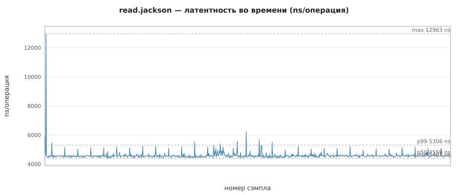
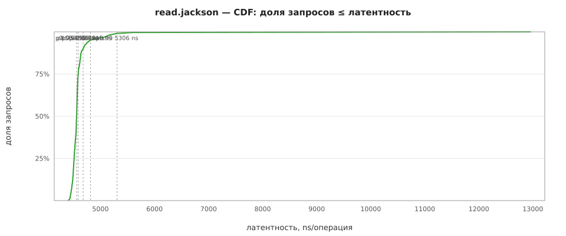
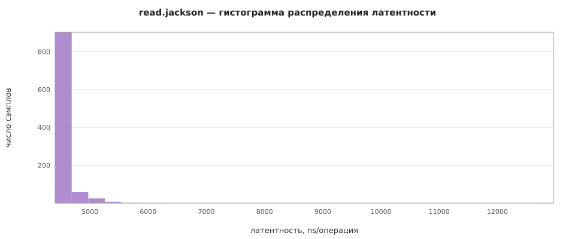

### read.kotlinx — kotlinx.serialization: JSON → объект (decodeFromString)

**Фазы (8e, 8f):** время теста и число операций с детализацией warmup/teardown.

| Фаза | Сэмплов | Операций в сэмпле | Операций всего | Время, мс |
|---|---|---|---|---|
| warmup | 2000 | 256 | 512000 | `2544.7` |
| measure | 1000 | 256 | 256000 | `677.4` |
| teardown | 250 | 256 | 64000 | `174.8` |
| **итого** | | | **832000** | |

**Статистика латентности, ns/операция (Требование 8d); throughput = 1e9/mean ⇒ ** `377,979` ops/s.**

| Метрика | Значение |
|---|---|
| испытаний (сэмплов) | 1000 |
| mean | `2645.6` ns |
| stdev | `807.5` ns |
| min | `2501.4` ns |
| max | `27998.1` ns |
| **p50 (медиана)** | **`2618.7` ns** (net: `2614.4` ns) |
| p75 | `2659.3` ns |
| p90 | `2674.5` ns |
| p95 | `2689.1` ns |
| p99 | `3167.8` ns |

**Распределение по перцентилям (8b/8d):**

| Перцентиль | Латентность, ns |
|---|---|
| p0.100 | `2543.5` |
| p0.250 | `2565.5` |
| p0.500 | `2618.7` |
| p0.750 | `2659.3` |
| p0.900 | `2674.5` |
| p0.950 | `2689.1` |
| p0.990 | `3167.8` |
| p0.999 | `3425.8` |

**Графики (встроены ниже):**

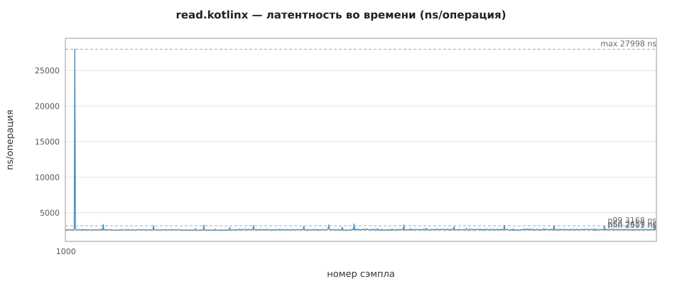
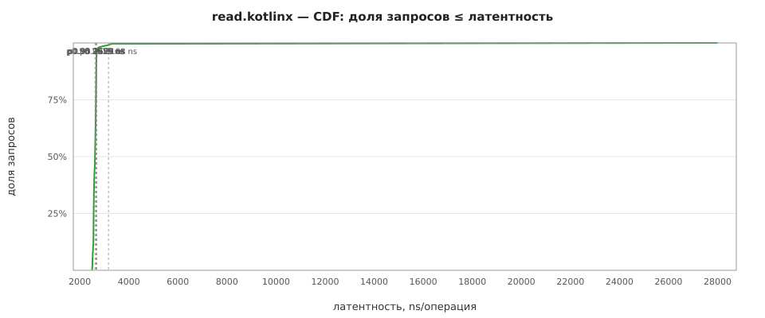
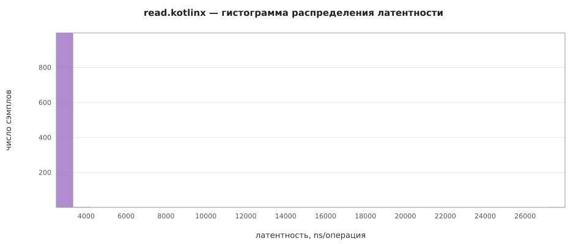

### write.jackson — Jackson 3 (jackson-module-kotlin): объект → JSON (serialize)

**Фазы (8e, 8f):** время теста и число операций с детализацией warmup/teardown.

| Фаза | Сэмплов | Операций в сэмпле | Операций всего | Время, мс |
|---|---|---|---|---|
| warmup | 2000 | 256 | 512000 | `1887.5` |
| measure | 1000 | 256 | 256000 | `340.7` |
| teardown | 250 | 256 | 64000 | `85.8` |
| **итого** | | | **832000** | |

**Статистика латентности, ns/операция (Требование 8d); throughput = 1e9/mean ⇒ ** `751,717` ops/s.**

| Метрика | Значение |
|---|---|
| испытаний (сэмплов) | 1000 |
| mean | `1330.3` ns |
| stdev | `136.3` ns |
| min | `1255.0` ns |
| max | `4432.2` ns |
| **p50 (медиана)** | **`1301.3` ns** (net: `1297.0` ns) |
| p75 | `1359.6` ns |
| p90 | `1379.0` ns |
| p95 | `1392.8` ns |
| p99 | `1685.9` ns |

**Распределение по перцентилям (8b/8d):**

| Перцентиль | Латентность, ns |
|---|---|
| p0.100 | `1274.2` |
| p0.250 | `1286.8` |
| p0.500 | `1301.3` |
| p0.750 | `1359.6` |
| p0.900 | `1379.0` |
| p0.950 | `1392.8` |
| p0.990 | `1685.9` |
| p0.999 | `2434.1` |

**Графики (встроены ниже):**

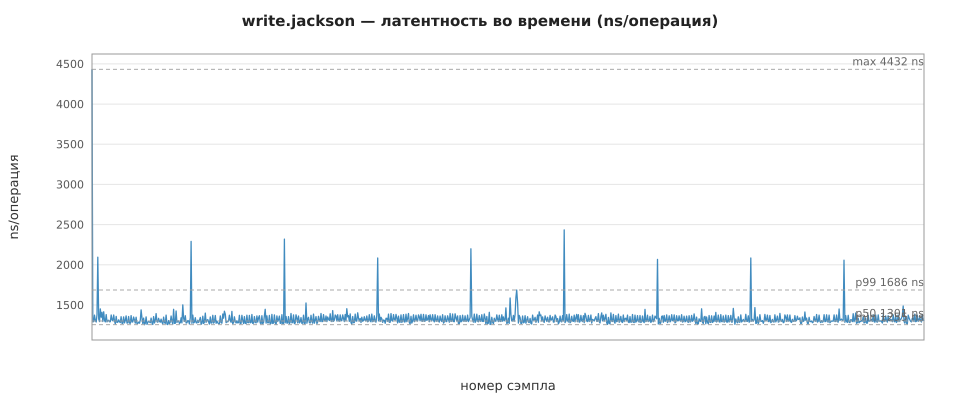

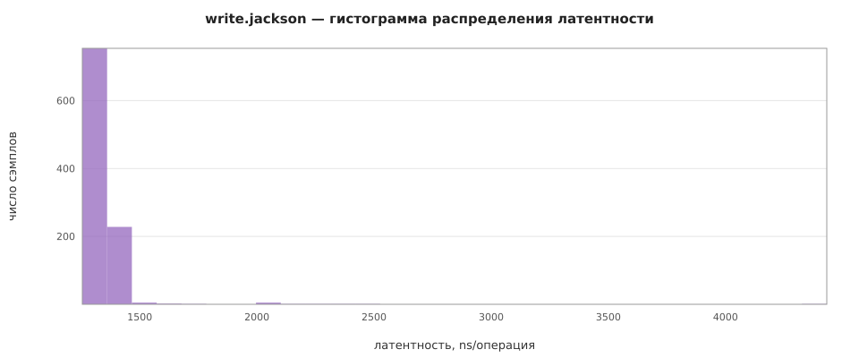

### write.kotlinx — kotlinx.serialization: объект → JSON (encodeToString)

**Фазы (8e, 8f):** время теста и число операций с детализацией warmup/teardown.

| Фаза | Сэмплов | Операций в сэмпле | Операций всего | Время, мс |
|---|---|---|---|---|
| warmup | 2000 | 256 | 512000 | `1390.8` |
| measure | 1000 | 256 | 256000 | `342.2` |
| teardown | 250 | 256 | 64000 | `85.5` |
| **итого** | | | **832000** | |

**Статистика латентности, ns/операция (Требование 8d); throughput = 1e9/mean ⇒ ** `748,332` ops/s.**

| Метрика | Значение |
|---|---|
| испытаний (сэмплов) | 1000 |
| mean | `1336.3` ns |
| stdev | `90.8` ns |
| min | `1255.3` ns |
| max | `2340.3` ns |
| **p50 (медиана)** | **`1309.8` ns** (net: `1305.5` ns) |
| p75 | `1367.4` ns |
| p90 | `1388.7` ns |
| p95 | `1401.9` ns |
| p99 | `1580.4` ns |

**Распределение по перцентилям (8b/8d):**

| Перцентиль | Латентность, ns |
|---|---|
| p0.100 | `1288.3` |
| p0.250 | `1298.1` |
| p0.500 | `1309.8` |
| p0.750 | `1367.4` |
| p0.900 | `1388.7` |
| p0.950 | `1401.9` |
| p0.990 | `1580.4` |
| p0.999 | `2278.6` |

**Графики (встроены ниже):**

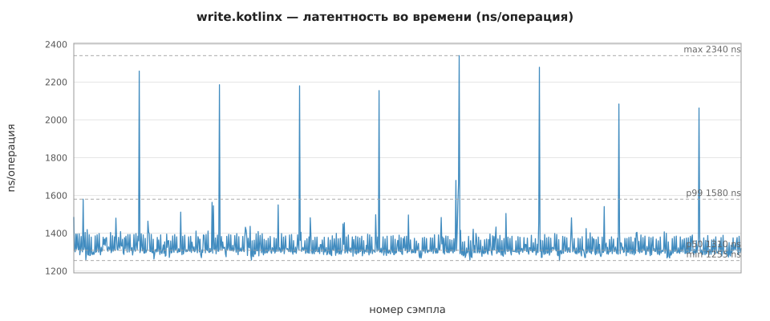
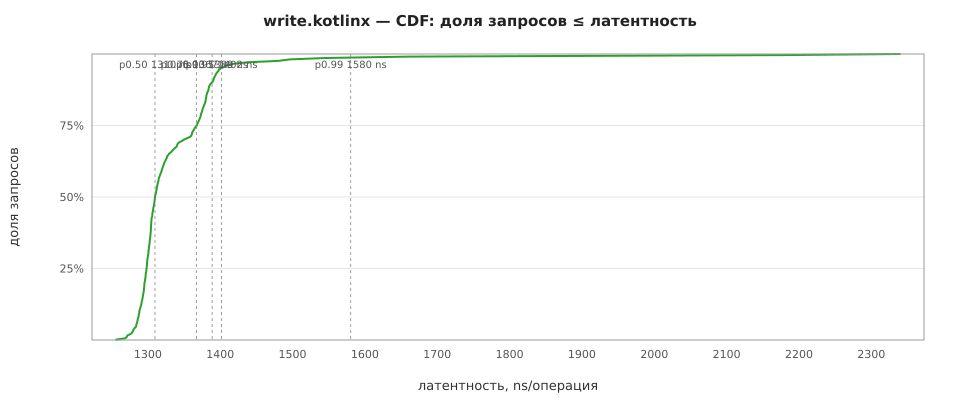
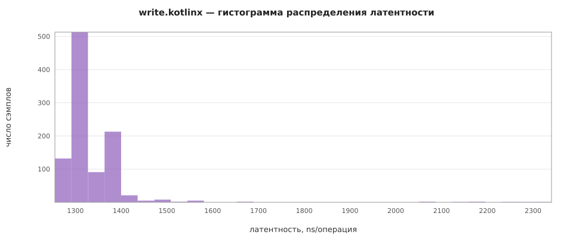

### mixed.jackson — Jackson 3: одновременные чтение (1 поток) + запись (2-й поток)

**Фазы (8e, 8f):** время теста и число операций с детализацией warmup/teardown.

| Фаза | Сэмплов | Операций в сэмпле | Операций всего | Время, мс |
|---|---|---|---|---|
| warmup | 2000 | 512 | 1024000 | `3861.6` |
| measure | 1000 | 512 | 512000 | `1485.6` |
| teardown | 250 | 512 | 128000 | `359.8` |
| **итого** | | | **1664000** | |

**Статистика латентности, ns/операция (Требование 8d); throughput = 1e9/mean ⇒ ** `344,738` ops/s.**

| Метрика | Значение |
|---|---|
| испытаний (сэмплов) | 1000 |
| mean | `2900.8` ns |
| stdev | `763.0` ns |
| min | `2661.8` ns |
| max | `10062.7` ns |
| **p50 (медиана)** | **`2772.6` ns** (net: `2732.3` ns) |
| p75 | `2806.9` ns |
| p90 | `2874.1` ns |
| p95 | `3170.9` ns |
| p99 | `8256.0` ns |

**Распределение по перцентилям (8b/8d):**

| Перцентиль | Латентность, ns |
|---|---|
| p0.100 | `2729.3` |
| p0.250 | `2754.8` |
| p0.500 | `2772.6` |
| p0.750 | `2806.9` |
| p0.900 | `2874.1` |
| p0.950 | `3170.9` |
| p0.990 | `8256.0` |
| p0.999 | `10054.6` |

**Графики (встроены ниже):**

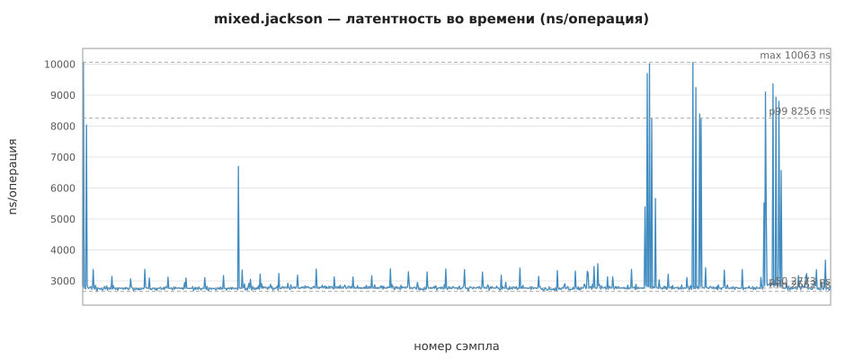
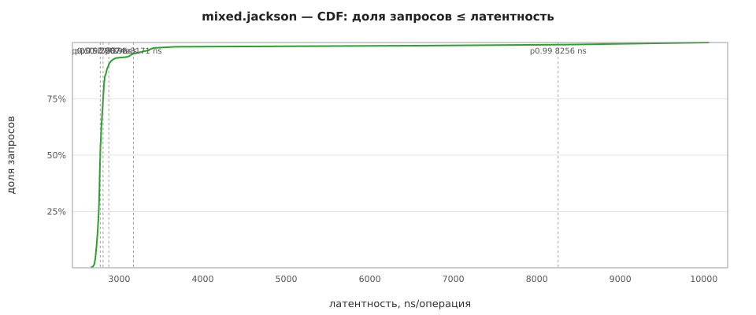
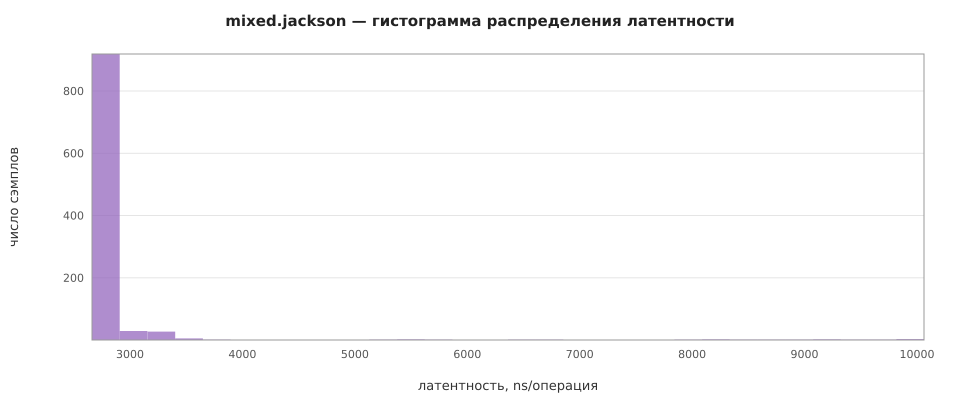

### mixed.kotlinx — kotlinx.serialization: одновременные чтение (1 поток) + запись (2-й поток)

**Фазы (8e, 8f):** время теста и число операций с детализацией warmup/teardown.

| Фаза | Сэмплов | Операций в сэмпле | Операций всего | Время, мс |
|---|---|---|---|---|
| warmup | 2000 | 512 | 1024000 | `2114.9` |
| measure | 1000 | 512 | 512000 | `1036.6` |
| teardown | 250 | 512 | 128000 | `256.5` |
| **итого** | | | **1664000** | |

**Статистика латентности, ns/операция (Требование 8d); throughput = 1e9/mean ⇒ ** `494,099` ops/s.**

| Метрика | Значение |
|---|---|
| испытаний (сэмплов) | 1000 |
| mean | `2023.9` ns |
| stdev | `395.6` ns |
| min | `1917.9` ns |
| max | `9143.8` ns |
| **p50 (медиана)** | **`1991.5` ns** (net: `1951.2` ns) |
| p75 | `2002.3` ns |
| p90 | `2017.5` ns |
| p95 | `2049.8` ns |
| p99 | `2565.8` ns |

**Распределение по перцентилям (8b/8d):**

| Перцентиль | Латентность, ns |
|---|---|
| p0.100 | `1956.4` |
| p0.250 | `1969.8` |
| p0.500 | `1991.5` |
| p0.750 | `2002.3` |
| p0.900 | `2017.5` |
| p0.950 | `2049.8` |
| p0.990 | `2565.8` |
| p0.999 | `7972.5` |

**Графики (встроены ниже):**

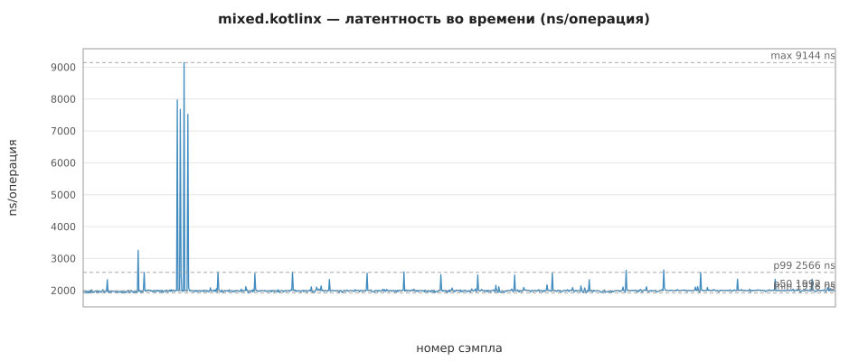
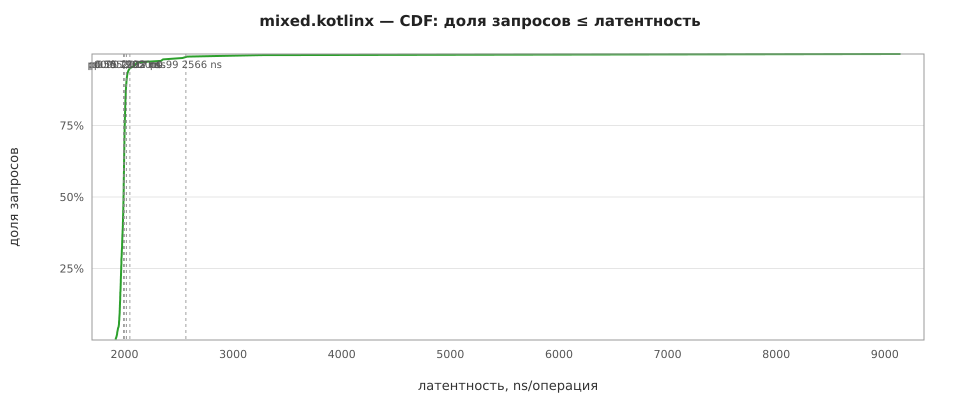
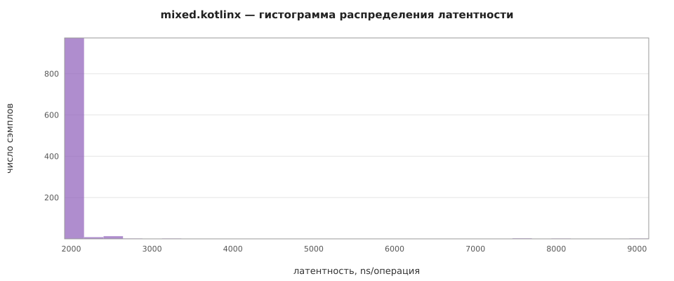

## 5. Сравнение двух объектов (Jackson 3 vs kotlinx.serialization)

| Сценарий | Медиана Jackson, ns | Медиана kotlinx, ns | Δ median | Δ mean | Δ p99 | Быстрее |
|---|---|---|---|---|---|---|
| mixed | `2772.6` | `1991.5` | `-28.2%` | `-30.2%` | `-68.9%` | **kotlinx.serialization** |
| read | `4558.5` | `2618.7` | `-42.6%` | `-42.4%` | `-40.3%` | **kotlinx.serialization** |
| write | `1301.3` | `1309.8` | `0.7%` | `0.5%` | `-6.3%` | **Jackson 3** |

> Δ = (kotlinx − Jackson) / Jackson × 100%. Отрицательное значение — kotlinx быстрее.

## 6. «Сырые» сэмплы

Каждый кейс: `raw/<case>.csv` (колонки `sample,ns_per_op`). Полные данные — `report.json`.

