# ЛР3: микробенчмарк — Jackson 3 vs kotlinx.serialization (vidayapi)

> Сгенерировано автоматически: `2026-10-22T20:30:31.720089867Z`.

## 1. Окружение прогона (воспроизводимость, Требование 6)

| Параметр | Значение |
|---|---|
| `availableProcessors` | `1` |
| `container` | `docker` |
| `cpuModel` | `AMD Ryzen 5 6600HS Creator Edition` |
| `cpusAllowedList` | `0` |
| `java.vendor` | `Eclipse Adoptium` |
| `java.version` | `17.0.20.1` |
| `jvm.name` | `OpenJDK 64-Bit Server VM` |
| `os.arch` | `amd64` |
| `os.name` | `Linux` |
| `os.version` | `7.0.0-38-generic` |
| `timestamp` | `2026-10-22T20:30:08.767039464Z` |

## 2. Конфигурация прогона (Требования 1, 2)

| Параметр | Значение |
|---|---|
| испытаний (samples) | 1000 (≥100 — Требование 1) |
| warmup-сэмплов | 2000 (Требование 2) |
| teardown-сэмплов | 250 (Требование 2) |
| операций в сэмпле (batch) | 256 |
| пар read+write в сэмпле mixed | 256 |

## 3. Overhead инструмента (Требование 7)

| Режим | Overhead, нс/операция |
|---|---|
| простой сценарий (2×nanoTime + цикл + Blackhole) / batch | `4.305` |
| смешанный сценарий (2 потока + диспетчеризация) / 2×pairs | `35.182` |

> Целевой ориентир задания — не более 4–5 нс; батч-измерение даёт sub-ns overhead. «Сырые» значения в таблицах включают overhead; столбец «net median» = median − overhead.

## 4. Сравнение по сценариям: таблицы и графики обоих методов

> Для каждого сценария: сводная таблица «метрика × метод», детальные таблицы
> и графики обоих методов. Δ = (kotlinx − Jackson) / Jackson × 100%; отрицательная — kotlinx быстрее.

### read — чтение (deserialize)

**Все метрики обоих методов (латентность, ns/операция):**

| Метрика | Jackson 3 | kotlinx.serialization | Δ, % |
|---|---|---|---|
| min | `4390.4` | `2534.8` | `-42.3%` |
| **p50 (медиана)** | **`4514.3`** | **`2696.3`** | `-40.3%` |
| p75 | `4637.3` | `4721.6` | `1.8%` |
| p90 | `4951.2` | `5112.0` | `3.2%` |
| p95 | `5283.4` | `5169.8` | `-2.2%` |
| p99 | `7335.1` | `5863.9` | `-20.1%` |
| max | `13921.8` | `28222.3` | `102.7%` |
| mean | `4663.9` | `3474.4` | `-25.5%` |
| stdev | `530.8` | `1346.0` | `153.6%` |
| net median (минус overhead) | `4510.0` | `2692.0` | `-40.3%` |
| throughput, ops/s | `214,411` | `287,822` | |

#### **Jackson 3** — read.jackson

**Фазы (8e, 8f):**

| Фаза | Сэмплов | Операций в сэмпле | Операций всего | Время, мс |
|---|---|---|---|---|
| warmup | 2000 | 256 | 512000 | `4561.8` |
| measure | 1000 | 256 | 256000 | `1194.4` |
| teardown | 250 | 256 | 64000 | `299.3` |
| **итого** | | | **832000** | |

**Статистика (8d), ns/операция; throughput ≈ `214,411` ops/s:**

| Метрика | Значение |
|---|---|
| сэмплов | 1000 |
| mean | `4663.9` ns |
| stdev | `530.8` ns |
| min | `4390.4` ns |
| max | `13921.8` ns |
| **p50 (медиана)** | **`4514.3` ns** (net: `4510.0` ns) |
| p75 | `4637.3` ns |
| p90 | `4951.2` ns |
| p95 | `5283.4` ns |
| p99 | `7335.1` ns |

**Перцентили (8b/8d):**

| Перцентиль | Латентность, ns |
|---|---|
| p0.100 | `4446.6` |
| p0.250 | `4470.4` |
| p0.500 | `4514.3` |
| p0.750 | `4637.3` |
| p0.900 | `4951.2` |
| p0.950 | `5283.4` |
| p0.990 | `7335.1` |
| p0.999 | `7869.5` |

**Графики:**

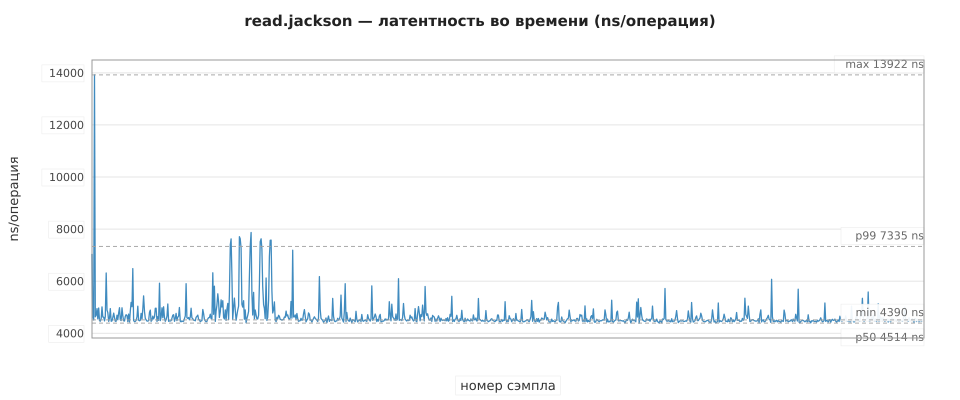
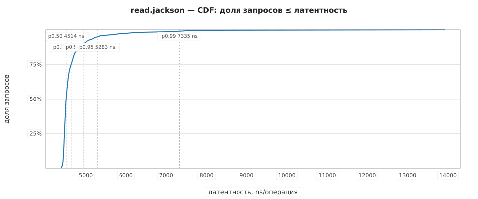
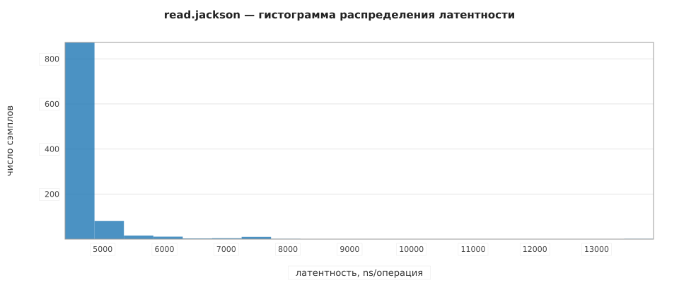

#### **kotlinx.serialization** — read.kotlinx

**Фазы (8e, 8f):**

| Фаза | Сэмплов | Операций в сэмпле | Операций всего | Время, мс |
|---|---|---|---|---|
| warmup | 2000 | 256 | 512000 | `2970.6` |
| measure | 1000 | 256 | 256000 | `889.8` |
| teardown | 250 | 256 | 64000 | `192.8` |
| **итого** | | | **832000** | |

**Статистика (8d), ns/операция; throughput ≈ `287,822` ops/s:**

| Метрика | Значение |
|---|---|
| сэмплов | 1000 |
| mean | `3474.4` ns |
| stdev | `1346.0` ns |
| min | `2534.8` ns |
| max | `28222.3` ns |
| **p50 (медиана)** | **`2696.3` ns** (net: `2692.0` ns) |
| p75 | `4721.6` ns |
| p90 | `5112.0` ns |
| p95 | `5169.8` ns |
| p99 | `5863.9` ns |

**Перцентили (8b/8d):**

| Перцентиль | Латентность, ns |
|---|---|
| p0.100 | `2567.0` |
| p0.250 | `2620.0` |
| p0.500 | `2696.3` |
| p0.750 | `4721.6` |
| p0.900 | `5112.0` |
| p0.950 | `5169.8` |
| p0.990 | `5863.9` |
| p0.999 | `6749.5` |

**Графики:**

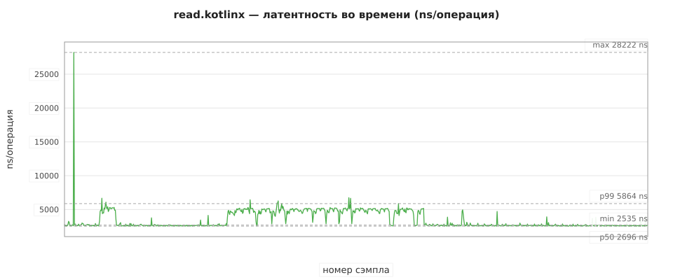
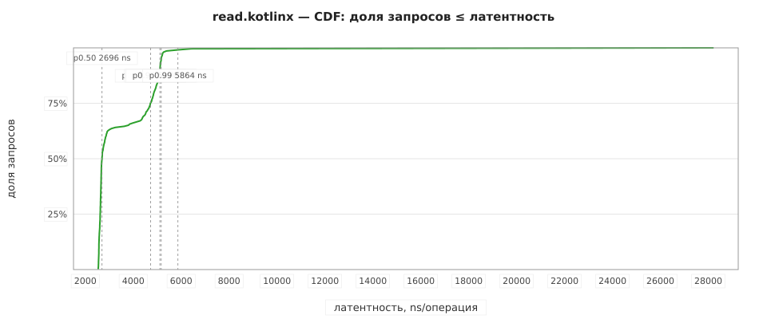
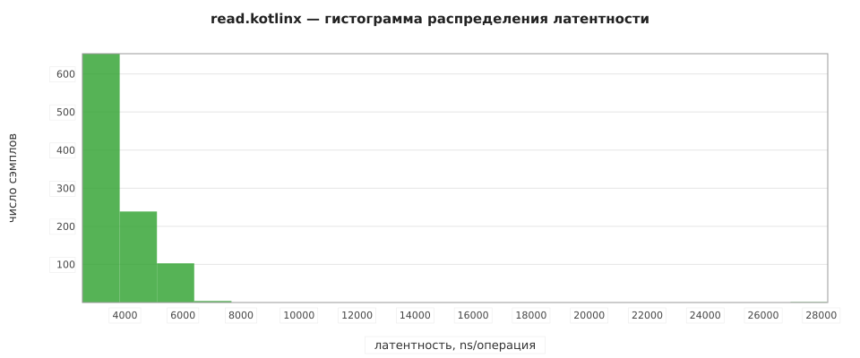

**Оба метода на одном графике (наложение):**

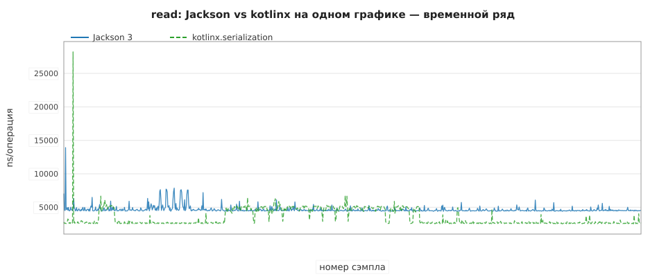
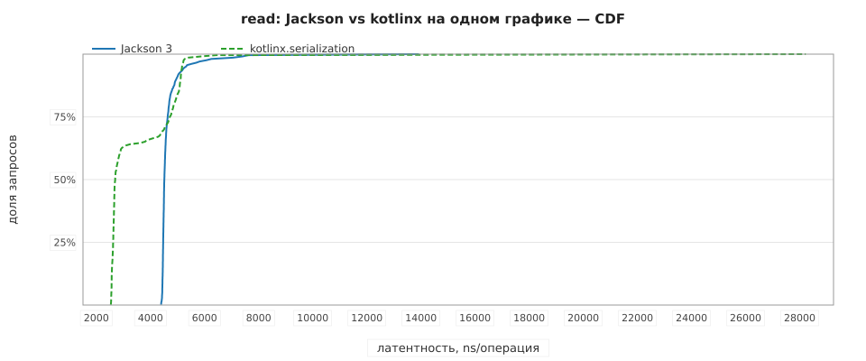
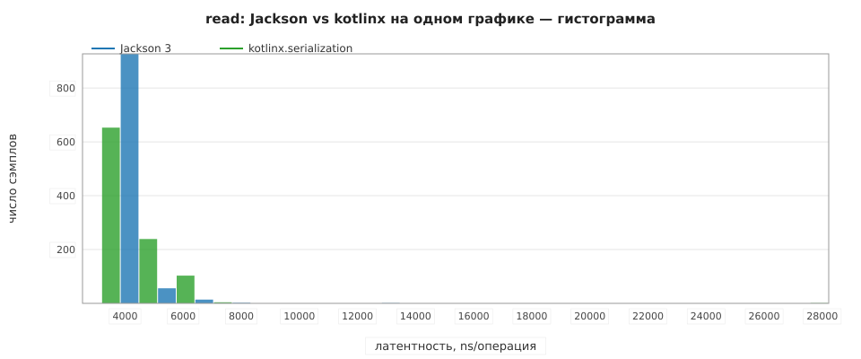

### write — запись (serialize)

**Все метрики обоих методов (латентность, ns/операция):**

| Метрика | Jackson 3 | kotlinx.serialization | Δ, % |
|---|---|---|---|
| min | `909.4` | `884.1` | `-2.8%` |
| **p50 (медиана)** | **`938.3`** | **`920.4`** | `-1.9%` |
| p75 | `970.8` | `947.2` | `-2.4%` |
| p90 | `1002.6` | `995.5` | `-0.7%` |
| p95 | `1014.3` | `1019.1` | `0.5%` |
| p99 | `1397.7` | `1453.1` | `4.0%` |
| max | `3500.3` | `2592.8` | `-25.9%` |
| mean | `961.2` | `948.0` | `-1.4%` |
| stdev | `104.3` | `110.8` | `6.2%` |
| net median (минус overhead) | `934.0` | `916.1` | `-1.9%` |
| throughput, ops/s | `1,040,372` | `1,054,866` | |

#### **Jackson 3** — write.jackson

**Фазы (8e, 8f):**

| Фаза | Сэмплов | Операций в сэмпле | Операций всего | Время, мс |
|---|---|---|---|---|
| warmup | 2000 | 256 | 512000 | `1529.6` |
| measure | 1000 | 256 | 256000 | `246.2` |
| teardown | 250 | 256 | 64000 | `62.1` |
| **итого** | | | **832000** | |

**Статистика (8d), ns/операция; throughput ≈ `1,040,372` ops/s:**

| Метрика | Значение |
|---|---|
| сэмплов | 1000 |
| mean | `961.2` ns |
| stdev | `104.3` ns |
| min | `909.4` ns |
| max | `3500.3` ns |
| **p50 (медиана)** | **`938.3` ns** (net: `934.0` ns) |
| p75 | `970.8` ns |
| p90 | `1002.6` ns |
| p95 | `1014.3` ns |
| p99 | `1397.7` ns |

**Перцентили (8b/8d):**

| Перцентиль | Латентность, ns |
|---|---|
| p0.100 | `923.7` |
| p0.250 | `930.1` |
| p0.500 | `938.3` |
| p0.750 | `970.8` |
| p0.900 | `1002.6` |
| p0.950 | `1014.3` |
| p0.990 | `1397.7` |
| p0.999 | `1602.4` |

**Графики:**

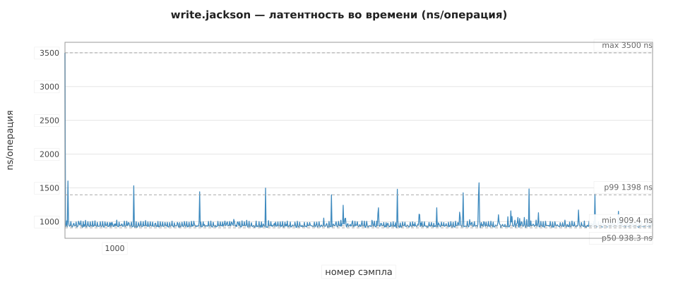
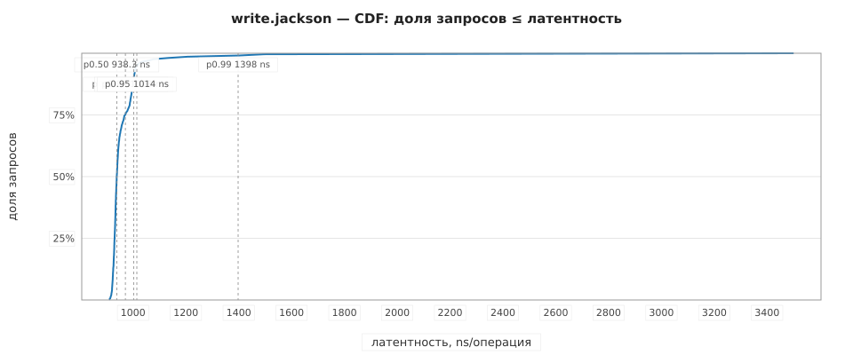
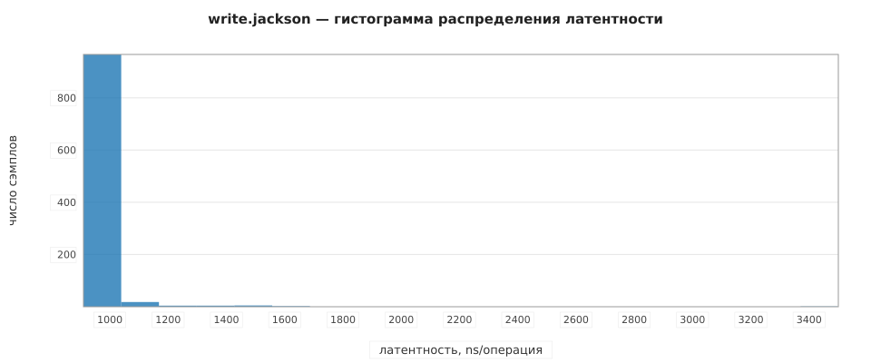

#### **kotlinx.serialization** — write.kotlinx

**Фазы (8e, 8f):**

| Фаза | Сэмплов | Операций в сэмпле | Операций всего | Время, мс |
|---|---|---|---|---|
| warmup | 2000 | 256 | 512000 | `977.6` |
| measure | 1000 | 256 | 256000 | `242.8` |
| teardown | 250 | 256 | 64000 | `59.6` |
| **итого** | | | **832000** | |

**Статистика (8d), ns/операция; throughput ≈ `1,054,866` ops/s:**

| Метрика | Значение |
|---|---|
| сэмплов | 1000 |
| mean | `948.0` ns |
| stdev | `110.8` ns |
| min | `884.1` ns |
| max | `2592.8` ns |
| **p50 (медиана)** | **`920.4` ns** (net: `916.1` ns) |
| p75 | `947.2` ns |
| p90 | `995.5` ns |
| p95 | `1019.1` ns |
| p99 | `1453.1` ns |

**Перцентили (8b/8d):**

| Перцентиль | Латентность, ns |
|---|---|
| p0.100 | `902.1` |
| p0.250 | `909.7` |
| p0.500 | `920.4` |
| p0.750 | `947.2` |
| p0.900 | `995.5` |
| p0.950 | `1019.1` |
| p0.990 | `1453.1` |
| p0.999 | `2138.0` |

**Графики:**

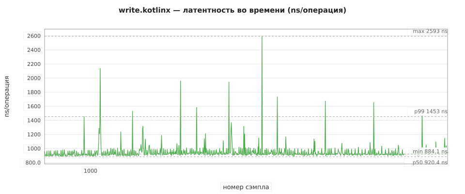
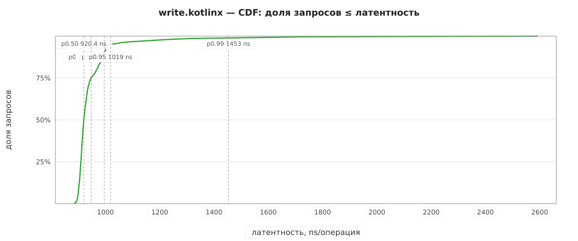
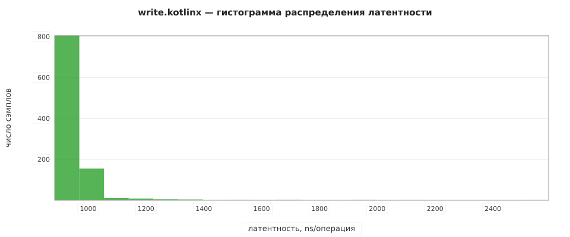

**Оба метода на одном графике (наложение):**

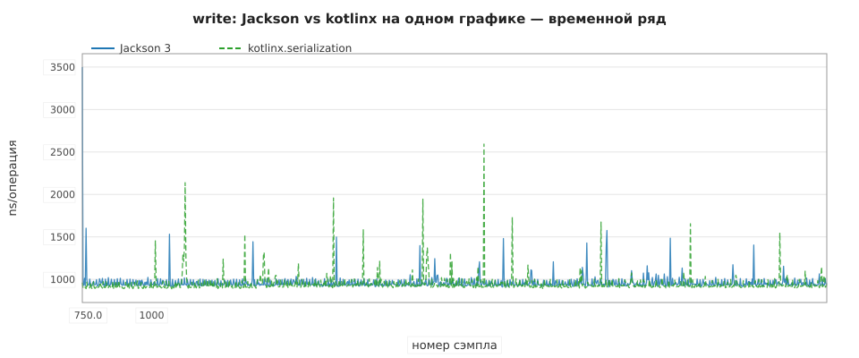
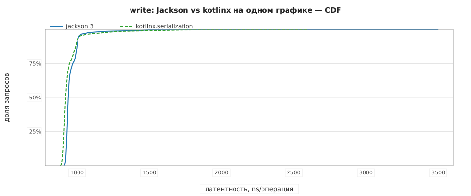
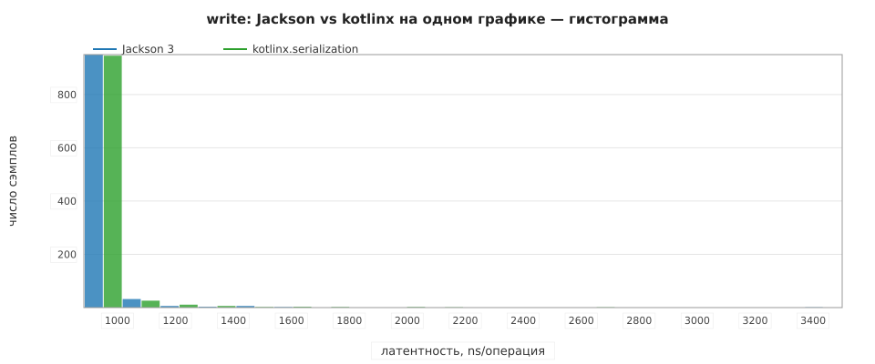

### mixed — одновременные чтение + запись (2 потока)

**Все метрики обоих методов (латентность, ns/операция):**

| Метрика | Jackson 3 | kotlinx.serialization | Δ, % |
|---|---|---|---|
| min | `2781.7` | `1946.6` | `-30.0%` |
| **p50 (медиана)** | **`2874.0`** | **`2006.3`** | `-30.2%` |
| p75 | `2914.8` | `2019.5` | `-30.7%` |
| p90 | `3016.3` | `2041.7` | `-32.3%` |
| p95 | `3217.3` | `2066.0` | `-35.8%` |
| p99 | `3803.7` | `2515.1` | `-33.9%` |
| max | `8635.2` | `2713.3` | `-68.6%` |
| mean | `2926.2` | `2017.2` | `-31.1%` |
| stdev | `257.6` | `75.7` | `-70.6%` |
| net median (минус overhead) | `2838.8` | `1971.1` | `-30.6%` |
| throughput, ops/s | `341,743` | `495,745` | |

#### **Jackson 3** — mixed.jackson

**Фазы (8e, 8f):**

| Фаза | Сэмплов | Операций в сэмпле | Операций всего | Время, мс |
|---|---|---|---|---|
| warmup | 2000 | 512 | 1024000 | `3846.2` |
| measure | 1000 | 512 | 512000 | `1498.6` |
| teardown | 250 | 512 | 128000 | `452.9` |
| **итого** | | | **1664000** | |

**Статистика (8d), ns/операция; throughput ≈ `341,743` ops/s:**

| Метрика | Значение |
|---|---|
| сэмплов | 1000 |
| mean | `2926.2` ns |
| stdev | `257.6` ns |
| min | `2781.7` ns |
| max | `8635.2` ns |
| **p50 (медиана)** | **`2874.0` ns** (net: `2838.8` ns) |
| p75 | `2914.8` ns |
| p90 | `3016.3` ns |
| p95 | `3217.3` ns |
| p99 | `3803.7` ns |

**Перцентили (8b/8d):**

| Перцентиль | Латентность, ns |
|---|---|
| p0.100 | `2829.2` |
| p0.250 | `2845.9` |
| p0.500 | `2874.0` |
| p0.750 | `2914.8` |
| p0.900 | `3016.3` |
| p0.950 | `3217.3` |
| p0.990 | `3803.7` |
| p0.999 | `5299.9` |

**Графики:**

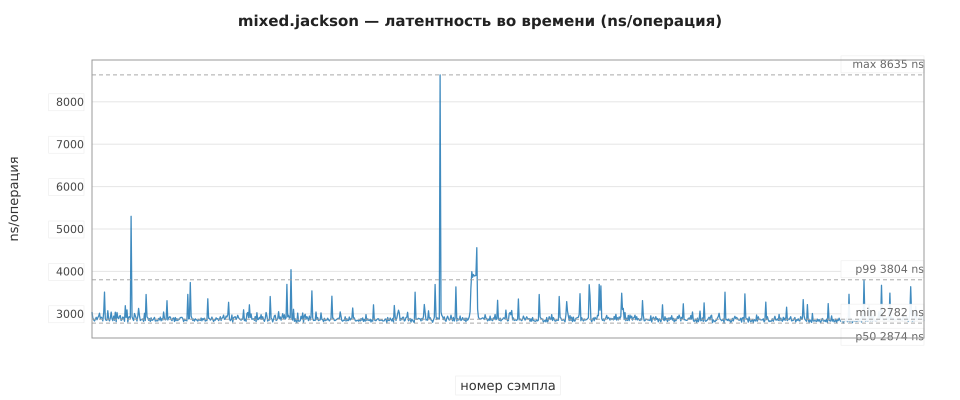
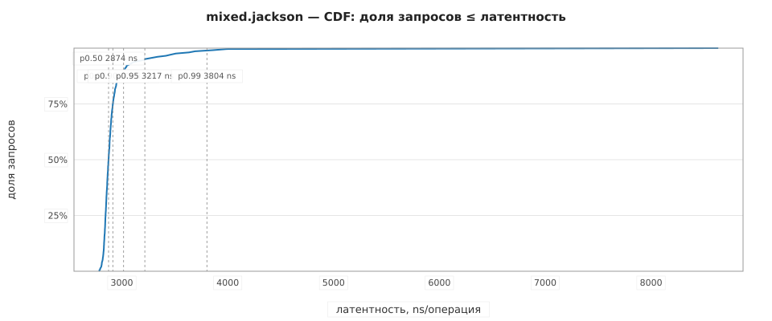
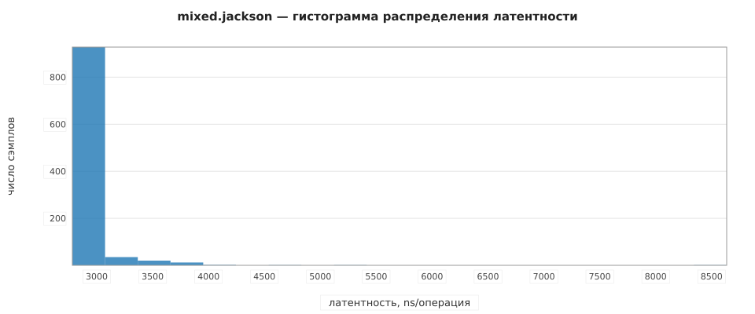

#### **kotlinx.serialization** — mixed.kotlinx

**Фазы (8e, 8f):**

| Фаза | Сэмплов | Операций в сэмпле | Операций всего | Время, мс |
|---|---|---|---|---|
| warmup | 2000 | 512 | 1024000 | `2158.1` |
| measure | 1000 | 512 | 512000 | `1033.1` |
| teardown | 250 | 512 | 128000 | `258.9` |
| **итого** | | | **1664000** | |

**Статистика (8d), ns/операция; throughput ≈ `495,745` ops/s:**

| Метрика | Значение |
|---|---|
| сэмплов | 1000 |
| mean | `2017.2` ns |
| stdev | `75.7` ns |
| min | `1946.6` ns |
| max | `2713.3` ns |
| **p50 (медиана)** | **`2006.3` ns** (net: `1971.1` ns) |
| p75 | `2019.5` ns |
| p90 | `2041.7` ns |
| p95 | `2066.0` ns |
| p99 | `2515.1` ns |

**Перцентили (8b/8d):**

| Перцентиль | Латентность, ns |
|---|---|
| p0.100 | `1971.7` |
| p0.250 | `1993.5` |
| p0.500 | `2006.3` |
| p0.750 | `2019.5` |
| p0.900 | `2041.7` |
| p0.950 | `2066.0` |
| p0.990 | `2515.1` |
| p0.999 | `2666.6` |

**Графики:**

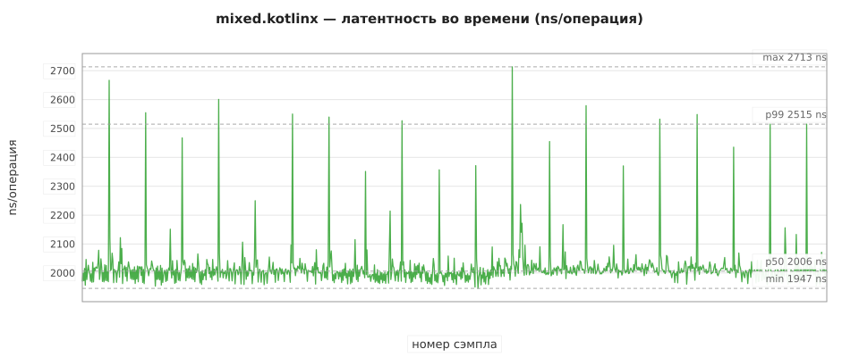
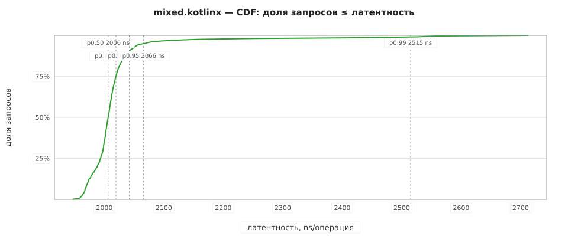
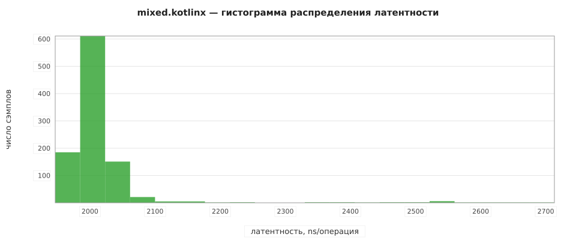

**Оба метода на одном графике (наложение):**

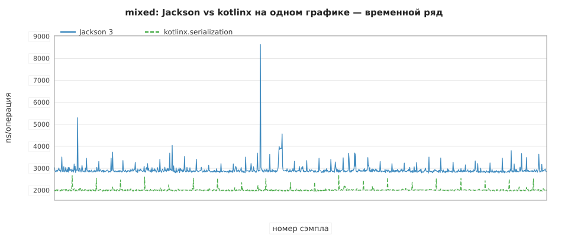
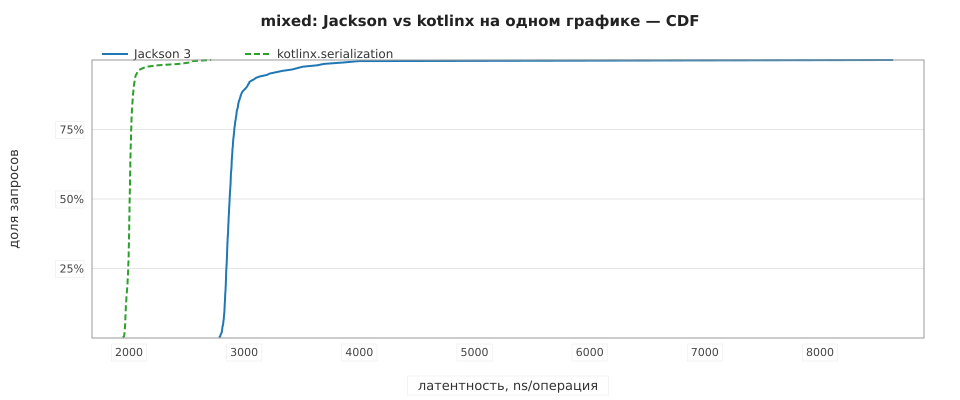
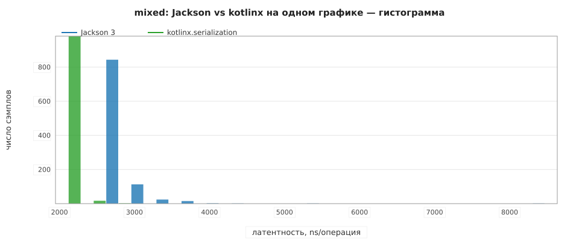

## 5. Сводная таблица сравнения (Jackson 3 vs kotlinx.serialization)

| Сценарий | Медиана Jackson, ns | Медиана kotlinx, ns | Δ median | Δ mean | Δ p99 | Быстрее |
|---|---|---|---|---|---|---|
| mixed | `2874.0` | `2006.3` | `-30.2%` | `-31.1%` | `-33.9%` | **kotlinx.serialization** |
| read | `4514.3` | `2696.3` | `-40.3%` | `-25.5%` | `-20.1%` | **kotlinx.serialization** |
| write | `938.3` | `920.4` | `-1.9%` | `-1.4%` | `4.0%` | **kotlinx.serialization** |

> Δ = (kotlinx − Jackson) / Jackson × 100%. Отрицательное значение — kotlinx быстрее.

## 5.1 Перцентили p50 и p99: столбчатое сравнение библиотек

> Три группы столбцов — read / write / mixed; в каждой два столбца: Jackson (синий) и kotlinx (зелёный).

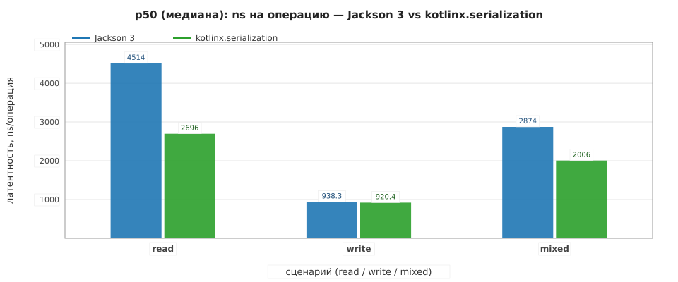

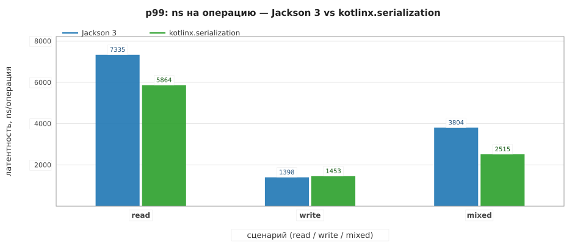

## 6. «Сырые» сэмплы

Каждый кейс: `raw/<case>.csv` (колонки `sample,ns_per_op`). Полные данные — `report.json`.

