# ЛР3: микробенчмарк — Jackson 3 vs kotlinx.serialization (vidayapi)

> Сгенерировано автоматически: `2026-10-22T20:50:34.890494158Z`.

## 1. Окружение прогона (воспроизводимость, Требование 6)

| Параметр | Значение |
|---|---|
| `availableProcessors` | `1` |
| `container` | `docker` |
| `cpuModel` | `AMD Ryzen 5 6600HS Creator Edition` |
| `cpusAllowedList` | `0` |
| `java.vendor` | `Eclipse Adoptium` |
| `java.version` | `17.0.20.1` |
| `jvm.name` | `OpenJDK 64-Bit Server VM` |
| `os.arch` | `amd64` |
| `os.name` | `Linux` |
| `os.version` | `7.0.0-38-generic` |
| `timestamp` | `2026-10-22T20:49:56.931529924Z` |

## 2. Конфигурация прогона (Требования 1, 2)

| Параметр | Значение |
|---|---|
| испытаний (samples) | 1000 (≥100 — Требование 1) |
| warmup-сэмплов | 5000 (Требование 2) |
| settle-сэмплов (стабилизация; отбрасываются) | 200 |
| teardown-сэмплов | 250 (Требование 2) |
| операций в сэмпле (batch) | 256 |
| пар read+write в сэмпле mixed | 256 |

## 3. Overhead инструмента (Требование 7)

| Режим | Overhead, нс/операция |
|---|---|
| простой сценарий (2×nanoTime + цикл + Blackhole) / batch | `4.266` |
| смешанный сценарий (2 потока + диспетчеризация) / 2×pairs | `35.330` |

> Целевой ориентир задания — не более 4–5 нс; батч-измерение даёт sub-ns overhead. «Сырые» значения в таблицах включают overhead; столбец «net median» = median − overhead.

## 4. Сравнение по сценариям: таблицы и графики обоих методов

> Для каждого сценария: сводная таблица «метрика × метод», детальные таблицы
> и графики обоих методов. Δ = (kotlinx − Jackson) / Jackson × 100%; отрицательная — kotlinx быстрее.
> Фаза **settle** (между warmup и measure) отбрасывается: первые сэмплы после прогрева
> (ленивая инициализация, JIT, GC-паузы) не входят в статистику и графики.

### read — чтение (deserialize)

**Все метрики обоих методов (латентность, ns/операция):**

| Метрика | Jackson 3 | kotlinx.serialization | Δ, % |
|---|---|---|---|
| min | `4327.0` | `2563.5` | `-40.8%` |
| **p50 (медиана)** | **`4473.9`** | **`2642.9`** | `-40.9%` |
| p75 | `4638.1` | `2688.9` | `-42.0%` |
| p90 | `4989.4` | `2710.1` | `-45.7%` |
| p95 | `5573.7` | `2747.8` | `-50.7%` |
| p99 | `6348.2` | `3226.5` | `-49.2%` |
| max | `11347.6` | `22240.9` | `96.0%` |
| mean | `4625.8` | `2689.6` | `-41.9%` |
| stdev | `456.1` | `641.9` | `40.8%` |
| net median (минус overhead) | `4469.6` | `2638.6` | `-41.0%` |
| throughput, ops/s | `216,180` | `371,800` | |

#### **Jackson 3** — read.jackson

**Фазы (8e, 8f):**

| Фаза | Сэмплов | Операций в сэмпле | Операций всего | Время, мс |
|---|---|---|---|---|
| warmup | 5000 | 256 | 1280000 | `6429.1` |
| settle | 200 | 256 | 51200 | `242.0` |
| measure | 1000 | 256 | 256000 | `1184.5` |
| teardown | 250 | 256 | 64000 | `298.1` |
| **итого** | | | **1651200** | |

**Статистика (8d), ns/операция; throughput ≈ `216,180` ops/s:**

| Метрика | Значение |
|---|---|
| сэмплов | 1000 |
| mean | `4625.8` ns |
| stdev | `456.1` ns |
| min | `4327.0` ns |
| max | `11347.6` ns |
| **p50 (медиана)** | **`4473.9` ns** (net: `4469.6` ns) |
| p75 | `4638.1` ns |
| p90 | `4989.4` ns |
| p95 | `5573.7` ns |
| p99 | `6348.2` ns |

**Перцентили (8b/8d):**

| Перцентиль | Латентность, ns |
|---|---|
| p0.100 | `4374.1` |
| p0.250 | `4408.6` |
| p0.500 | `4473.9` |
| p0.750 | `4638.1` |
| p0.900 | `4989.4` |
| p0.950 | `5573.7` |
| p0.990 | `6348.2` |
| p0.999 | `7658.0` |

**Графики:**

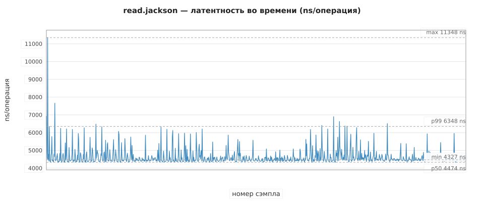
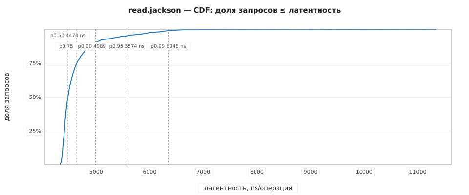
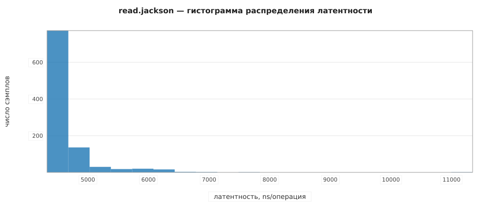

#### **kotlinx.serialization** — read.kotlinx

**Фазы (8e, 8f):**

| Фаза | Сэмплов | Операций в сэмпле | Операций всего | Время, мс |
|---|---|---|---|---|
| warmup | 5000 | 256 | 1280000 | `4723.6` |
| settle | 200 | 256 | 51200 | `143.4` |
| measure | 1000 | 256 | 256000 | `688.7` |
| teardown | 250 | 256 | 64000 | `185.4` |
| **итого** | | | **1651200** | |

**Статистика (8d), ns/операция; throughput ≈ `371,800` ops/s:**

| Метрика | Значение |
|---|---|
| сэмплов | 1000 |
| mean | `2689.6` ns |
| stdev | `641.9` ns |
| min | `2563.5` ns |
| max | `22240.9` ns |
| **p50 (медиана)** | **`2642.9` ns** (net: `2638.6` ns) |
| p75 | `2688.9` ns |
| p90 | `2710.1` ns |
| p95 | `2747.8` ns |
| p99 | `3226.5` ns |

**Перцентили (8b/8d):**

| Перцентиль | Латентность, ns |
|---|---|
| p0.100 | `2605.4` |
| p0.250 | `2618.7` |
| p0.500 | `2642.9` |
| p0.750 | `2688.9` |
| p0.900 | `2710.1` |
| p0.950 | `2747.8` |
| p0.990 | `3226.5` |
| p0.999 | `6816.0` |

**Графики:**

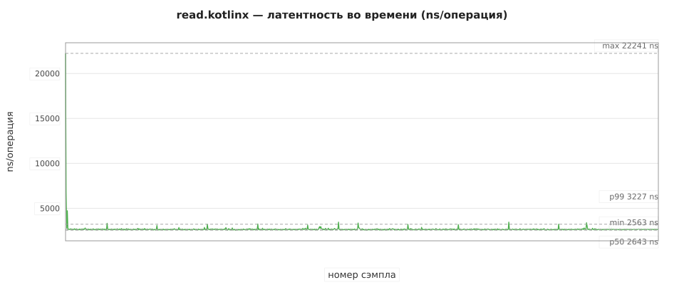
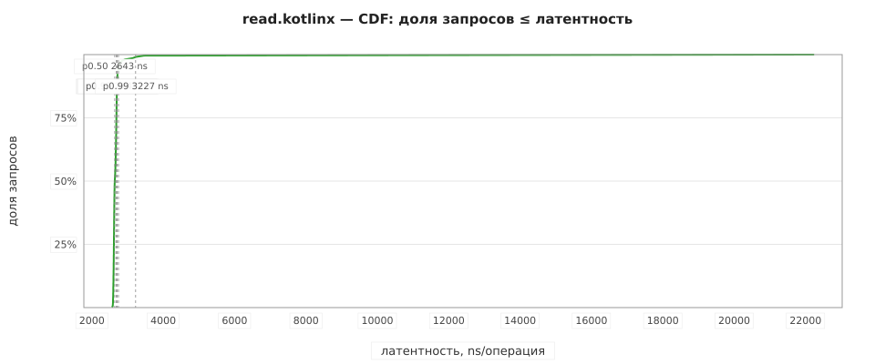
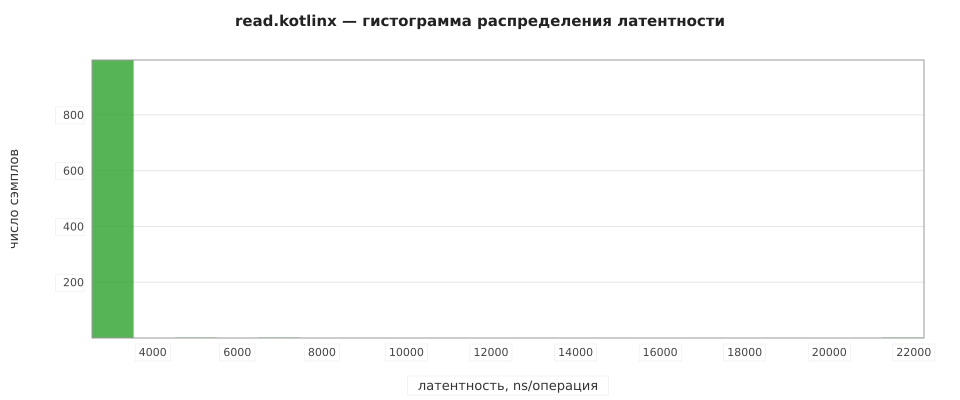

**Оба метода на одном графике (наложение):**

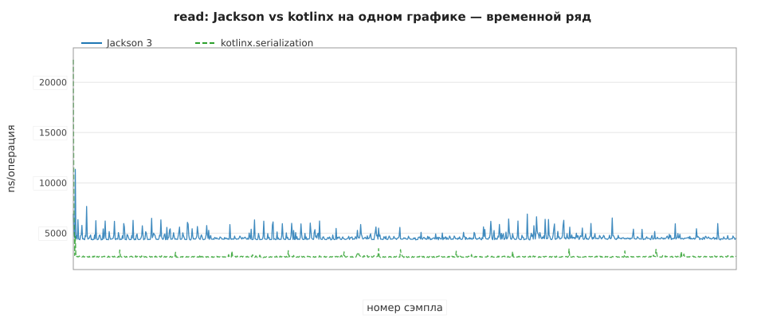
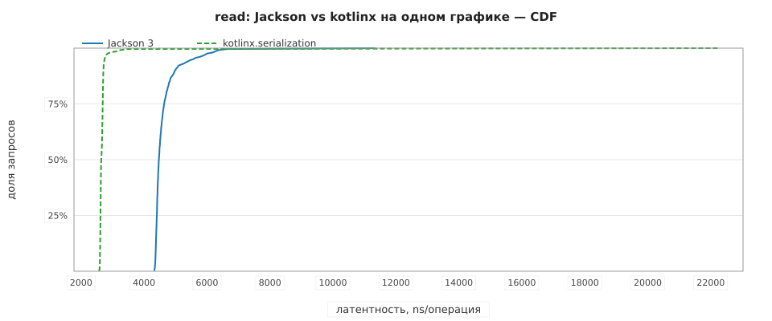
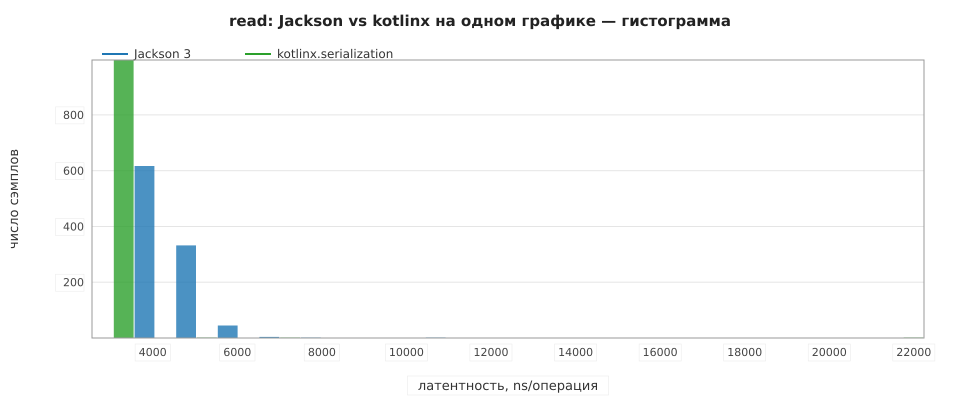

### write — запись (serialize)

**Все метрики обоих методов (латентность, ns/операция):**

| Метрика | Jackson 3 | kotlinx.serialization | Δ, % |
|---|---|---|---|
| min | `1228.6` | `1245.0` | `1.3%` |
| **p50 (медиана)** | **`1263.7`** | **`1293.5`** | `2.4%` |
| p75 | `1333.2` | `1353.6` | `1.5%` |
| p90 | `1353.4` | `1379.7` | `1.9%` |
| p95 | `1381.5` | `1404.6` | `1.7%` |
| p99 | `1802.9` | `1767.5` | `-2.0%` |
| max | `4220.8` | `2367.7` | `-43.9%` |
| mean | `1299.0` | `1322.5` | `1.8%` |
| stdev | `131.6` | `94.6` | `-28.1%` |
| net median (минус overhead) | `1259.4` | `1289.2` | `2.4%` |
| throughput, ops/s | `769,813` | `756,147` | |

#### **Jackson 3** — write.jackson

**Фазы (8e, 8f):**

| Фаза | Сэмплов | Операций в сэмпле | Операций всего | Время, мс |
|---|---|---|---|---|
| warmup | 5000 | 256 | 1280000 | `2879.1` |
| settle | 200 | 256 | 51200 | `66.8` |
| measure | 1000 | 256 | 256000 | `332.7` |
| teardown | 250 | 256 | 64000 | `82.8` |
| **итого** | | | **1651200** | |

**Статистика (8d), ns/операция; throughput ≈ `769,813` ops/s:**

| Метрика | Значение |
|---|---|
| сэмплов | 1000 |
| mean | `1299.0` ns |
| stdev | `131.6` ns |
| min | `1228.6` ns |
| max | `4220.8` ns |
| **p50 (медиана)** | **`1263.7` ns** (net: `1259.4` ns) |
| p75 | `1333.2` ns |
| p90 | `1353.4` ns |
| p95 | `1381.5` ns |
| p99 | `1802.9` ns |

**Перцентили (8b/8d):**

| Перцентиль | Латентность, ns |
|---|---|
| p0.100 | `1245.8` |
| p0.250 | `1252.6` |
| p0.500 | `1263.7` |
| p0.750 | `1333.2` |
| p0.900 | `1353.4` |
| p0.950 | `1381.5` |
| p0.990 | `1802.9` |
| p0.999 | `2336.4` |

**Графики:**

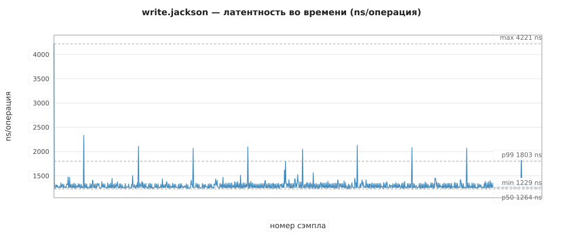
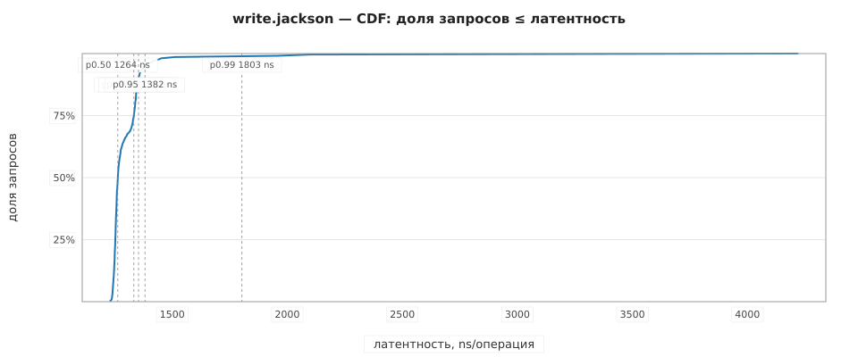
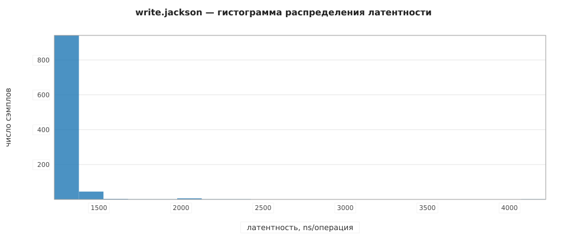

#### **kotlinx.serialization** — write.kotlinx

**Фазы (8e, 8f):**

| Фаза | Сэмплов | Операций в сэмпле | Операций всего | Время, мс |
|---|---|---|---|---|
| warmup | 5000 | 256 | 1280000 | `2394.3` |
| settle | 200 | 256 | 51200 | `67.6` |
| measure | 1000 | 256 | 256000 | `338.7` |
| teardown | 250 | 256 | 64000 | `84.6` |
| **итого** | | | **1651200** | |

**Статистика (8d), ns/операция; throughput ≈ `756,147` ops/s:**

| Метрика | Значение |
|---|---|
| сэмплов | 1000 |
| mean | `1322.5` ns |
| stdev | `94.6` ns |
| min | `1245.0` ns |
| max | `2367.7` ns |
| **p50 (медиана)** | **`1293.5` ns** (net: `1289.2` ns) |
| p75 | `1353.6` ns |
| p90 | `1379.7` ns |
| p95 | `1404.6` ns |
| p99 | `1767.5` ns |

**Перцентили (8b/8d):**

| Перцентиль | Латентность, ns |
|---|---|
| p0.100 | `1267.0` |
| p0.250 | `1276.1` |
| p0.500 | `1293.5` |
| p0.750 | `1353.6` |
| p0.900 | `1379.7` |
| p0.950 | `1404.6` |
| p0.990 | `1767.5` |
| p0.999 | `2192.8` |

**Графики:**

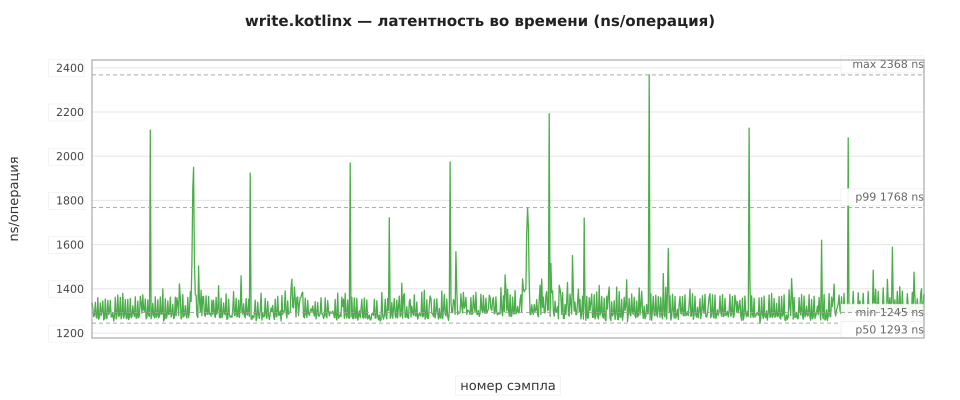
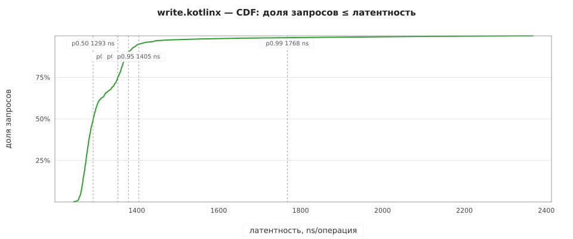
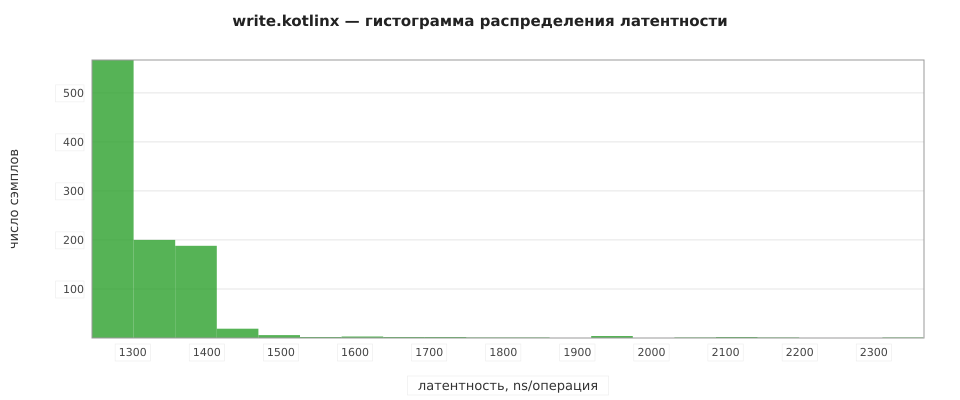

**Оба метода на одном графике (наложение):**

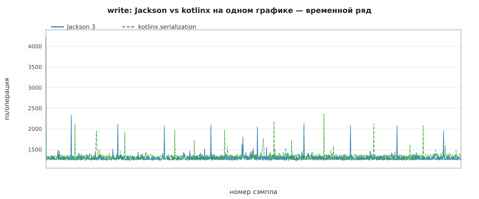
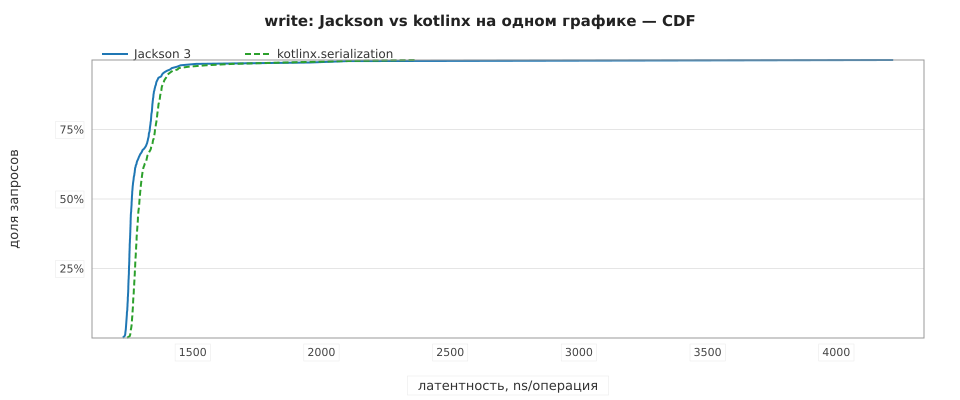
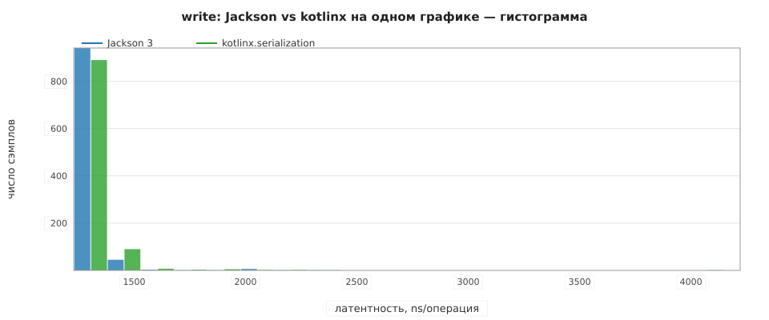

### mixed — одновременные чтение + запись (2 потока)

**Все метрики обоих методов (латентность, ns/операция):**

| Метрика | Jackson 3 | kotlinx.serialization | Δ, % |
|---|---|---|---|
| min | `2762.2` | `1960.3` | `-29.0%` |
| **p50 (медиана)** | **`2866.7`** | **`2036.1`** | `-29.0%` |
| p75 | `2901.3` | `2056.2` | `-29.1%` |
| p90 | `2943.8` | `2084.9` | `-29.2%` |
| p95 | `3023.8` | `2123.4` | `-29.8%` |
| p99 | `3471.6` | `2975.5` | `-14.3%` |
| max | `4221.3` | `3190.9` | `-24.4%` |
| mean | `2892.1` | `2058.9` | `-28.8%` |
| stdev | `124.4` | `137.1` | `10.2%` |
| net median (минус overhead) | `2831.4` | `2000.8` | `-29.3%` |
| throughput, ops/s | `345,773` | `485,701` | |

#### **Jackson 3** — mixed.jackson

**Фазы (8e, 8f):**

| Фаза | Сэмплов | Операций в сэмпле | Операций всего | Время, мс |
|---|---|---|---|---|
| warmup | 5000 | 512 | 2560000 | `8417.0` |
| settle | 200 | 512 | 102400 | `294.7` |
| measure | 1000 | 512 | 512000 | `1481.2` |
| teardown | 250 | 512 | 128000 | `368.9` |
| **итого** | | | **3302400** | |

**Статистика (8d), ns/операция; throughput ≈ `345,773` ops/s:**

| Метрика | Значение |
|---|---|
| сэмплов | 1000 |
| mean | `2892.1` ns |
| stdev | `124.4` ns |
| min | `2762.2` ns |
| max | `4221.3` ns |
| **p50 (медиана)** | **`2866.7` ns** (net: `2831.4` ns) |
| p75 | `2901.3` ns |
| p90 | `2943.8` ns |
| p95 | `3023.8` ns |
| p99 | `3471.6` ns |

**Перцентили (8b/8d):**

| Перцентиль | Латентность, ns |
|---|---|
| p0.100 | `2815.8` |
| p0.250 | `2836.6` |
| p0.500 | `2866.7` |
| p0.750 | `2901.3` |
| p0.900 | `2943.8` |
| p0.950 | `3023.8` |
| p0.990 | `3471.6` |
| p0.999 | `3919.4` |

**Графики:**

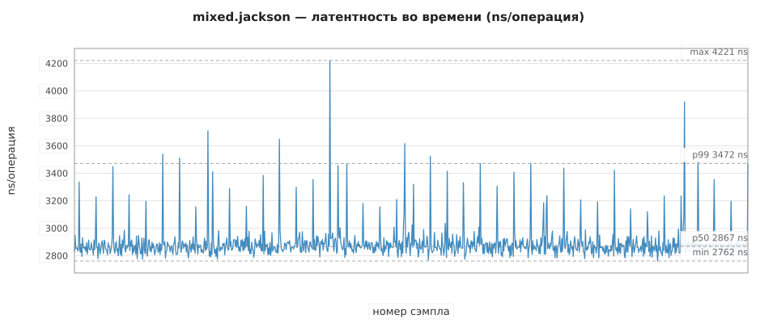
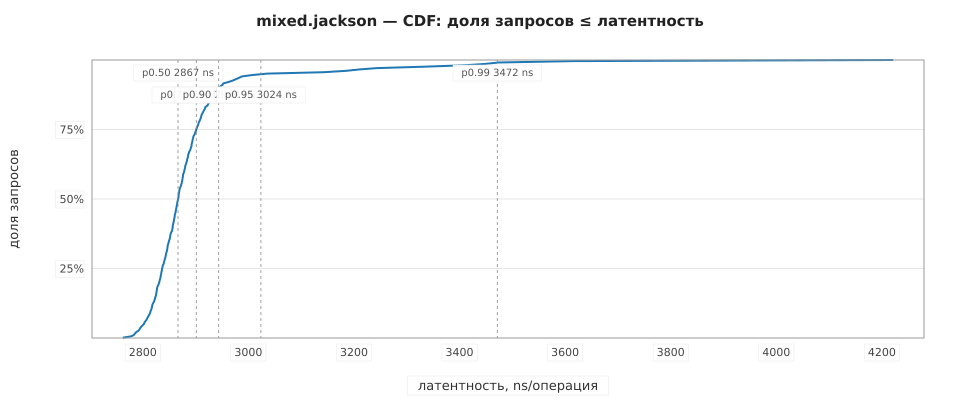
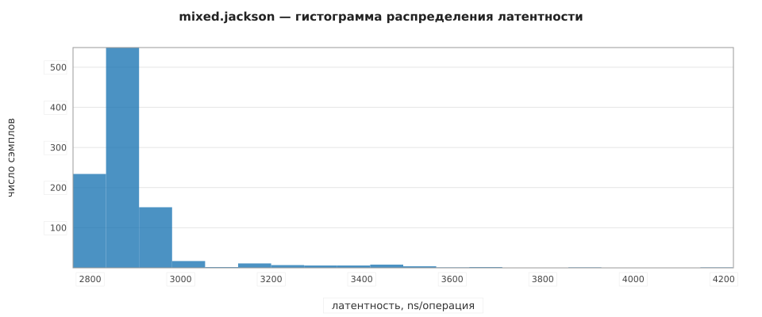

#### **kotlinx.serialization** — mixed.kotlinx

**Фазы (8e, 8f):**

| Фаза | Сэмплов | Операций в сэмпле | Операций всего | Время, мс |
|---|---|---|---|---|
| warmup | 5000 | 512 | 2560000 | `5325.5` |
| settle | 200 | 512 | 102400 | `210.2` |
| measure | 1000 | 512 | 512000 | `1054.4` |
| teardown | 250 | 512 | 128000 | `264.0` |
| **итого** | | | **3302400** | |

**Статистика (8d), ns/операция; throughput ≈ `485,701` ops/s:**

| Метрика | Значение |
|---|---|
| сэмплов | 1000 |
| mean | `2058.9` ns |
| stdev | `137.1` ns |
| min | `1960.3` ns |
| max | `3190.9` ns |
| **p50 (медиана)** | **`2036.1` ns** (net: `2000.8` ns) |
| p75 | `2056.2` ns |
| p90 | `2084.9` ns |
| p95 | `2123.4` ns |
| p99 | `2975.5` ns |

**Перцентили (8b/8d):**

| Перцентиль | Латентность, ns |
|---|---|
| p0.100 | `1997.5` |
| p0.250 | `2014.5` |
| p0.500 | `2036.1` |
| p0.750 | `2056.2` |
| p0.900 | `2084.9` |
| p0.950 | `2123.4` |
| p0.990 | `2975.5` |
| p0.999 | `3162.7` |

**Графики:**

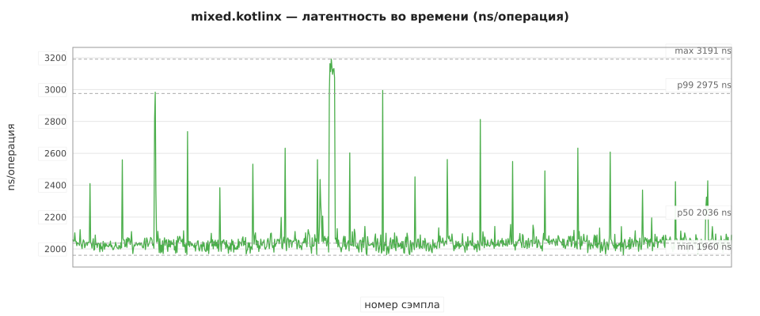
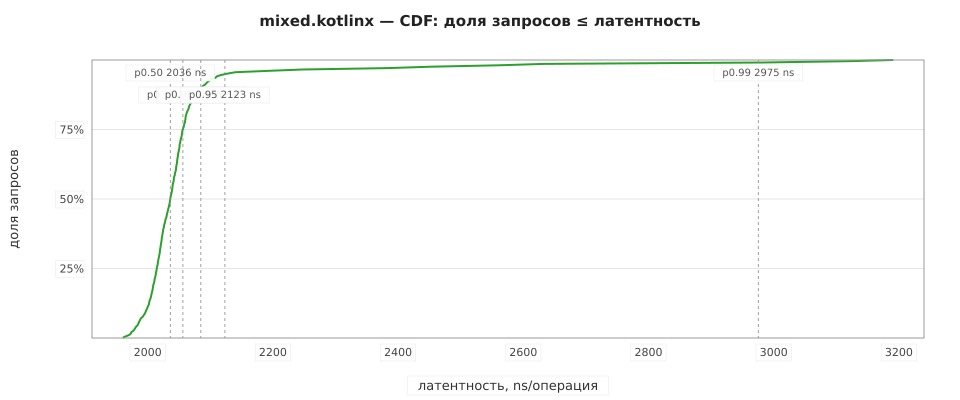
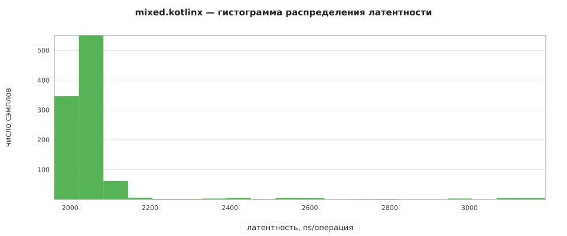

**Оба метода на одном графике (наложение):**

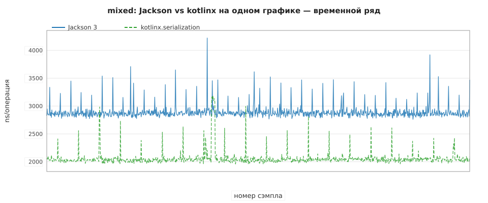
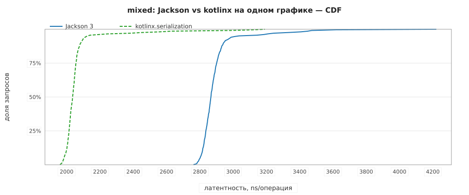
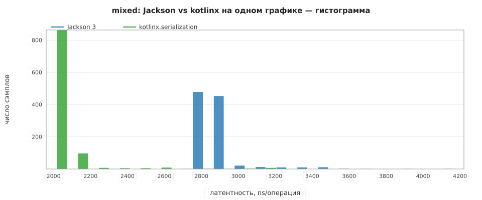

## 5. Сводная таблица сравнения (Jackson 3 vs kotlinx.serialization)

| Сценарий | Медиана Jackson, ns | Медиана kotlinx, ns | Δ median | Δ mean | Δ p99 | Быстрее |
|---|---|---|---|---|---|---|
| mixed | `2866.7` | `2036.1` | `-29.0%` | `-28.8%` | `-14.3%` | **kotlinx.serialization** |
| read | `4473.9` | `2642.9` | `-40.9%` | `-41.9%` | `-49.2%` | **kotlinx.serialization** |
| write | `1263.7` | `1293.5` | `2.4%` | `1.8%` | `-2.0%` | **Jackson 3** |

> Δ = (kotlinx − Jackson) / Jackson × 100%. Отрицательное значение — kotlinx быстрее.

## 5.1 Перцентили p50 и p99: столбчатое сравнение библиотек

> Три группы столбцов — read / write / mixed; в каждой два столбца: Jackson (синий) и kotlinx (зелёный).

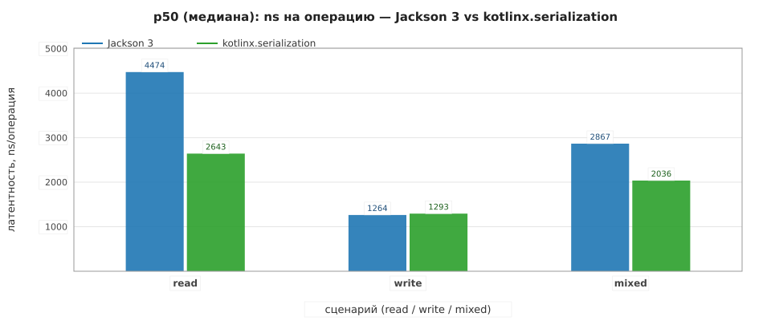

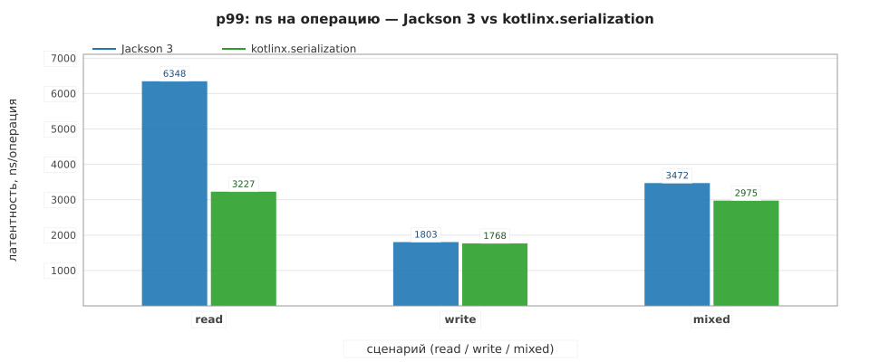

## 6. «Сырые» сэмплы

Каждый кейс: `raw/<case>.csv` (колонки `sample,ns_per_op`). Полные данные — `report.json`.

