# ЛР3: микробенчмарк — Jackson 3 vs kotlinx.serialization (vidayapi)

> Сгенерировано автоматически: `2026-10-22T21:32:34.214010760Z`.

## 1. Окружение прогона (воспроизводимость, Требование 6)

| Параметр | Значение |
|---|---|
| `availableProcessors` | `1` |
| `container` | `docker` |
| `cpuModel` | `AMD Ryzen 5 6600HS Creator Edition` |
| `cpusAllowedList` | `0` |
| `java.vendor` | `Eclipse Adoptium` |
| `java.version` | `17.0.20.1` |
| `jvm.name` | `OpenJDK 64-Bit Server VM` |
| `os.arch` | `amd64` |
| `os.name` | `Linux` |
| `os.version` | `7.0.0-38-generic` |
| `timestamp` | `2026-10-22T21:31:55.975266447Z` |

## 2. Конфигурация прогона (Требования 1, 2)

| Параметр | Значение |
|---|---|
| испытаний (samples) | 1000 (≥100 — Требование 1) |
| warmup-сэмплов | 5000 (Требование 2) |
| settle-сэмплов (стабилизация; отбрасываются) | 200 |
| первых сэмплов measure удалено (drop; фиксируется в отчёте) | 10 |
| teardown-сэмплов | 250 (Требование 2) |
| операций в сэмпле (batch) | 256 |
| пар read+write в сэмпле mixed | 256 |

## 3. Overhead инструмента (Требование 7)

| Режим | Overhead, нс/операция |
|---|---|
| простой сценарий (2×nanoTime + цикл + Blackhole) / batch | `4.262` |
| смешанный сценарий (2 потока + диспетчеризация) / 2×pairs | `42.816` |

> Целевой ориентир задания — не более 4–5 нс; батч-измерение даёт sub-ns overhead. «Сырые» значения в таблицах включают overhead; столбец «net median» = median − overhead.

## 4. Сравнение по сценариям: таблицы и графики обоих методов

> Для каждого сценария: сводная таблица «метрика × метод», детальные таблицы
> и графики обоих методов. Δ = (kotlinx − Jackson) / Jackson × 100%; отрицательная — kotlinx быстрее.
> Фаза **settle** (между warmup и measure) отбрасывается: первые сэмплы после прогрева
> (ленивая инициализация, JIT, GC-паузы) не входят в статистику и графики.
> Дополнительно из фазы measure удалено **10** первых сэмплов
> («стартовый переходный процесс»); это справочно отражено в конфигурации.

### read — чтение (deserialize)

**Все метрики обоих методов (латентность, ns/операция):**

| Метрика | Jackson 3 | kotlinx.serialization | Δ, % |
|---|---|---|---|
| min | `4106.7` | `2559.7` | `-37.7%` |
| **p50 (медиана)** | **`4265.6`** | **`2659.8`** | `-37.6%` |
| p75 | `4303.5` | `2712.2` | `-37.0%` |
| p90 | `4460.0` | `2733.3` | `-38.7%` |
| p95 | `4984.7` | `2802.8` | `-43.8%` |
| p99 | `7074.7` | `3154.8` | `-55.4%` |
| max | `7429.7` | `3790.6` | `-49.0%` |
| mean | `4395.8` | `2683.5` | `-39.0%` |
| stdev | `534.6` | `92.7` | `-82.7%` |
| net median (минус overhead) | `4261.3` | `2655.6` | `-37.7%` |
| throughput, ops/s | `227,490` | `372,654` | |

#### **Jackson 3** — read.jackson

**Фазы (8e, 8f):**

| Фаза | Сэмплов | Операций в сэмпле | Операций всего | Время, мс |
|---|---|---|---|---|
| warmup | 5000 | 256 | 1280000 | `6970.2` |
| settle | 200 | 256 | 51200 | `221.9` |
| measure | 990 | 256 | 253440 | `1127.4` |
| teardown | 250 | 256 | 64000 | `276.1` |
| **итого** | | | **1648640** | |

**Статистика (8d), ns/операция; throughput ≈ `227,490` ops/s:**

| Метрика | Значение |
|---|---|
| сэмплов | 990 |
| mean | `4395.8` ns |
| stdev | `534.6` ns |
| min | `4106.7` ns |
| max | `7429.7` ns |
| **p50 (медиана)** | **`4265.6` ns** (net: `4261.3` ns) |
| p75 | `4303.5` ns |
| p90 | `4460.0` ns |
| p95 | `4984.7` ns |
| p99 | `7074.7` ns |

**Перцентили (8b/8d):**

| Перцентиль | Латентность, ns |
|---|---|
| p0.100 | `4191.3` |
| p0.250 | `4222.4` |
| p0.500 | `4265.6` |
| p0.750 | `4303.5` |
| p0.900 | `4460.0` |
| p0.950 | `4984.7` |
| p0.990 | `7074.7` |
| p0.999 | `7429.7` |

**Графики:**

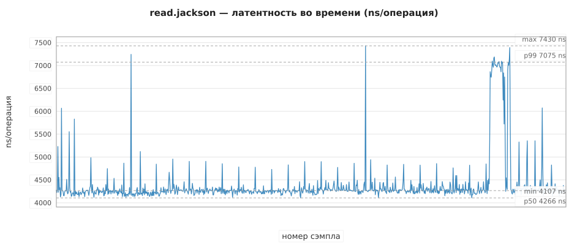
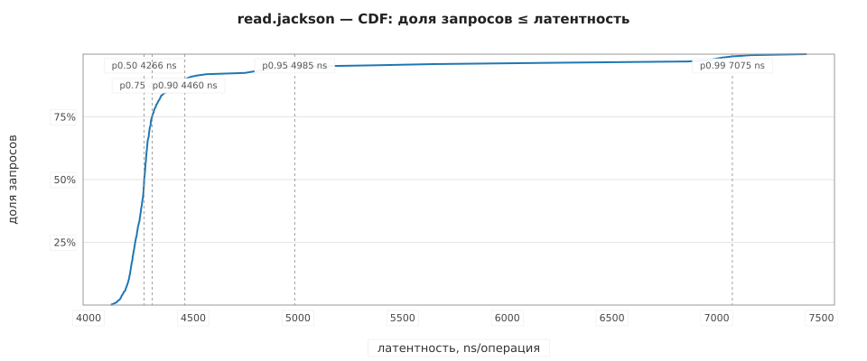
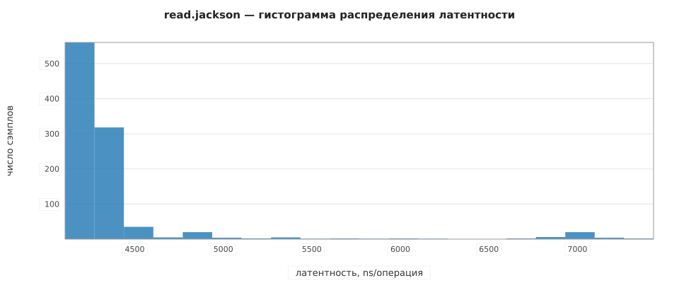

#### **kotlinx.serialization** — read.kotlinx

**Фазы (8e, 8f):**

| Фаза | Сэмплов | Операций в сэмпле | Операций всего | Время, мс |
|---|---|---|---|---|
| warmup | 5000 | 256 | 1280000 | `4645.0` |
| settle | 200 | 256 | 51200 | `145.4` |
| measure | 990 | 256 | 253440 | `693.8` |
| teardown | 250 | 256 | 64000 | `179.3` |
| **итого** | | | **1648640** | |

**Статистика (8d), ns/операция; throughput ≈ `372,654` ops/s:**

| Метрика | Значение |
|---|---|
| сэмплов | 990 |
| mean | `2683.5` ns |
| stdev | `92.7` ns |
| min | `2559.7` ns |
| max | `3790.6` ns |
| **p50 (медиана)** | **`2659.8` ns** (net: `2655.6` ns) |
| p75 | `2712.2` ns |
| p90 | `2733.3` ns |
| p95 | `2802.8` ns |
| p99 | `3154.8` ns |

**Перцентили (8b/8d):**

| Перцентиль | Латентность, ns |
|---|---|
| p0.100 | `2618.1` |
| p0.250 | `2631.8` |
| p0.500 | `2659.8` |
| p0.750 | `2712.2` |
| p0.900 | `2733.3` |
| p0.950 | `2802.8` |
| p0.990 | `3154.8` |
| p0.999 | `3790.6` |

**Графики:**

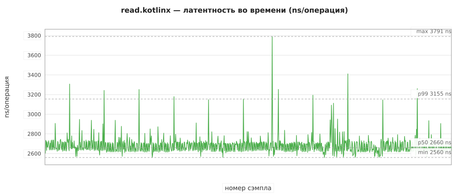
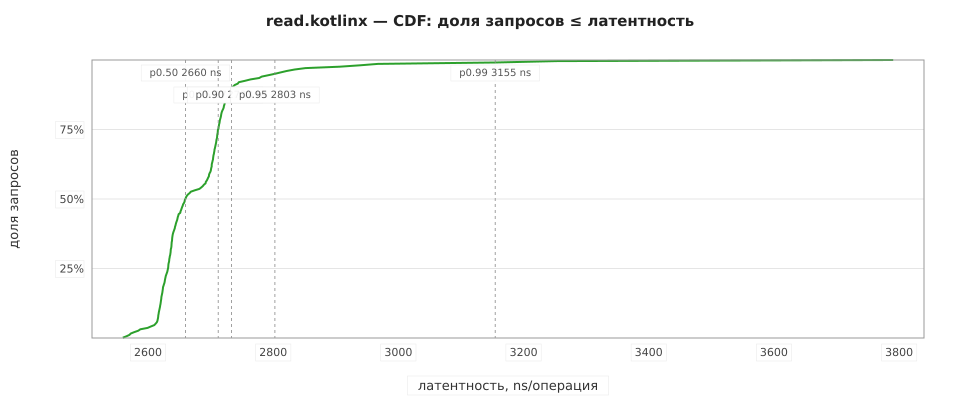
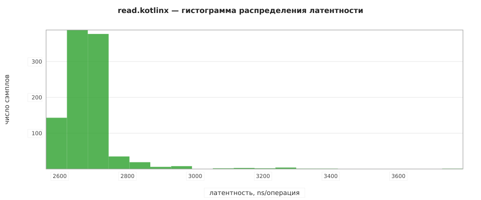

**Оба метода на одном графике (наложение):**

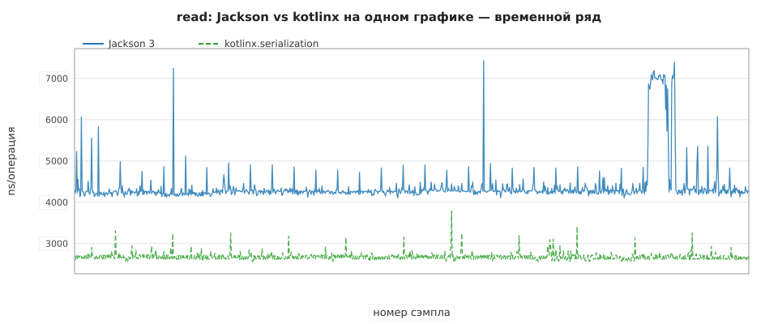
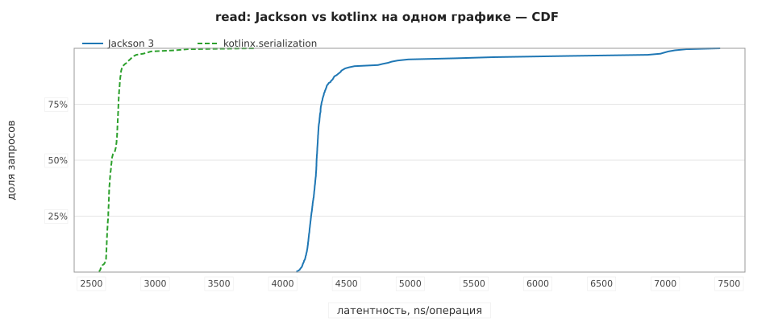
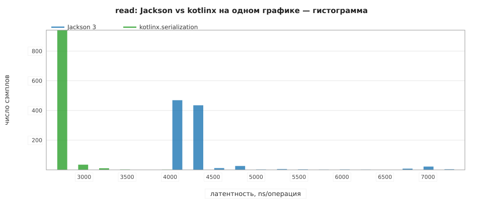

### write — запись (serialize)

**Все метрики обоих методов (латентность, ns/операция):**

| Метрика | Jackson 3 | kotlinx.serialization | Δ, % |
|---|---|---|---|
| min | `1228.9` | `1235.3` | `0.5%` |
| **p50 (медиана)** | **`1293.7`** | **`1294.6`** | `0.1%` |
| p75 | `1360.9` | `1344.2` | `-1.2%` |
| p90 | `1456.2` | `1369.0` | `-6.0%` |
| p95 | `1522.8` | `1378.4` | `-9.5%` |
| p99 | `13234.9` | `1495.0` | `-88.7%` |
| max | `13380.6` | `2372.9` | `-82.3%` |
| mean | `1501.1` | `1315.5` | `-12.4%` |
| stdev | `1376.9` | `79.9` | `-94.2%` |
| net median (минус overhead) | `1289.5` | `1290.4` | `0.1%` |
| throughput, ops/s | `666,181` | `760,163` | |

#### **Jackson 3** — write.jackson

**Фазы (8e, 8f):**

| Фаза | Сэмплов | Операций в сэмпле | Операций всего | Время, мс |
|---|---|---|---|---|
| warmup | 5000 | 256 | 1280000 | `3013.1` |
| settle | 200 | 256 | 51200 | `68.5` |
| measure | 990 | 256 | 253440 | `394.2` |
| teardown | 250 | 256 | 64000 | `85.1` |
| **итого** | | | **1648640** | |

**Статистика (8d), ns/операция; throughput ≈ `666,181` ops/s:**

| Метрика | Значение |
|---|---|
| сэмплов | 990 |
| mean | `1501.1` ns |
| stdev | `1376.9` ns |
| min | `1228.9` ns |
| max | `13380.6` ns |
| **p50 (медиана)** | **`1293.7` ns** (net: `1289.5` ns) |
| p75 | `1360.9` ns |
| p90 | `1456.2` ns |
| p95 | `1522.8` ns |
| p99 | `13234.9` ns |

**Перцентили (8b/8d):**

| Перцентиль | Латентность, ns |
|---|---|
| p0.100 | `1269.0` |
| p0.250 | `1278.8` |
| p0.500 | `1293.7` |
| p0.750 | `1360.9` |
| p0.900 | `1456.2` |
| p0.950 | `1522.8` |
| p0.990 | `13234.9` |
| p0.999 | `13380.6` |

**Графики:**

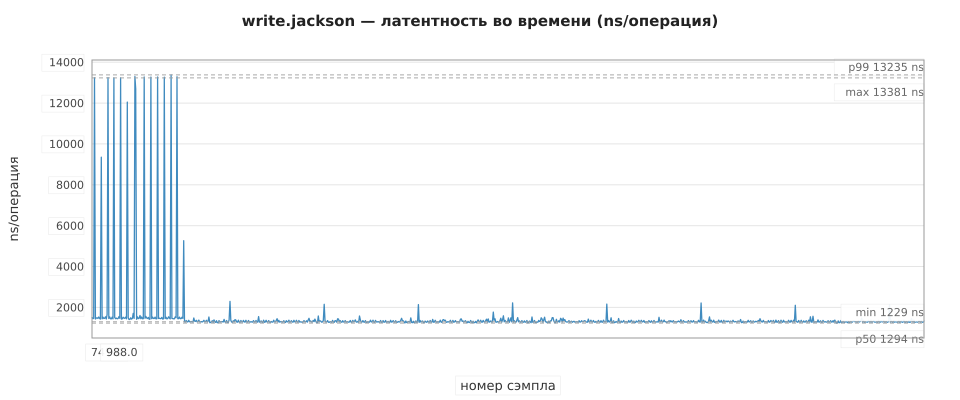
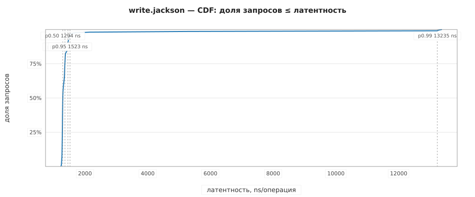
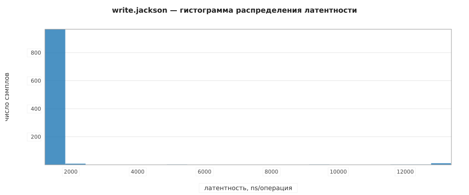

#### **kotlinx.serialization** — write.kotlinx

**Фазы (8e, 8f):**

| Фаза | Сэмплов | Операций в сэмпле | Операций всего | Время, мс |
|---|---|---|---|---|
| warmup | 5000 | 256 | 1280000 | `2405.9` |
| settle | 200 | 256 | 51200 | `67.9` |
| measure | 990 | 256 | 253440 | `336.9` |
| teardown | 250 | 256 | 64000 | `84.1` |
| **итого** | | | **1648640** | |

**Статистика (8d), ns/операция; throughput ≈ `760,163` ops/s:**

| Метрика | Значение |
|---|---|
| сэмплов | 990 |
| mean | `1315.5` ns |
| stdev | `79.9` ns |
| min | `1235.3` ns |
| max | `2372.9` ns |
| **p50 (медиана)** | **`1294.6` ns** (net: `1290.4` ns) |
| p75 | `1344.2` ns |
| p90 | `1369.0` ns |
| p95 | `1378.4` ns |
| p99 | `1495.0` ns |

**Перцентили (8b/8d):**

| Перцентиль | Латентность, ns |
|---|---|
| p0.100 | `1270.6` |
| p0.250 | `1280.3` |
| p0.500 | `1294.6` |
| p0.750 | `1344.2` |
| p0.900 | `1369.0` |
| p0.950 | `1378.4` |
| p0.990 | `1495.0` |
| p0.999 | `2372.9` |

**Графики:**

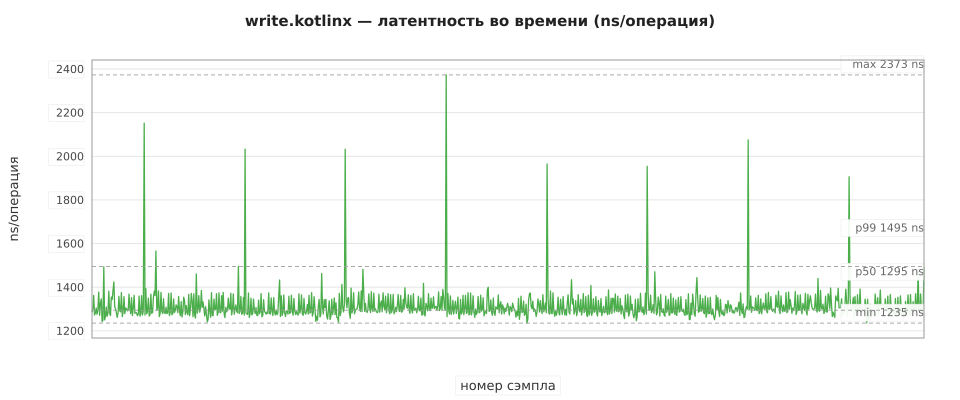
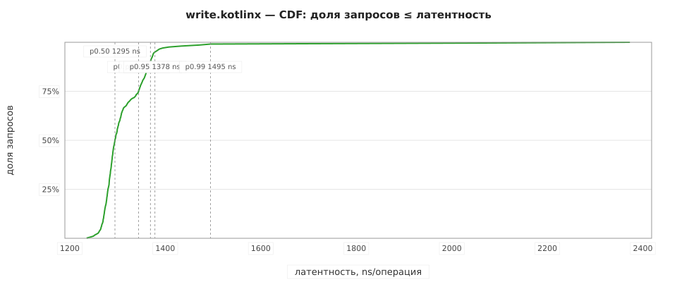
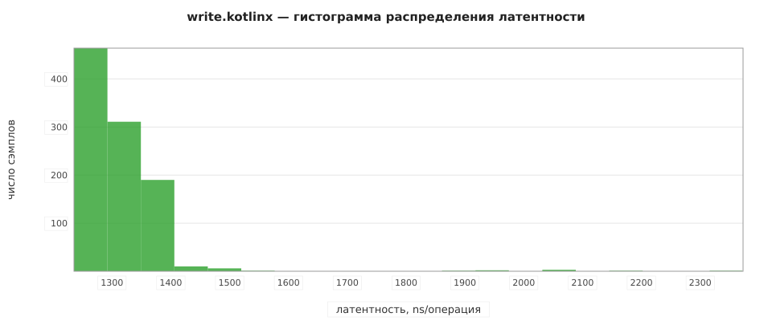

**Оба метода на одном графике (наложение):**

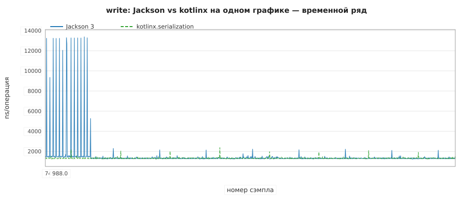
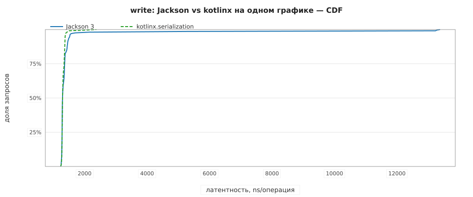
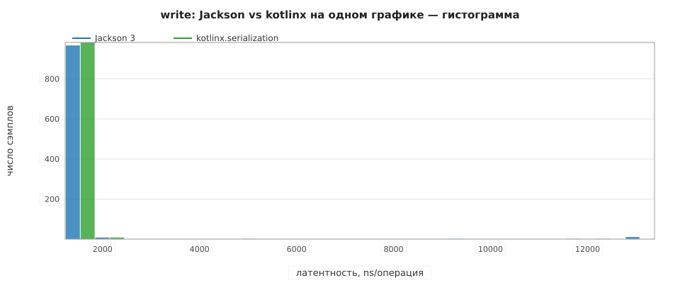

### mixed — одновременные чтение + запись (2 потока)

**Все метрики обоих методов (латентность, ns/операция):**

| Метрика | Jackson 3 | kotlinx.serialization | Δ, % |
|---|---|---|---|
| min | `1945.5` | `1943.6` | `-0.1%` |
| **p50 (медиана)** | **`2045.3`** | **`2022.2`** | `-1.1%` |
| p75 | `2244.4` | `2040.2` | `-9.1%` |
| p90 | `2393.9` | `2057.3` | `-14.1%` |
| p95 | `2881.4` | `2080.4` | `-27.8%` |
| p99 | `9248.0` | `2592.3` | `-72.0%` |
| max | `15859.7` | `7964.9` | `-49.8%` |
| mean | `2342.4` | `2040.7` | `-12.9%` |
| stdev | `1213.3` | `213.9` | `-82.4%` |
| net median (минус overhead) | `2002.5` | `1979.4` | `-1.2%` |
| throughput, ops/s | `426,904` | `490,024` | |

#### **Jackson 3** — mixed.jackson

**Фазы (8e, 8f):**

| Фаза | Сэмплов | Операций в сэмпле | Операций всего | Время, мс |
|---|---|---|---|---|
| warmup | 5000 | 512 | 2560000 | `8584.6` |
| settle | 200 | 512 | 102400 | `239.0` |
| measure | 990 | 512 | 506880 | `1200.5` |
| teardown | 250 | 512 | 128000 | `258.1` |
| **итого** | | | **3297280** | |

**Статистика (8d), ns/операция; throughput ≈ `426,904` ops/s:**

| Метрика | Значение |
|---|---|
| сэмплов | 990 |
| mean | `2342.4` ns |
| stdev | `1213.3` ns |
| min | `1945.5` ns |
| max | `15859.7` ns |
| **p50 (медиана)** | **`2045.3` ns** (net: `2002.5` ns) |
| p75 | `2244.4` ns |
| p90 | `2393.9` ns |
| p95 | `2881.4` ns |
| p99 | `9248.0` ns |

**Перцентили (8b/8d):**

| Перцентиль | Латентность, ns |
|---|---|
| p0.100 | `1978.5` |
| p0.250 | `1995.9` |
| p0.500 | `2045.3` |
| p0.750 | `2244.4` |
| p0.900 | `2393.9` |
| p0.950 | `2881.4` |
| p0.990 | `9248.0` |
| p0.999 | `15859.7` |

**Графики:**

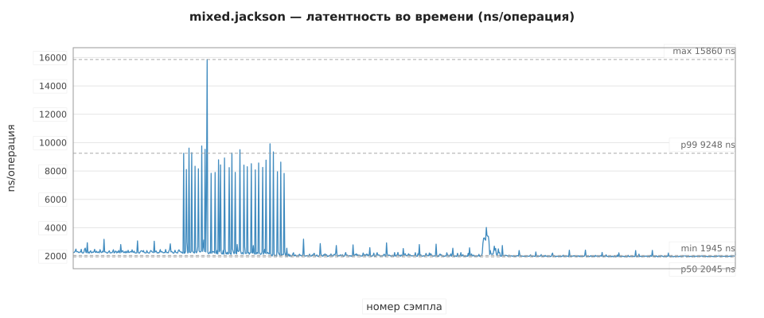
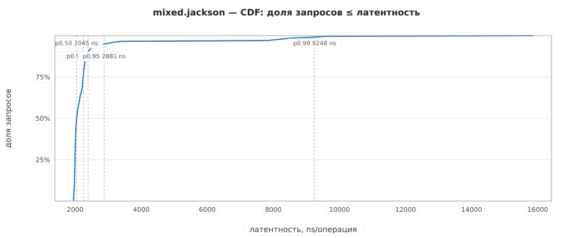
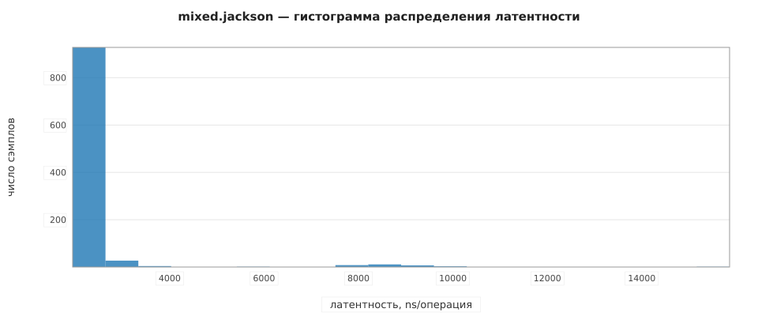

#### **kotlinx.serialization** — mixed.kotlinx

**Фазы (8e, 8f):**

| Фаза | Сэмплов | Операций в сэмпле | Операций всего | Время, мс |
|---|---|---|---|---|
| warmup | 5000 | 512 | 2560000 | `5332.0` |
| settle | 200 | 512 | 102400 | `237.9` |
| measure | 990 | 512 | 506880 | `1045.1` |
| teardown | 250 | 512 | 128000 | `261.2` |
| **итого** | | | **3297280** | |

**Статистика (8d), ns/операция; throughput ≈ `490,024` ops/s:**

| Метрика | Значение |
|---|---|
| сэмплов | 990 |
| mean | `2040.7` ns |
| stdev | `213.9` ns |
| min | `1943.6` ns |
| max | `7964.9` ns |
| **p50 (медиана)** | **`2022.2` ns** (net: `1979.4` ns) |
| p75 | `2040.2` ns |
| p90 | `2057.3` ns |
| p95 | `2080.4` ns |
| p99 | `2592.3` ns |

**Перцентили (8b/8d):**

| Перцентиль | Латентность, ns |
|---|---|
| p0.100 | `1988.4` |
| p0.250 | `2000.5` |
| p0.500 | `2022.2` |
| p0.750 | `2040.2` |
| p0.900 | `2057.3` |
| p0.950 | `2080.4` |
| p0.990 | `2592.3` |
| p0.999 | `7964.9` |

**Графики:**

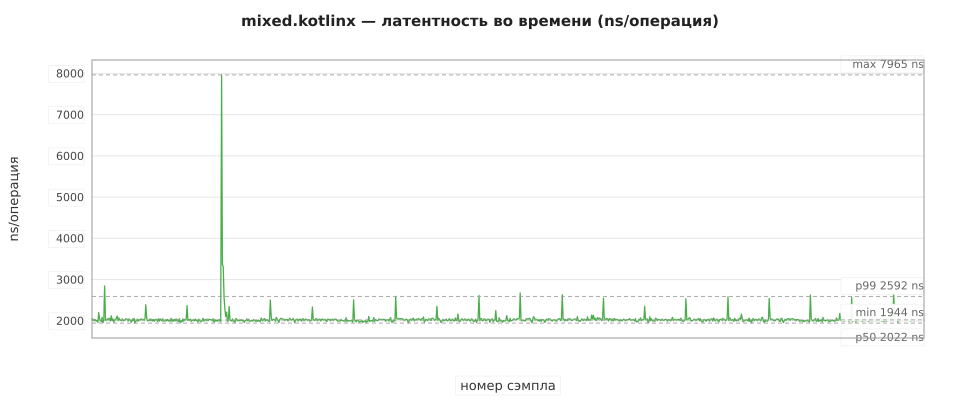
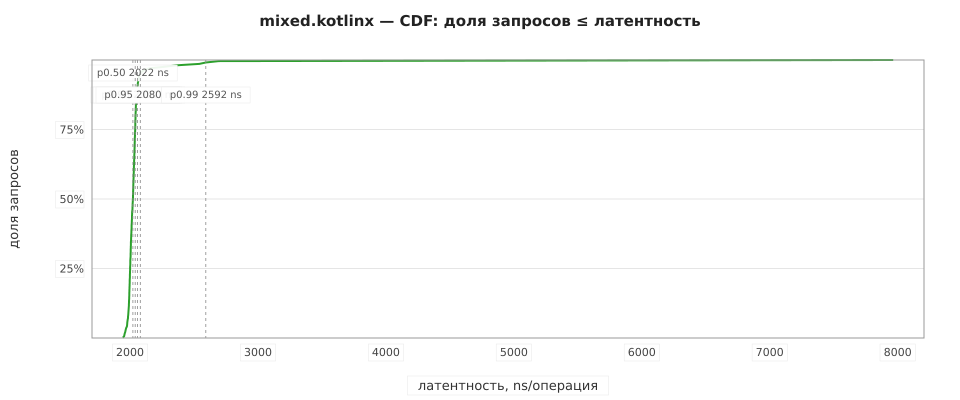
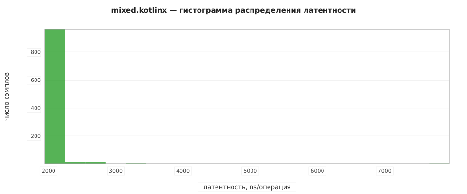

**Оба метода на одном графике (наложение):**

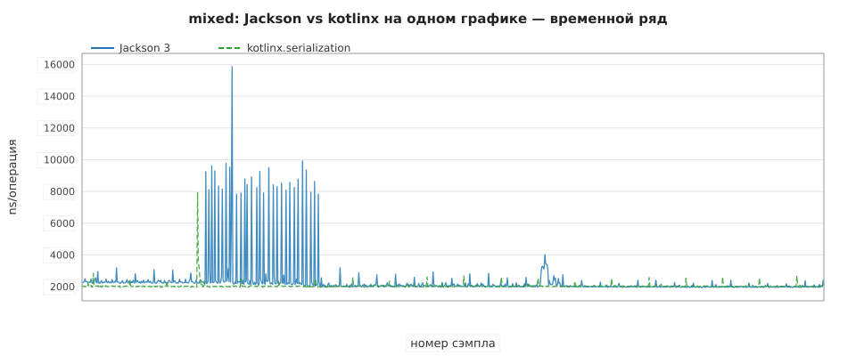
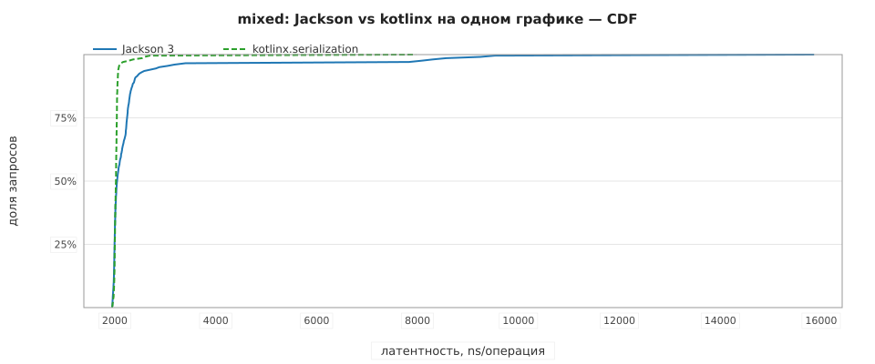
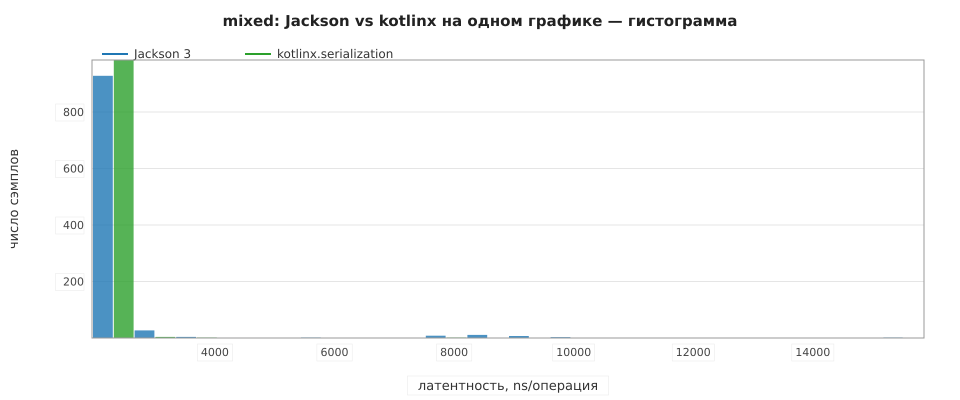

## 5. Сводная таблица сравнения (Jackson 3 vs kotlinx.serialization)

| Сценарий | Медиана Jackson, ns | Медиана kotlinx, ns | Δ median | Δ mean | Δ p99 | Быстрее |
|---|---|---|---|---|---|---|
| mixed | `2045.3` | `2022.2` | `-1.1%` | `-12.9%` | `-72.0%` | **kotlinx.serialization** |
| read | `4265.6` | `2659.8` | `-37.6%` | `-39.0%` | `-55.4%` | **kotlinx.serialization** |
| write | `1293.7` | `1294.6` | `0.1%` | `-12.4%` | `-88.7%` | **Jackson 3** |

> Δ = (kotlinx − Jackson) / Jackson × 100%. Отрицательное значение — kotlinx быстрее.

## 5.1 Перцентили p50 и p99: столбчатое сравнение библиотек

> Три группы столбцов — read / write / mixed; в каждой два столбца: Jackson (синий) и kotlinx (зелёный).

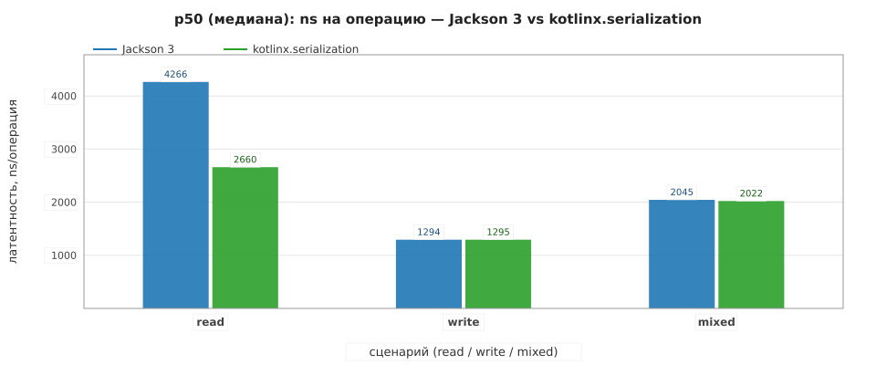

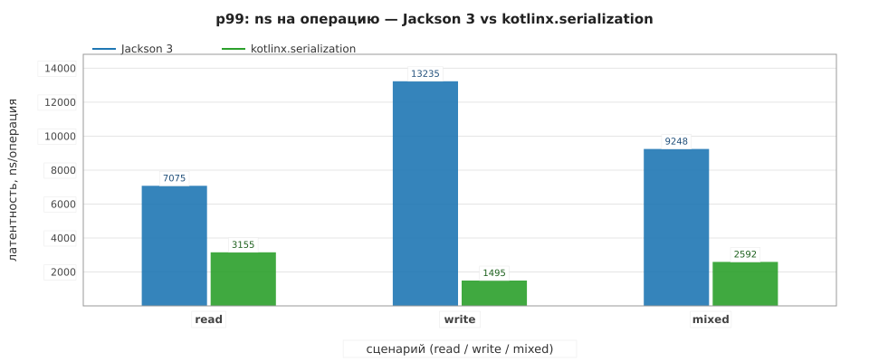

## 6. «Сырые» сэмплы

Каждый кейс: `raw/<case>.csv` (колонки `sample,ns_per_op`). Полные данные — `report.json`.

