# ЛР3: микробенчмарк — Jackson 3 vs kotlinx.serialization (vidayapi)

> Сгенерировано автоматически: `2026-10-23T07:08:19.320969908Z`.

## 1. Окружение прогона (воспроизводимость, Требование 6)

| Параметр | Значение |
|---|---|
| `availableProcessors` | `1` |
| `container` | `docker` |
| `cpuModel` | `AMD Ryzen 5 6600HS Creator Edition` |
| `cpusAllowedList` | `0` |
| `java.vendor` | `Eclipse Adoptium` |
| `java.version` | `17.0.20.1` |
| `jvm.name` | `OpenJDK 64-Bit Server VM` |
| `os.arch` | `amd64` |
| `os.name` | `Linux` |
| `os.version` | `7.0.0-38-generic` |
| `timestamp` | `2026-10-23T06:57:07.469445078Z` |

## 2. Конфигурация прогона (Требования 1, 2)

| Параметр | Значение |
|---|---|
| испытаний (samples) | 1000 (≥100 — Требование 1) |
| warmup-сэмплов | 5000 (Требование 2) |
| settle-сэмплов (стабилизация; отбрасываются) | 200 |
| первых сэмплов measure удалено (drop; фиксируется в отчёте) | 10 |
| teardown-сэмплов | 250 (Требование 2) |
| операций в сэмпле (batch) | 256 |
| пар read+write в сэмпле mixed | 256 |

## 3. Overhead инструмента (Требование 7)

| Режим | Overhead, нс/операция |
|---|---|
| простой сценарий (2×nanoTime + цикл + Blackhole) / batch | `5.516` |
| смешанный сценарий (2 потока + диспетчеризация) / 2×pairs | `29.078` |

> Целевой ориентир задания — не более 4–5 нс; батч-измерение даёт sub-ns overhead. «Сырые» значения в таблицах включают overhead; столбец «net median» = median − overhead.

## 4. Сравнение по сценариям: таблицы и графики обоих методов

> Для каждого сценария: сводная таблица «метрика × метод», детальные таблицы
> и графики обоих методов. Δ = (kotlinx − Jackson) / Jackson × 100%; отрицательная — kotlinx быстрее.
> Фаза **settle** (между warmup и measure) отбрасывается: первые сэмплы после прогрева
> (ленивая инициализация, JIT, GC-паузы) не входят в статистику и графики.
> Дополнительно из фазы measure удалено **10** первых сэмплов
> («стартовый переходный процесс»); это справочно отражено в конфигурации.

### Модель x1 (10 полей)

#### read — чтение (deserialize)

**Все метрики обоих методов (латентность, ns/операция):**

| Метрика | Jackson 3 | kotlinx.serialization | Δ, % |
|---|---|---|---|
| min | `3792.0` | `2472.2` | `-34.8%` |
| **p50 (медиана)** | **`3942.2`** | **`2579.4`** | `-34.6%` |
| p75 | `3981.4` | `2639.0` | `-33.7%` |
| p90 | `4098.6` | `2663.3` | `-35.0%` |
| p95 | `4292.2` | `2731.1` | `-36.4%` |
| p99 | `4840.2` | `3188.8` | `-34.1%` |
| max | `5791.6` | `3470.9` | `-40.1%` |
| mean | `3982.7` | `2600.7` | `-34.7%` |
| stdev | `185.2` | `106.7` | `-42.4%` |
| net median (минус overhead) | `3936.7` | `2573.8` | `-34.6%` |
| throughput, ops/s | `251,084` | `384,510` | |

#### **Jackson 3** — read.jackson.x1

**Фазы (8e, 8f):**

| Фаза | Сэмплов | Операций в сэмпле | Операций всего | Время, мс |
|---|---|---|---|---|
| warmup | 5000 | 256 | 1280000 | `7164.8` |
| settle | 200 | 256 | 51200 | `213.7` |
| measure | 990 | 256 | 253440 | `1022.2` |
| teardown | 250 | 256 | 64000 | `255.9` |
| **итого** | | | **1648640** | |

**Статистика (8d), ns/операция; throughput ≈ `251,084` ops/s:**

| Метрика | Значение |
|---|---|
| сэмплов | 990 |
| mean | `3982.7` ns |
| stdev | `185.2` ns |
| min | `3792.0` ns |
| max | `5791.6` ns |
| **p50 (медиана)** | **`3942.2` ns** (net: `3936.7` ns) |
| p75 | `3981.4` ns |
| p90 | `4098.6` ns |
| p95 | `4292.2` ns |
| p99 | `4840.2` ns |

**Перцентили (8b/8d):**

| Перцентиль | Латентность, ns |
|---|---|
| p0.100 | `3868.9` |
| p0.250 | `3899.0` |
| p0.500 | `3942.2` |
| p0.750 | `3981.4` |
| p0.900 | `4098.6` |
| p0.950 | `4292.2` |
| p0.990 | `4840.2` |
| p0.999 | `5791.6` |

**Графики:**

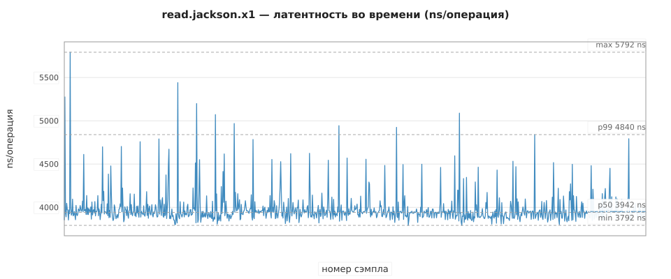
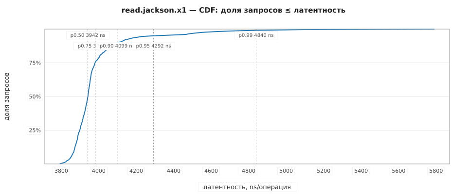
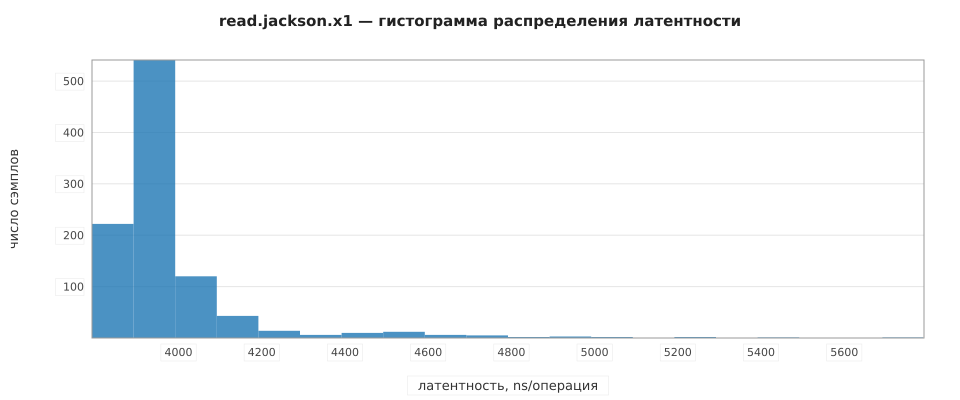

#### **kotlinx.serialization** — read.kotlinx.x1

**Фазы (8e, 8f):**

| Фаза | Сэмплов | Операций в сэмпле | Операций всего | Время, мс |
|---|---|---|---|---|
| warmup | 5000 | 256 | 1280000 | `4074.8` |
| settle | 200 | 256 | 51200 | `146.1` |
| measure | 990 | 256 | 253440 | `673.7` |
| teardown | 250 | 256 | 64000 | `173.9` |
| **итого** | | | **1648640** | |

**Статистика (8d), ns/операция; throughput ≈ `384,510` ops/s:**

| Метрика | Значение |
|---|---|
| сэмплов | 990 |
| mean | `2600.7` ns |
| stdev | `106.7` ns |
| min | `2472.2` ns |
| max | `3470.9` ns |
| **p50 (медиана)** | **`2579.4` ns** (net: `2573.8` ns) |
| p75 | `2639.0` ns |
| p90 | `2663.3` ns |
| p95 | `2731.1` ns |
| p99 | `3188.8` ns |

**Перцентили (8b/8d):**

| Перцентиль | Латентность, ns |
|---|---|
| p0.100 | `2515.9` |
| p0.250 | `2536.3` |
| p0.500 | `2579.4` |
| p0.750 | `2639.0` |
| p0.900 | `2663.3` |
| p0.950 | `2731.1` |
| p0.990 | `3188.8` |
| p0.999 | `3470.9` |

**Графики:**

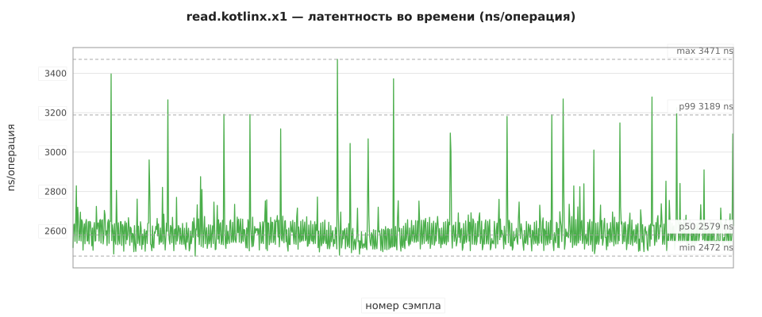
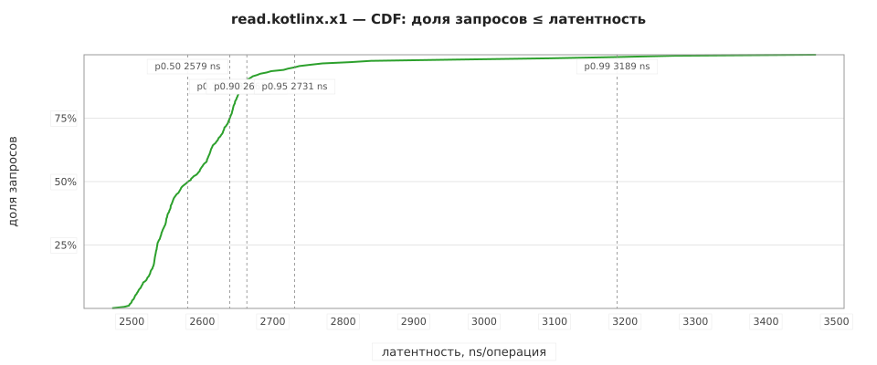
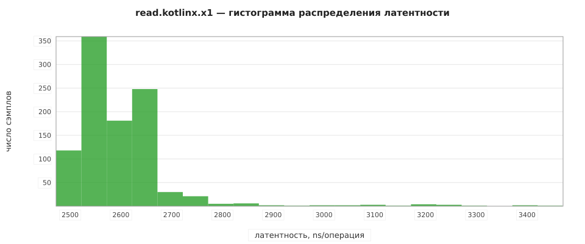

**Оба метода на одном графике (наложение):**

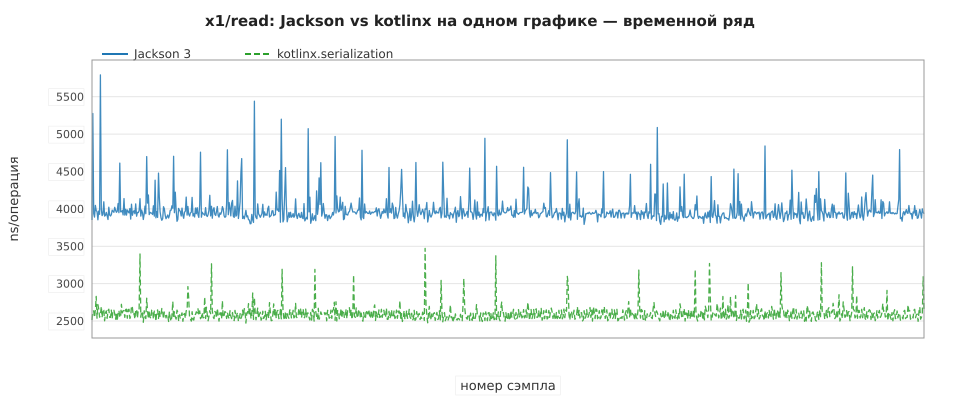
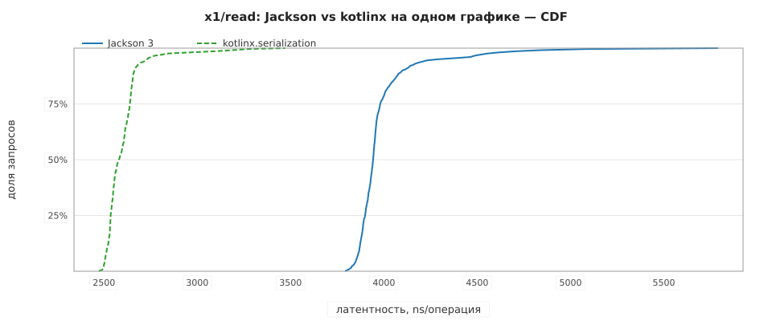
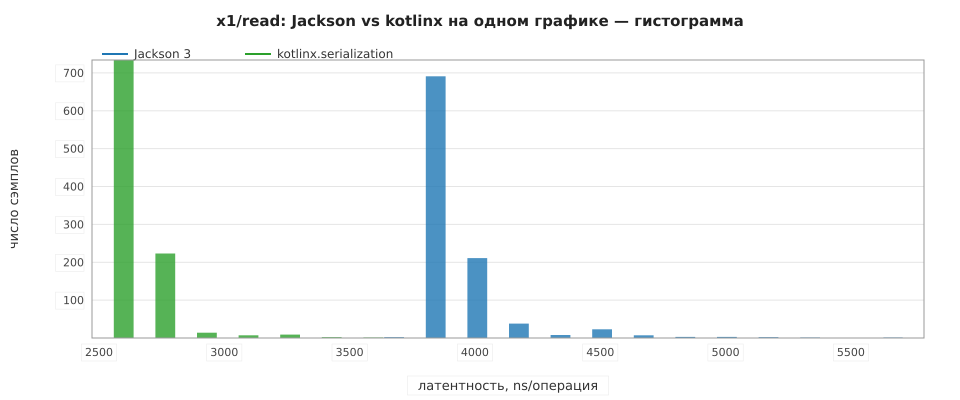

#### write — запись (serialize)

**Все метрики обоих методов (латентность, ns/операция):**

| Метрика | Jackson 3 | kotlinx.serialization | Δ, % |
|---|---|---|---|
| min | `1352.6` | `1326.6` | `-1.9%` |
| **p50 (медиана)** | **`1413.7`** | **`1381.7`** | `-2.3%` |
| p75 | `1487.8` | `1451.2` | `-2.5%` |
| p90 | `1523.6` | `1494.0` | `-1.9%` |
| p95 | `1604.2` | `1561.6` | `-2.7%` |
| p99 | `2111.3` | `2155.7` | `2.1%` |
| max | `2318.5` | `2671.6` | `15.2%` |
| mean | `1453.6` | `1419.9` | `-2.3%` |
| stdev | `112.8` | `120.7` | `6.9%` |
| net median (минус overhead) | `1408.2` | `1376.2` | `-2.3%` |
| throughput, ops/s | `687,935` | `704,279` | |

#### **Jackson 3** — write.jackson.x1

**Фазы (8e, 8f):**

| Фаза | Сэмплов | Операций в сэмпле | Операций всего | Время, мс |
|---|---|---|---|---|
| warmup | 5000 | 256 | 1280000 | `3173.4` |
| settle | 200 | 256 | 51200 | `75.3` |
| measure | 990 | 256 | 253440 | `373.0` |
| teardown | 250 | 256 | 64000 | `94.2` |
| **итого** | | | **1648640** | |

**Статистика (8d), ns/операция; throughput ≈ `687,935` ops/s:**

| Метрика | Значение |
|---|---|
| сэмплов | 990 |
| mean | `1453.6` ns |
| stdev | `112.8` ns |
| min | `1352.6` ns |
| max | `2318.5` ns |
| **p50 (медиана)** | **`1413.7` ns** (net: `1408.2` ns) |
| p75 | `1487.8` ns |
| p90 | `1523.6` ns |
| p95 | `1604.2` ns |
| p99 | `2111.3` ns |

**Перцентили (8b/8d):**

| Перцентиль | Латентность, ns |
|---|---|
| p0.100 | `1388.1` |
| p0.250 | `1398.6` |
| p0.500 | `1413.7` |
| p0.750 | `1487.8` |
| p0.900 | `1523.6` |
| p0.950 | `1604.2` |
| p0.990 | `2111.3` |
| p0.999 | `2318.5` |

**Графики:**

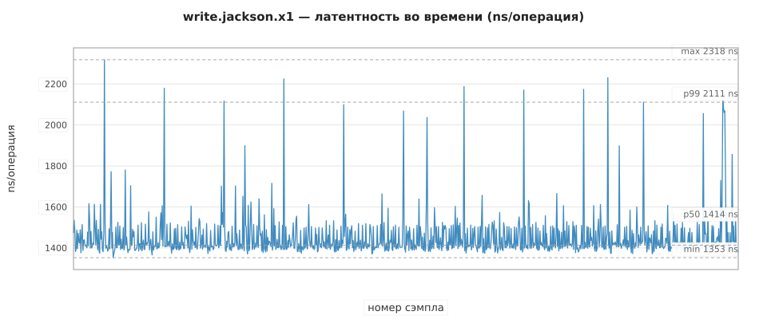
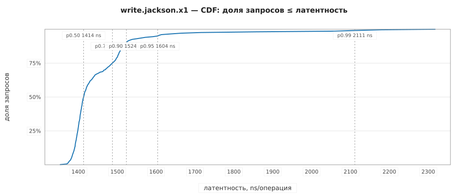
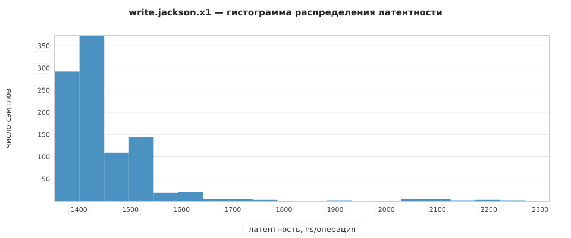

#### **kotlinx.serialization** — write.kotlinx.x1

**Фазы (8e, 8f):**

| Фаза | Сэмплов | Операций в сэмпле | Операций всего | Время, мс |
|---|---|---|---|---|
| warmup | 5000 | 256 | 1280000 | `2329.7` |
| settle | 200 | 256 | 51200 | `73.2` |
| measure | 990 | 256 | 253440 | `363.7` |
| teardown | 250 | 256 | 64000 | `90.6` |
| **итого** | | | **1648640** | |

**Статистика (8d), ns/операция; throughput ≈ `704,279` ops/s:**

| Метрика | Значение |
|---|---|
| сэмплов | 990 |
| mean | `1419.9` ns |
| stdev | `120.7` ns |
| min | `1326.6` ns |
| max | `2671.6` ns |
| **p50 (медиана)** | **`1381.7` ns** (net: `1376.2` ns) |
| p75 | `1451.2` ns |
| p90 | `1494.0` ns |
| p95 | `1561.6` ns |
| p99 | `2155.7` ns |

**Перцентили (8b/8d):**

| Перцентиль | Латентность, ns |
|---|---|
| p0.100 | `1350.0` |
| p0.250 | `1362.8` |
| p0.500 | `1381.7` |
| p0.750 | `1451.2` |
| p0.900 | `1494.0` |
| p0.950 | `1561.6` |
| p0.990 | `2155.7` |
| p0.999 | `2671.6` |

**Графики:**

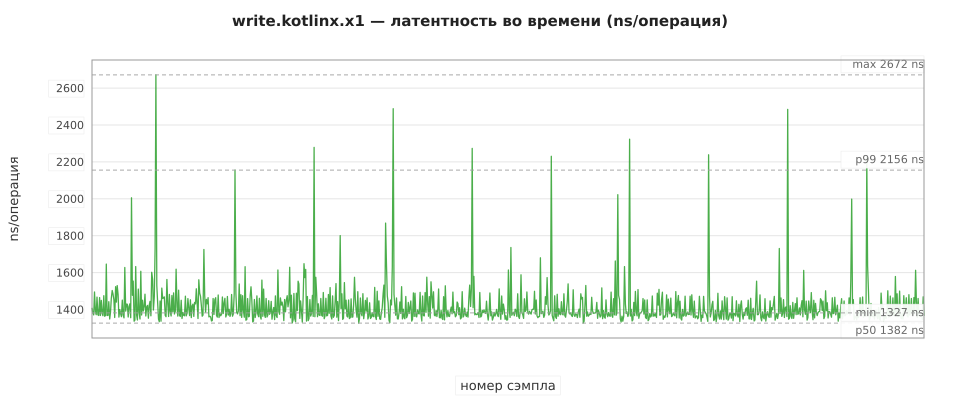
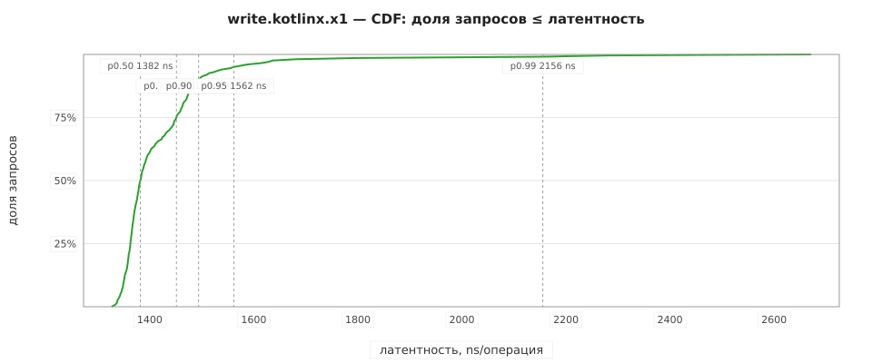
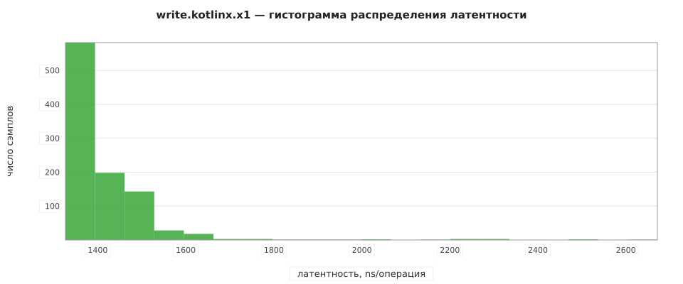

**Оба метода на одном графике (наложение):**

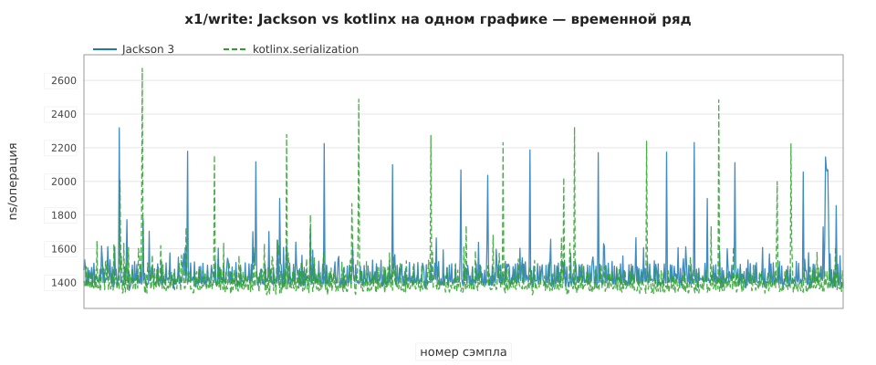
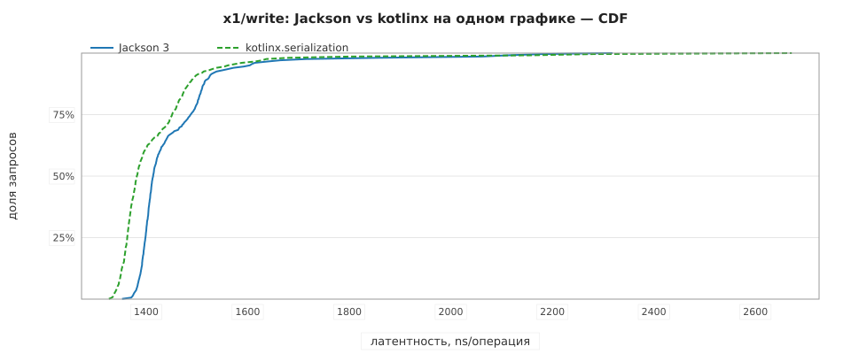
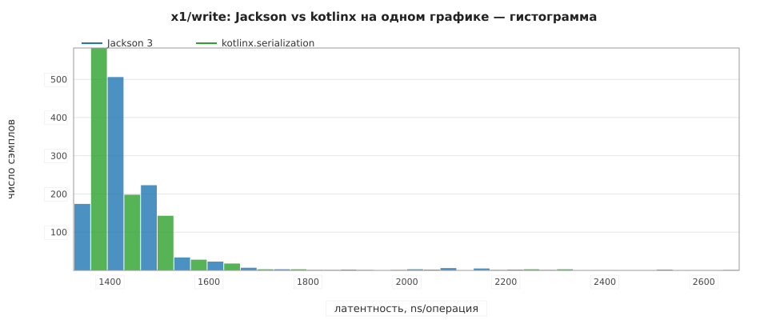

#### mixed — одновременные чтение + запись (2 потока)

**Все метрики обоих методов (латентность, ns/операция):**

| Метрика | Jackson 3 | kotlinx.serialization | Δ, % |
|---|---|---|---|
| min | `2735.3` | `1964.2` | `-28.2%` |
| **p50 (медиана)** | **`2837.3`** | **`2044.9`** | `-27.9%` |
| p75 | `2884.5` | `2069.1` | `-28.3%` |
| p90 | `2992.1` | `2126.3` | `-28.9%` |
| p95 | `3202.6` | `2188.5` | `-31.7%` |
| p99 | `3451.2` | `2645.7` | `-23.3%` |
| max | `3748.1` | `3039.3` | `-18.9%` |
| mean | `2877.9` | `2067.4` | `-28.2%` |
| stdev | `134.6` | `108.5` | `-19.4%` |
| net median (минус overhead) | `2808.2` | `2015.8` | `-28.2%` |
| throughput, ops/s | `347,475` | `483,710` | |

#### **Jackson 3** — mixed.jackson.x1

**Фазы (8e, 8f):**

| Фаза | Сэмплов | Операций в сэмпле | Операций всего | Время, мс |
|---|---|---|---|---|
| warmup | 5000 | 512 | 2560000 | `8586.9` |
| settle | 200 | 512 | 102400 | `295.3` |
| measure | 990 | 512 | 506880 | `1473.9` |
| teardown | 250 | 512 | 128000 | `457.0` |
| **итого** | | | **3297280** | |

**Статистика (8d), ns/операция; throughput ≈ `347,475` ops/s:**

| Метрика | Значение |
|---|---|
| сэмплов | 990 |
| mean | `2877.9` ns |
| stdev | `134.6` ns |
| min | `2735.3` ns |
| max | `3748.1` ns |
| **p50 (медиана)** | **`2837.3` ns** (net: `2808.2` ns) |
| p75 | `2884.5` ns |
| p90 | `2992.1` ns |
| p95 | `3202.6` ns |
| p99 | `3451.2` ns |

**Перцентили (8b/8d):**

| Перцентиль | Латентность, ns |
|---|---|
| p0.100 | `2788.9` |
| p0.250 | `2811.9` |
| p0.500 | `2837.3` |
| p0.750 | `2884.5` |
| p0.900 | `2992.1` |
| p0.950 | `3202.6` |
| p0.990 | `3451.2` |
| p0.999 | `3748.1` |

**Графики:**

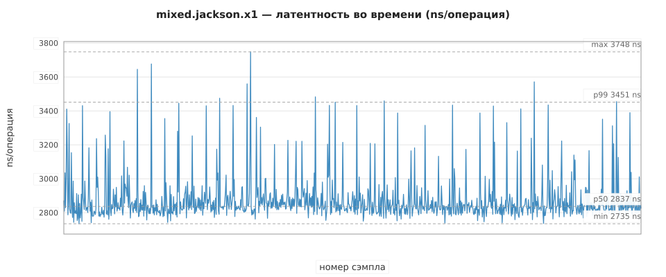
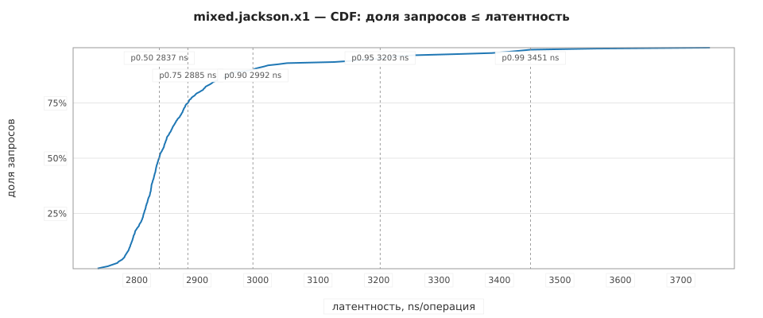
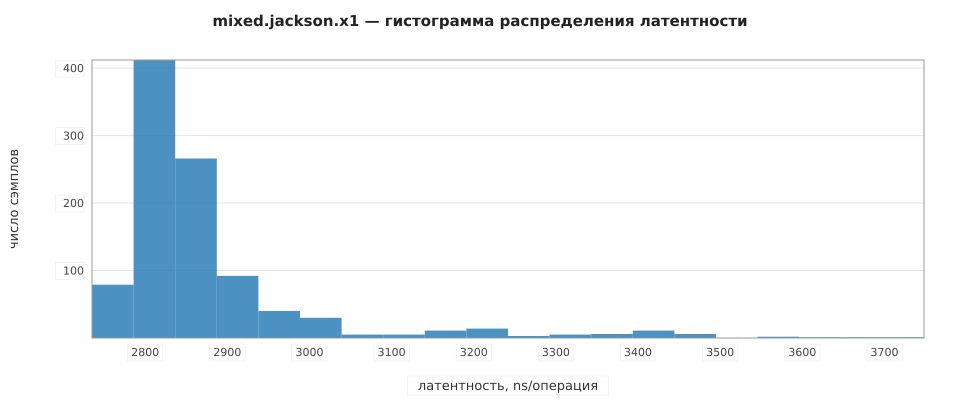

#### **kotlinx.serialization** — mixed.kotlinx.x1

**Фазы (8e, 8f):**

| Фаза | Сэмплов | Операций в сэмпле | Операций всего | Время, мс |
|---|---|---|---|---|
| warmup | 5000 | 512 | 2560000 | `5411.4` |
| settle | 200 | 512 | 102400 | `211.9` |
| measure | 990 | 512 | 506880 | `1058.7` |
| teardown | 250 | 512 | 128000 | `265.3` |
| **итого** | | | **3297280** | |

**Статистика (8d), ns/операция; throughput ≈ `483,710` ops/s:**

| Метрика | Значение |
|---|---|
| сэмплов | 990 |
| mean | `2067.4` ns |
| stdev | `108.5` ns |
| min | `1964.2` ns |
| max | `3039.3` ns |
| **p50 (медиана)** | **`2044.9` ns** (net: `2015.8` ns) |
| p75 | `2069.1` ns |
| p90 | `2126.3` ns |
| p95 | `2188.5` ns |
| p99 | `2645.7` ns |

**Перцентили (8b/8d):**

| Перцентиль | Латентность, ns |
|---|---|
| p0.100 | `2002.6` |
| p0.250 | `2021.4` |
| p0.500 | `2044.9` |
| p0.750 | `2069.1` |
| p0.900 | `2126.3` |
| p0.950 | `2188.5` |
| p0.990 | `2645.7` |
| p0.999 | `3039.3` |

**Графики:**

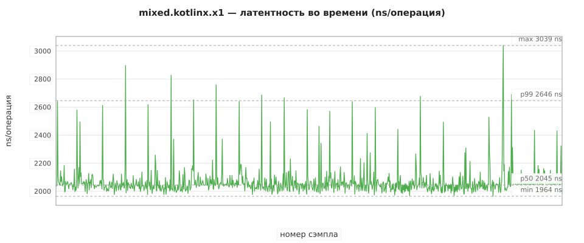
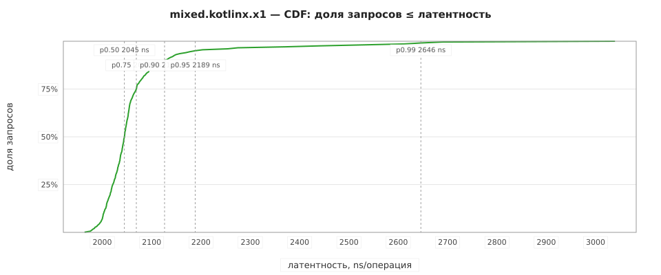
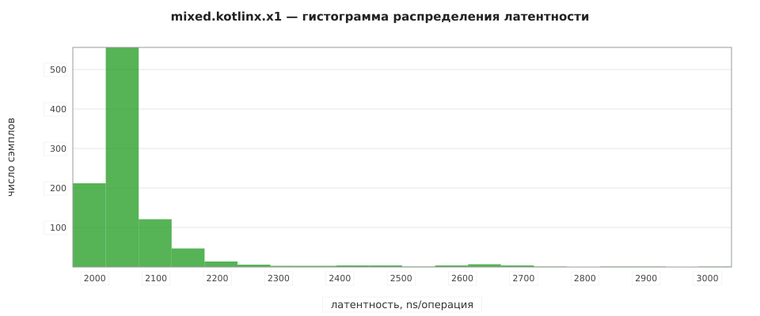

**Оба метода на одном графике (наложение):**

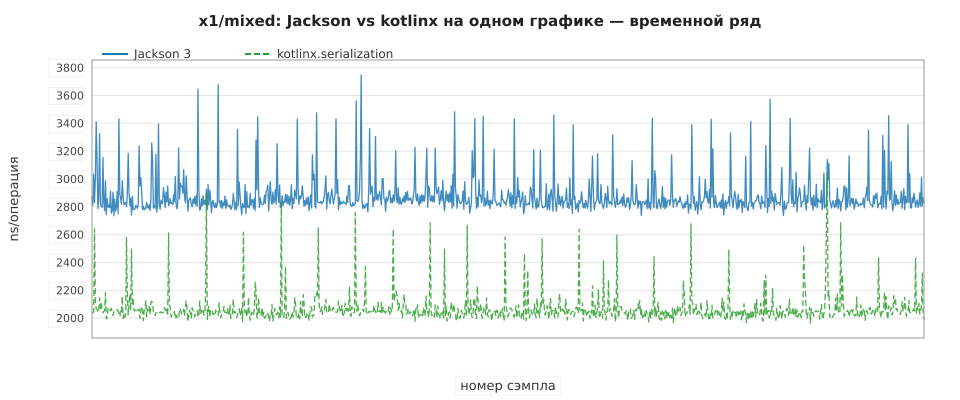
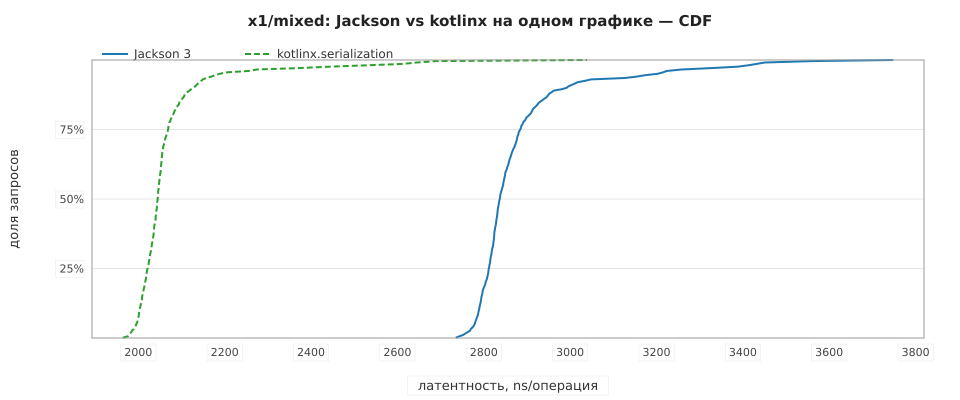
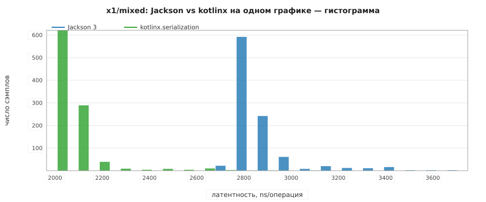

### Модель x4 (40 полей)

#### read — чтение (deserialize)

**Все метрики обоих методов (латентность, ns/операция):**

| Метрика | Jackson 3 | kotlinx.serialization | Δ, % |
|---|---|---|---|
| min | `14238.4` | `12800.5` | `-10.1%` |
| **p50 (медиана)** | **`14927.5`** | **`13322.9`** | `-10.7%` |
| p75 | `15250.0` | `13584.7` | `-10.9%` |
| p90 | `15742.1` | `14244.2` | `-9.5%` |
| p95 | `16103.0` | `14598.0` | `-9.3%` |
| p99 | `17325.5` | `15300.8` | `-11.7%` |
| max | `25695.1` | `21863.3` | `-14.9%` |
| mean | `15090.9` | `13481.4` | `-10.7%` |
| stdev | `679.1` | `576.7` | `-15.1%` |
| net median (минус overhead) | `14921.9` | `13317.4` | `-10.8%` |
| throughput, ops/s | `66,265` | `74,176` | |

#### **Jackson 3** — read.jackson.x4

**Фазы (8e, 8f):**

| Фаза | Сэмплов | Операций в сэмпле | Операций всего | Время, мс |
|---|---|---|---|---|
| warmup | 5000 | 256 | 1280000 | `20575.8` |
| settle | 200 | 256 | 51200 | `763.3` |
| measure | 990 | 256 | 253440 | `3863.9` |
| teardown | 250 | 256 | 64000 | `1004.7` |
| **итого** | | | **1648640** | |

**Статистика (8d), ns/операция; throughput ≈ `66,265` ops/s:**

| Метрика | Значение |
|---|---|
| сэмплов | 990 |
| mean | `15090.9` ns |
| stdev | `679.1` ns |
| min | `14238.4` ns |
| max | `25695.1` ns |
| **p50 (медиана)** | **`14927.5` ns** (net: `14921.9` ns) |
| p75 | `15250.0` ns |
| p90 | `15742.1` ns |
| p95 | `16103.0` ns |
| p99 | `17325.5` ns |

**Перцентили (8b/8d):**

| Перцентиль | Латентность, ns |
|---|---|
| p0.100 | `14600.9` |
| p0.250 | `14735.6` |
| p0.500 | `14927.5` |
| p0.750 | `15250.0` |
| p0.900 | `15742.1` |
| p0.950 | `16103.0` |
| p0.990 | `17325.5` |
| p0.999 | `25695.1` |

**Графики:**

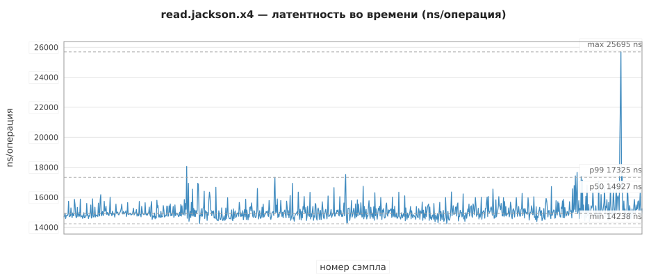
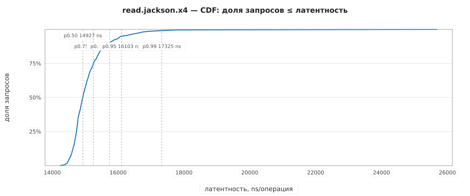
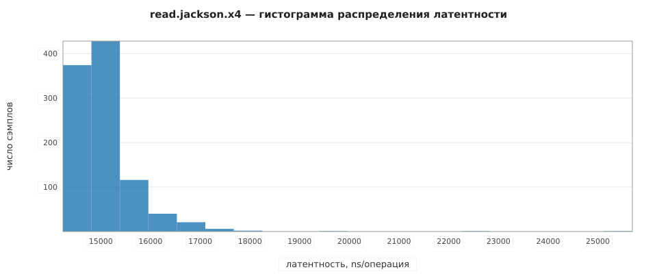

#### **kotlinx.serialization** — read.kotlinx.x4

**Фазы (8e, 8f):**

| Фаза | Сэмплов | Операций в сэмпле | Операций всего | Время, мс |
|---|---|---|---|---|
| warmup | 5000 | 256 | 1280000 | `18195.8` |
| settle | 200 | 256 | 51200 | `688.2` |
| measure | 990 | 256 | 253440 | `3453.5` |
| teardown | 250 | 256 | 64000 | `866.0` |
| **итого** | | | **1648640** | |

**Статистика (8d), ns/операция; throughput ≈ `74,176` ops/s:**

| Метрика | Значение |
|---|---|
| сэмплов | 990 |
| mean | `13481.4` ns |
| stdev | `576.7` ns |
| min | `12800.5` ns |
| max | `21863.3` ns |
| **p50 (медиана)** | **`13322.9` ns** (net: `13317.4` ns) |
| p75 | `13584.7` ns |
| p90 | `14244.2` ns |
| p95 | `14598.0` ns |
| p99 | `15300.8` ns |

**Перцентили (8b/8d):**

| Перцентиль | Латентность, ns |
|---|---|
| p0.100 | `13039.9` |
| p0.250 | `13152.6` |
| p0.500 | `13322.9` |
| p0.750 | `13584.7` |
| p0.900 | `14244.2` |
| p0.950 | `14598.0` |
| p0.990 | `15300.8` |
| p0.999 | `21863.3` |

**Графики:**

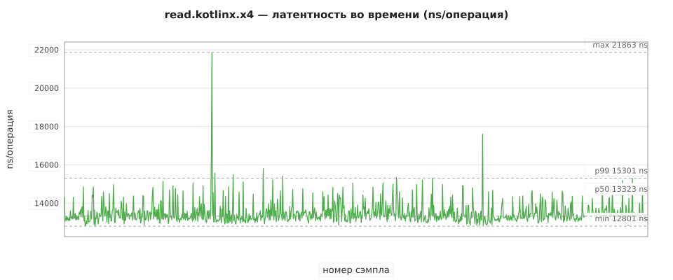
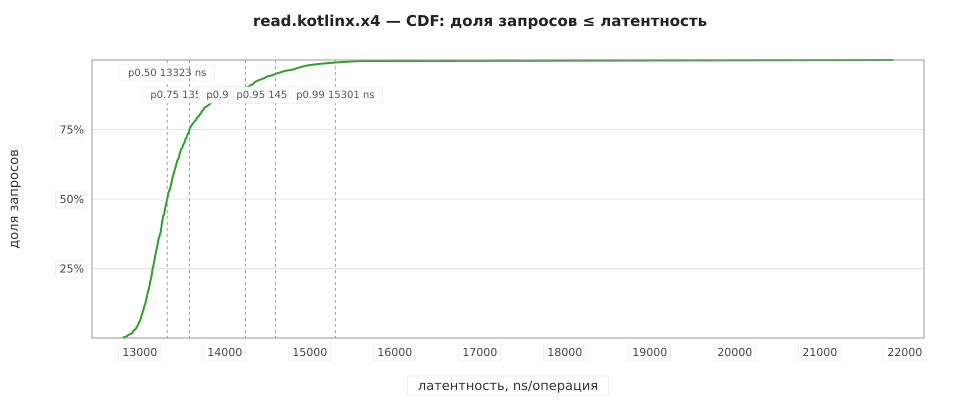
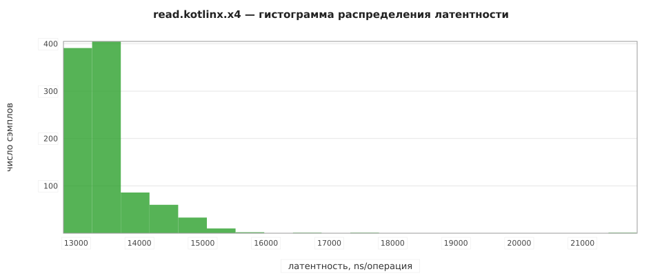

**Оба метода на одном графике (наложение):**

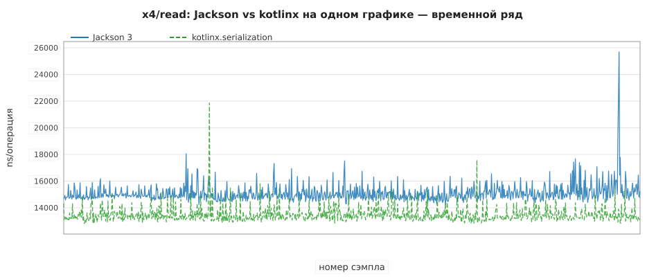
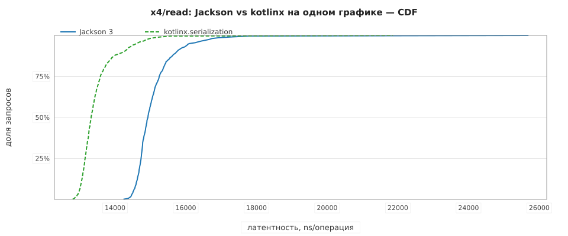
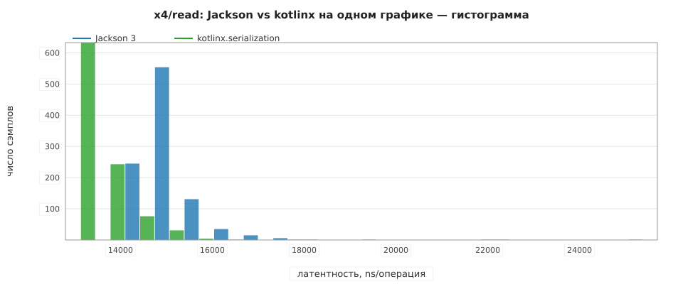

#### write — запись (serialize)

**Все метрики обоих методов (латентность, ns/операция):**

| Метрика | Jackson 3 | kotlinx.serialization | Δ, % |
|---|---|---|---|
| min | `6353.0` | `7241.1` | `14.0%` |
| **p50 (медиана)** | **`6653.6`** | **`7525.9`** | `13.1%` |
| p75 | `6892.3` | `7654.1` | `11.1%` |
| p90 | `7791.9` | `7956.3` | `2.1%` |
| p95 | `8711.1` | `8293.5` | `-4.8%` |
| p99 | `12602.0` | `9576.4` | `-24.0%` |
| max | `17083.0` | `15189.1` | `-11.1%` |
| mean | `7005.1` | `7649.1` | `9.2%` |
| stdev | `1149.5` | `520.1` | `-54.8%` |
| net median (минус overhead) | `6648.1` | `7520.4` | `13.1%` |
| throughput, ops/s | `142,754` | `130,735` | |

#### **Jackson 3** — write.jackson.x4

**Фазы (8e, 8f):**

| Фаза | Сэмплов | Операций в сэмпле | Операций всего | Время, мс |
|---|---|---|---|---|
| warmup | 5000 | 256 | 1280000 | `11141.8` |
| settle | 200 | 256 | 51200 | `343.1` |
| measure | 990 | 256 | 253440 | `1793.1` |
| teardown | 250 | 256 | 64000 | `374.1` |
| **итого** | | | **1648640** | |

**Статистика (8d), ns/операция; throughput ≈ `142,754` ops/s:**

| Метрика | Значение |
|---|---|
| сэмплов | 990 |
| mean | `7005.1` ns |
| stdev | `1149.5` ns |
| min | `6353.0` ns |
| max | `17083.0` ns |
| **p50 (медиана)** | **`6653.6` ns** (net: `6648.1` ns) |
| p75 | `6892.3` ns |
| p90 | `7791.9` ns |
| p95 | `8711.1` ns |
| p99 | `12602.0` ns |

**Перцентили (8b/8d):**

| Перцентиль | Латентность, ns |
|---|---|
| p0.100 | `6484.0` |
| p0.250 | `6545.9` |
| p0.500 | `6653.6` |
| p0.750 | `6892.3` |
| p0.900 | `7791.9` |
| p0.950 | `8711.1` |
| p0.990 | `12602.0` |
| p0.999 | `17083.0` |

**Графики:**

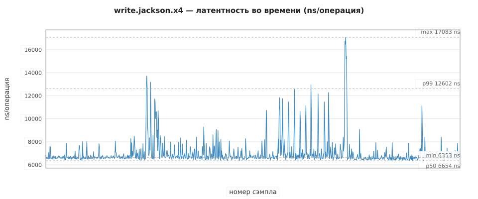
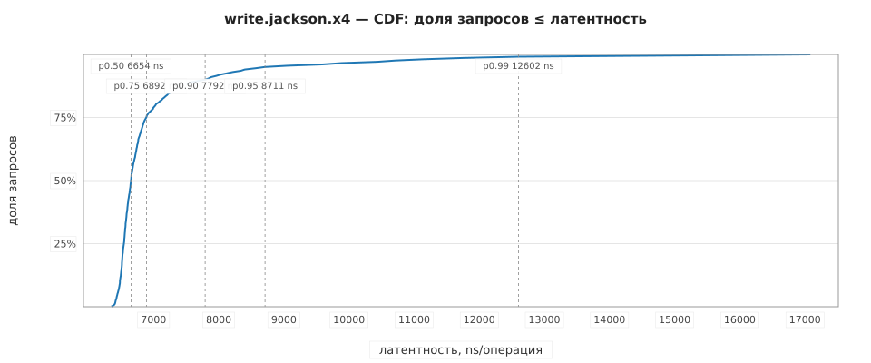
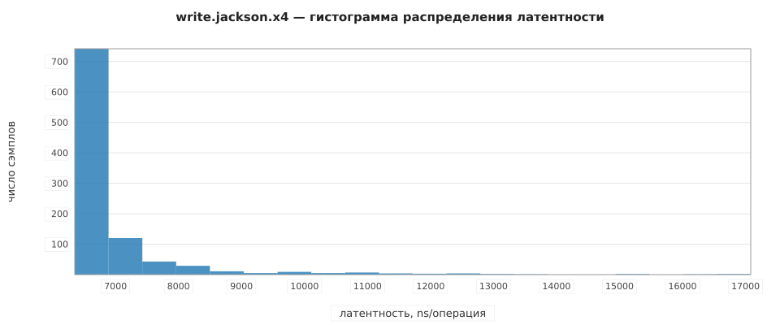

#### **kotlinx.serialization** — write.kotlinx.x4

**Фазы (8e, 8f):**

| Фаза | Сэмплов | Операций в сэмпле | Операций всего | Время, мс |
|---|---|---|---|---|
| warmup | 5000 | 256 | 1280000 | `9164.5` |
| settle | 200 | 256 | 51200 | `384.5` |
| measure | 990 | 256 | 253440 | `1958.1` |
| teardown | 250 | 256 | 64000 | `525.1` |
| **итого** | | | **1648640** | |

**Статистика (8d), ns/операция; throughput ≈ `130,735` ops/s:**

| Метрика | Значение |
|---|---|
| сэмплов | 990 |
| mean | `7649.1` ns |
| stdev | `520.1` ns |
| min | `7241.1` ns |
| max | `15189.1` ns |
| **p50 (медиана)** | **`7525.9` ns** (net: `7520.4` ns) |
| p75 | `7654.1` ns |
| p90 | `7956.3` ns |
| p95 | `8293.5` ns |
| p99 | `9576.4` ns |

**Перцентили (8b/8d):**

| Перцентиль | Латентность, ns |
|---|---|
| p0.100 | `7390.4` |
| p0.250 | `7453.4` |
| p0.500 | `7525.9` |
| p0.750 | `7654.1` |
| p0.900 | `7956.3` |
| p0.950 | `8293.5` |
| p0.990 | `9576.4` |
| p0.999 | `15189.1` |

**Графики:**

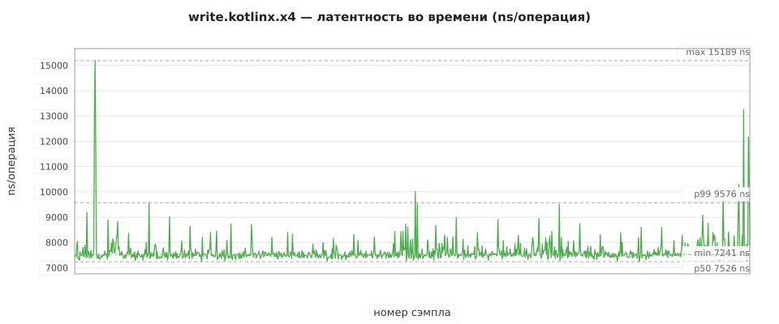
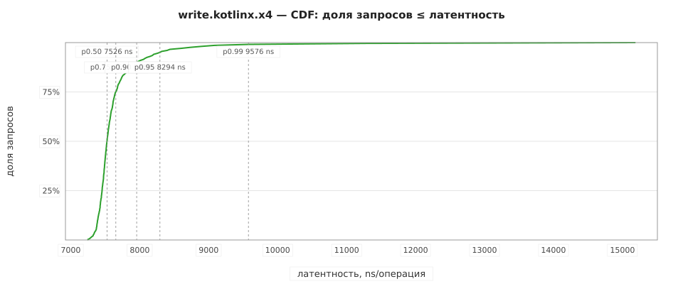
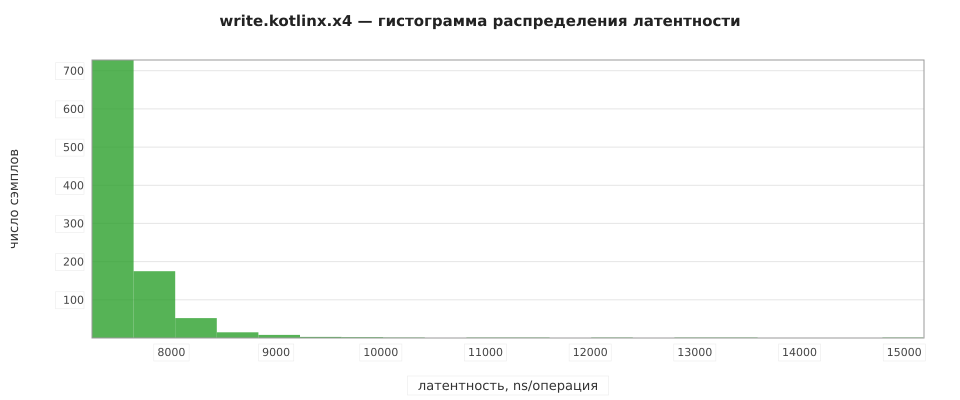

**Оба метода на одном графике (наложение):**

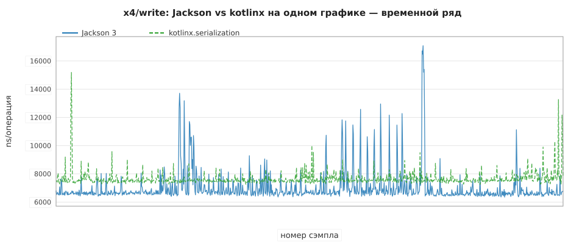
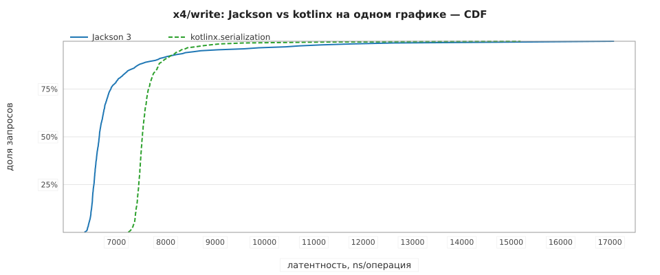
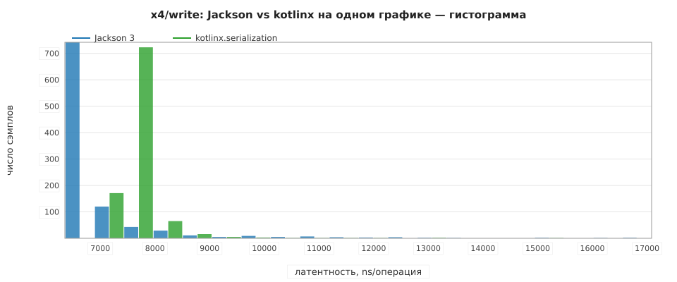

#### mixed — одновременные чтение + запись (2 потока)

**Все метрики обоих методов (латентность, ns/операция):**

| Метрика | Jackson 3 | kotlinx.serialization | Δ, % |
|---|---|---|---|
| min | `10410.9` | `10223.6` | `-1.8%` |
| **p50 (медиана)** | **`10767.4`** | **`10766.8`** | `-0.0%` |
| p75 | `11001.8` | `11203.1` | `1.8%` |
| p90 | `11472.6` | `11800.3` | `2.9%` |
| p95 | `12215.5` | `12155.0` | `-0.5%` |
| p99 | `17923.3` | `13967.9` | `-22.1%` |
| max | `24780.8` | `19432.4` | `-21.6%` |
| mean | `11111.9` | `10979.0` | `-1.2%` |
| stdev | `1315.5` | `728.1` | `-44.7%` |
| net median (минус overhead) | `10738.3` | `10737.7` | `-0.0%` |
| throughput, ops/s | `89,994` | `91,083` | |

#### **Jackson 3** — mixed.jackson.x4

**Фазы (8e, 8f):**

| Фаза | Сэмплов | Операций в сэмпле | Операций всего | Время, мс |
|---|---|---|---|---|
| warmup | 5000 | 512 | 2560000 | `29072.2` |
| settle | 200 | 512 | 102400 | `1123.2` |
| measure | 990 | 512 | 506880 | `5688.0` |
| teardown | 250 | 512 | 128000 | `1382.7` |
| **итого** | | | **3297280** | |

**Статистика (8d), ns/операция; throughput ≈ `89,994` ops/s:**

| Метрика | Значение |
|---|---|
| сэмплов | 990 |
| mean | `11111.9` ns |
| stdev | `1315.5` ns |
| min | `10410.9` ns |
| max | `24780.8` ns |
| **p50 (медиана)** | **`10767.4` ns** (net: `10738.3` ns) |
| p75 | `11001.8` ns |
| p90 | `11472.6` ns |
| p95 | `12215.5` ns |
| p99 | `17923.3` ns |

**Перцентили (8b/8d):**

| Перцентиль | Латентность, ns |
|---|---|
| p0.100 | `10590.5` |
| p0.250 | `10658.2` |
| p0.500 | `10767.4` |
| p0.750 | `11001.8` |
| p0.900 | `11472.6` |
| p0.950 | `12215.5` |
| p0.990 | `17923.3` |
| p0.999 | `24780.8` |

**Графики:**

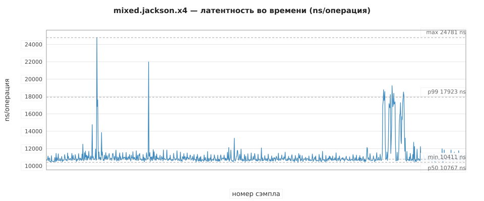
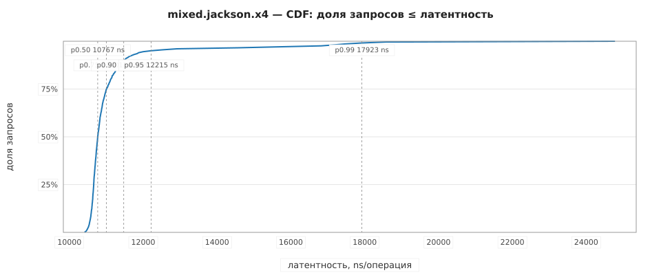
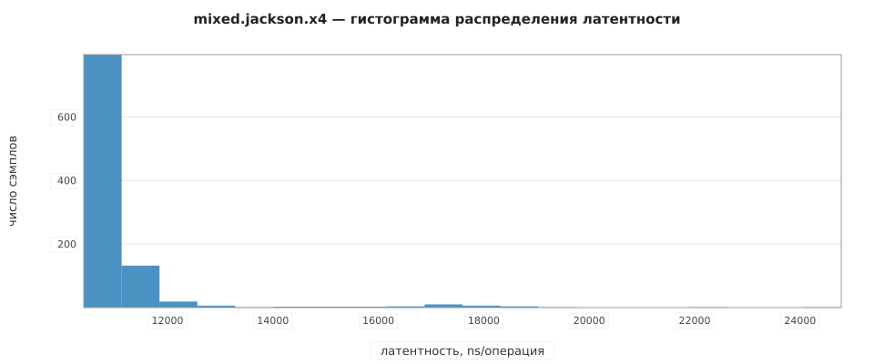

#### **kotlinx.serialization** — mixed.kotlinx.x4

**Фазы (8e, 8f):**

| Фаза | Сэмплов | Операций в сэмпле | Операций всего | Время, мс |
|---|---|---|---|---|
| warmup | 5000 | 512 | 2560000 | `27368.8` |
| settle | 200 | 512 | 102400 | `1093.5` |
| measure | 990 | 512 | 506880 | `5621.9` |
| teardown | 250 | 512 | 128000 | `1435.7` |
| **итого** | | | **3297280** | |

**Статистика (8d), ns/операция; throughput ≈ `91,083` ops/s:**

| Метрика | Значение |
|---|---|
| сэмплов | 990 |
| mean | `10979.0` ns |
| stdev | `728.1` ns |
| min | `10223.6` ns |
| max | `19432.4` ns |
| **p50 (медиана)** | **`10766.8` ns** (net: `10737.7` ns) |
| p75 | `11203.1` ns |
| p90 | `11800.3` ns |
| p95 | `12155.0` ns |
| p99 | `13967.9` ns |

**Перцентили (8b/8d):**

| Перцентиль | Латентность, ns |
|---|---|
| p0.100 | `10410.4` |
| p0.250 | `10523.9` |
| p0.500 | `10766.8` |
| p0.750 | `11203.1` |
| p0.900 | `11800.3` |
| p0.950 | `12155.0` |
| p0.990 | `13967.9` |
| p0.999 | `19432.4` |

**Графики:**

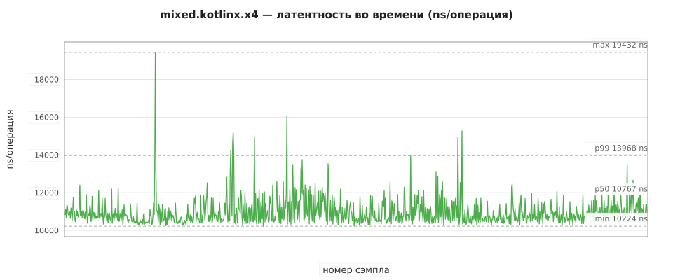
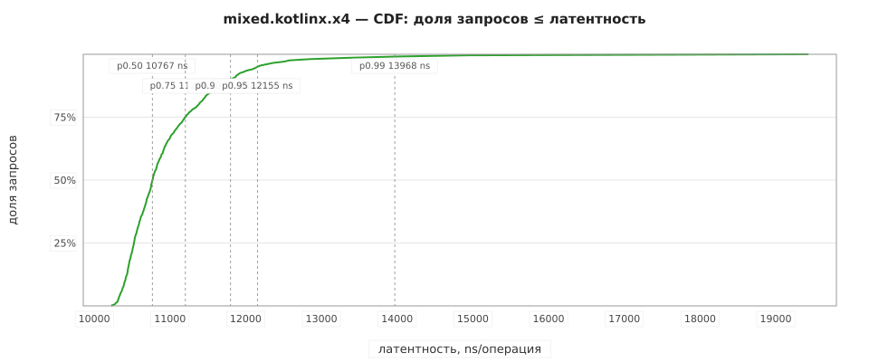

**Оба метода на одном графике (наложение):**

### Модель x8 (80 полей)

#### read — чтение (deserialize)

**Все метрики обоих методов (латентность, ns/операция):**

| Метрика | Jackson 3 | kotlinx.serialization | Δ, % |
|---|---|---|---|
| min | `44987.2` | `50647.4` | `12.6%` |
| **p50 (медиана)** | **`47378.1`** | **`51933.0`** | `9.6%` |
| p75 | `48488.4` | `52453.0` | `8.2%` |
| p90 | `49432.7` | `53091.4` | `7.4%` |
| p95 | `50148.8` | `53674.3` | `7.0%` |
| p99 | `53790.8` | `54899.1` | `2.1%` |
| max | `92859.6` | `72325.3` | `-22.1%` |
| mean | `47690.9` | `52143.4` | `9.3%` |
| stdev | `2405.0` | `1200.2` | `-50.1%` |
| net median (минус overhead) | `47372.6` | `51927.5` | `9.6%` |
| throughput, ops/s | `20,968` | `19,178` | |

#### **Jackson 3** — read.jackson.x8

**Фазы (8e, 8f):**

| Фаза | Сэмплов | Операций в сэмпле | Операций всего | Время, мс |
|---|---|---|---|---|
| warmup | 5000 | 256 | 1280000 | `60462.2` |
| settle | 200 | 256 | 51200 | `2421.7` |
| measure | 990 | 256 | 253440 | `12207.9` |
| teardown | 250 | 256 | 64000 | `3090.4` |
| **итого** | | | **1648640** | |

**Статистика (8d), ns/операция; throughput ≈ `20,968` ops/s:**

| Метрика | Значение |
|---|---|
| сэмплов | 990 |
| mean | `47690.9` ns |
| stdev | `2405.0` ns |
| min | `44987.2` ns |
| max | `92859.6` ns |
| **p50 (медиана)** | **`47378.1` ns** (net: `47372.6` ns) |
| p75 | `48488.4` ns |
| p90 | `49432.7` ns |
| p95 | `50148.8` ns |
| p99 | `53790.8` ns |

**Перцентили (8b/8d):**

| Перцентиль | Латентность, ns |
|---|---|
| p0.100 | `45814.5` |
| p0.250 | `46537.9` |
| p0.500 | `47378.1` |
| p0.750 | `48488.4` |
| p0.900 | `49432.7` |
| p0.950 | `50148.8` |
| p0.990 | `53790.8` |
| p0.999 | `92859.6` |

**Графики:**

#### **kotlinx.serialization** — read.kotlinx.x8

**Фазы (8e, 8f):**

| Фаза | Сэмплов | Операций в сэмпле | Операций всего | Время, мс |
|---|---|---|---|---|
| warmup | 5000 | 256 | 1280000 | `67487.0` |
| settle | 200 | 256 | 51200 | `2712.5` |
| measure | 990 | 256 | 253440 | `13349.5` |
| teardown | 250 | 256 | 64000 | `3365.8` |
| **итого** | | | **1648640** | |

**Статистика (8d), ns/операция; throughput ≈ `19,178` ops/s:**

| Метрика | Значение |
|---|---|
| сэмплов | 990 |
| mean | `52143.4` ns |
| stdev | `1200.2` ns |
| min | `50647.4` ns |
| max | `72325.3` ns |
| **p50 (медиана)** | **`51933.0` ns** (net: `51927.5` ns) |
| p75 | `52453.0` ns |
| p90 | `53091.4` ns |
| p95 | `53674.3` ns |
| p99 | `54899.1` ns |

**Перцентили (8b/8d):**

| Перцентиль | Латентность, ns |
|---|---|
| p0.100 | `51340.5` |
| p0.250 | `51552.3` |
| p0.500 | `51933.0` |
| p0.750 | `52453.0` |
| p0.900 | `53091.4` |
| p0.950 | `53674.3` |
| p0.990 | `54899.1` |
| p0.999 | `72325.3` |

**Графики:**

**Оба метода на одном графике (наложение):**

#### write — запись (serialize)

**Все метрики обоих методов (латентность, ns/операция):**

| Метрика | Jackson 3 | kotlinx.serialization | Δ, % |
|---|---|---|---|
| min | `21093.9` | `22226.8` | `5.4%` |
| **p50 (медиана)** | **`21734.4`** | **`22756.1`** | `4.7%` |
| p75 | `22196.0` | `23277.2` | `4.9%` |
| p90 | `22935.5` | `24007.4` | `4.7%` |
| p95 | `23436.4` | `24360.5` | `3.9%` |
| p99 | `24561.9` | `25717.3` | `4.7%` |
| max | `42005.9` | `35735.5` | `-14.9%` |
| mean | `21991.3` | `23046.3` | `4.8%` |
| stdev | `939.3` | `910.7` | `-3.1%` |
| net median (минус overhead) | `21728.9` | `22750.6` | `4.7%` |
| throughput, ops/s | `45,473` | `43,391` | |

#### **Jackson 3** — write.jackson.x8

**Фазы (8e, 8f):**

| Фаза | Сэмплов | Операций в сэмпле | Операций всего | Время, мс |
|---|---|---|---|---|
| warmup | 5000 | 256 | 1280000 | `29952.2` |
| settle | 200 | 256 | 51200 | `1133.0` |
| measure | 990 | 256 | 253440 | `5629.9` |
| teardown | 250 | 256 | 64000 | `1403.6` |
| **итого** | | | **1648640** | |

**Статистика (8d), ns/операция; throughput ≈ `45,473` ops/s:**

| Метрика | Значение |
|---|---|
| сэмплов | 990 |
| mean | `21991.3` ns |
| stdev | `939.3` ns |
| min | `21093.9` ns |
| max | `42005.9` ns |
| **p50 (медиана)** | **`21734.4` ns** (net: `21728.9` ns) |
| p75 | `22196.0` ns |
| p90 | `22935.5` ns |
| p95 | `23436.4` ns |
| p99 | `24561.9` ns |

**Перцентили (8b/8d):**

| Перцентиль | Латентность, ns |
|---|---|
| p0.100 | `21386.9` |
| p0.250 | `21519.0` |
| p0.500 | `21734.4` |
| p0.750 | `22196.0` |
| p0.900 | `22935.5` |
| p0.950 | `23436.4` |
| p0.990 | `24561.9` |
| p0.999 | `42005.9` |

**Графики:**

#### **kotlinx.serialization** — write.kotlinx.x8

**Фазы (8e, 8f):**

| Фаза | Сэмплов | Операций в сэмпле | Операций всего | Время, мс |
|---|---|---|---|---|
| warmup | 5000 | 256 | 1280000 | `30252.0` |
| settle | 200 | 256 | 51200 | `1169.0` |
| measure | 990 | 256 | 253440 | `5899.3` |
| teardown | 250 | 256 | 64000 | `1472.4` |
| **итого** | | | **1648640** | |

**Статистика (8d), ns/операция; throughput ≈ `43,391` ops/s:**

| Метрика | Значение |
|---|---|
| сэмплов | 990 |
| mean | `23046.3` ns |
| stdev | `910.7` ns |
| min | `22226.8` ns |
| max | `35735.5` ns |
| **p50 (медиана)** | **`22756.1` ns** (net: `22750.6` ns) |
| p75 | `23277.2` ns |
| p90 | `24007.4` ns |
| p95 | `24360.5` ns |
| p99 | `25717.3` ns |

**Перцентили (8b/8d):**

| Перцентиль | Латентность, ns |
|---|---|
| p0.100 | `22447.8` |
| p0.250 | `22563.0` |
| p0.500 | `22756.1` |
| p0.750 | `23277.2` |
| p0.900 | `24007.4` |
| p0.950 | `24360.5` |
| p0.990 | `25717.3` |
| p0.999 | `35735.5` |

**Графики:**

**Оба метода на одном графике (наложение):**

#### mixed — одновременные чтение + запись (2 потока)

**Все метрики обоих методов (латентность, ns/операция):**

| Метрика | Jackson 3 | kotlinx.serialization | Δ, % |
|---|---|---|---|
| min | `33566.8` | `37192.8` | `10.8%` |
| **p50 (медиана)** | **`34901.4`** | **`38306.4`** | `9.8%` |
| p75 | `35498.5` | `39024.9` | `9.9%` |
| p90 | `36180.7` | `39573.9` | `9.4%` |
| p95 | `36986.8` | `39964.9` | `8.1%` |
| p99 | `47295.9` | `45965.6` | `-2.8%` |
| max | `60459.4` | `66703.0` | `10.3%` |
| mean | `35309.9` | `38712.6` | `9.6%` |
| stdev | `2277.9` | `2150.2` | `-5.6%` |
| net median (минус overhead) | `34872.3` | `38277.3` | `9.8%` |
| throughput, ops/s | `28,321` | `25,831` | |

#### **Jackson 3** — mixed.jackson.x8

**Фазы (8e, 8f):**

| Фаза | Сэмплов | Операций в сэмпле | Операций всего | Время, мс |
|---|---|---|---|---|
| warmup | 5000 | 512 | 2560000 | `89026.8` |
| settle | 200 | 512 | 102400 | `3568.7` |
| measure | 990 | 512 | 506880 | `18077.7` |
| teardown | 250 | 512 | 128000 | `4488.2` |
| **итого** | | | **3297280** | |

**Статистика (8d), ns/операция; throughput ≈ `28,321` ops/s:**

| Метрика | Значение |
|---|---|
| сэмплов | 990 |
| mean | `35309.9` ns |
| stdev | `2277.9` ns |
| min | `33566.8` ns |
| max | `60459.4` ns |
| **p50 (медиана)** | **`34901.4` ns** (net: `34872.3` ns) |
| p75 | `35498.5` ns |
| p90 | `36180.7` ns |
| p95 | `36986.8` ns |
| p99 | `47295.9` ns |

**Перцентили (8b/8d):**

| Перцентиль | Латентность, ns |
|---|---|
| p0.100 | `34116.0` |
| p0.250 | `34434.2` |
| p0.500 | `34901.4` |
| p0.750 | `35498.5` |
| p0.900 | `36180.7` |
| p0.950 | `36986.8` |
| p0.990 | `47295.9` |
| p0.999 | `60459.4` |

**Графики:**

#### **kotlinx.serialization** — mixed.kotlinx.x8

**Фазы (8e, 8f):**

| Фаза | Сэмплов | Операций в сэмпле | Операций всего | Время, мс |
|---|---|---|---|---|
| warmup | 5000 | 512 | 2560000 | `99387.3` |
| settle | 200 | 512 | 102400 | `3953.4` |
| measure | 990 | 512 | 506880 | `19821.4` |
| teardown | 250 | 512 | 128000 | `4934.3` |
| **итого** | | | **3297280** | |

**Статистика (8d), ns/операция; throughput ≈ `25,831` ops/s:**

| Метрика | Значение |
|---|---|
| сэмплов | 990 |
| mean | `38712.6` ns |
| stdev | `2150.2` ns |
| min | `37192.8` ns |
| max | `66703.0` ns |
| **p50 (медиана)** | **`38306.4` ns** (net: `38277.3` ns) |
| p75 | `39024.9` ns |
| p90 | `39573.9` ns |
| p95 | `39964.9` ns |
| p99 | `45965.6` ns |

**Перцентили (8b/8d):**

| Перцентиль | Латентность, ns |
|---|---|
| p0.100 | `37689.4` |
| p0.250 | `37952.0` |
| p0.500 | `38306.4` |
| p0.750 | `39024.9` |
| p0.900 | `39573.9` |
| p0.950 | `39964.9` |
| p0.990 | `45965.6` |
| p0.999 | `66703.0` |

**Графики:**

**Оба метода на одном графике (наложение):**

## 5. Сводная таблица сравнения (Jackson 3 vs kotlinx.serialization)

| Модель | Сценарий | Медиана Jackson, ns | Медиана kotlinx, ns | Δ median | Δ mean | Δ p99 | Быстрее |
|---|---|---|---|---|---|---|---|
| x1 | mixed | `2837.3` | `2044.9` | `-27.9%` | `-28.2%` | `-23.3%` | **kotlinx.serialization** |
| x1 | read | `3942.2` | `2579.4` | `-34.6%` | `-34.7%` | `-34.1%` | **kotlinx.serialization** |
| x1 | write | `1413.7` | `1381.7` | `-2.3%` | `-2.3%` | `2.1%` | **kotlinx.serialization** |
| x4 | mixed | `10767.4` | `10766.8` | `-0.0%` | `-1.2%` | `-22.1%` | **kotlinx.serialization** |
| x4 | read | `14927.5` | `13322.9` | `-10.7%` | `-10.7%` | `-11.7%` | **kotlinx.serialization** |
| x4 | write | `6653.6` | `7525.9` | `13.1%` | `9.2%` | `-24.0%` | **Jackson 3** |
| x8 | mixed | `34901.4` | `38306.4` | `9.8%` | `9.6%` | `-2.8%` | **Jackson 3** |
| x8 | read | `47378.1` | `51933.0` | `9.6%` | `9.3%` | `2.1%` | **Jackson 3** |
| x8 | write | `21734.4` | `22756.1` | `4.7%` | `4.8%` | `4.7%` | **Jackson 3** |

> Δ = (kotlinx − Jackson) / Jackson × 100%. Отрицательное значение — kotlinx быстрее.

## 5.1 Перцентили p50 и p99: столбчатое сравнение библиотек

> Девять групп столбцов — 3 модели (x1/x4/x8) × 3 сценария (read/write/mixed); в каждой два столбца: Jackson (синий) и kotlinx (зелёный).

## 6. «Сырые» сэмплы

Каждый кейс: `raw/<case>.csv` (колонки `sample,ns_per_op`). Полные данные — `report.json`.

