# ЛР3: микробенчмарк — Jackson 3 vs kotlinx.serialization (vidayapi)

> Сгенерировано автоматически: `2026-10-23T06:46:23.236601781Z`.

## 1. Окружение прогона (воспроизводимость, Требование 6)

| Параметр | Значение |
|---|---|
| `availableProcessors` | `1` |
| `container` | `docker` |
| `cpuModel` | `AMD Ryzen 5 6600HS Creator Edition` |
| `cpusAllowedList` | `0` |
| `java.vendor` | `Eclipse Adoptium` |
| `java.version` | `17.0.20.1` |
| `jvm.name` | `OpenJDK 64-Bit Server VM` |
| `os.arch` | `amd64` |
| `os.name` | `Linux` |
| `os.version` | `7.0.0-38-generic` |
| `timestamp` | `2026-10-23T06:45:59.096674019Z` |

## 2. Конфигурация прогона (Требования 1, 2)

| Параметр | Значение |
|---|---|
| испытаний (samples) | 200 (≥100 — Требование 1) |
| warmup-сэмплов | 100 (Требование 2) |
| settle-сэмплов (стабилизация; отбрасываются) | 20 |
| первых сэмплов measure удалено (drop; фиксируется в отчёте) | 5 |
| teardown-сэмплов | 20 (Требование 2) |
| операций в сэмпле (batch) | 64 |
| пар read+write в сэмпле mixed | 64 |

## 3. Overhead инструмента (Требование 7)

| Режим | Overhead, нс/операция |
|---|---|
| простой сценарий (2×nanoTime + цикл + Blackhole) / batch | `4.859` |
| смешанный сценарий (2 потока + диспетчеризация) / 2×pairs | `209.539` |

> Целевой ориентир задания — не более 4–5 нс; батч-измерение даёт sub-ns overhead. «Сырые» значения в таблицах включают overhead; столбец «net median» = median − overhead.

## 4. Сравнение по сценариям: таблицы и графики обоих методов

> Для каждого сценария: сводная таблица «метрика × метод», детальные таблицы
> и графики обоих методов. Δ = (kotlinx − Jackson) / Jackson × 100%; отрицательная — kotlinx быстрее.
> Фаза **settle** (между warmup и measure) отбрасывается: первые сэмплы после прогрева
> (ленивая инициализация, JIT, GC-паузы) не входят в статистику и графики.
> Дополнительно из фазы measure удалено **5** первых сэмплов
> («стартовый переходный процесс»); это справочно отражено в конфигурации.

### Модель x1 (10 полей)

#### read — чтение (deserialize)

**Все метрики обоих методов (латентность, ns/операция):**

| Метрика | Jackson 3 | kotlinx.serialization | Δ, % |
|---|---|---|---|
| min | `6195.1` | `4796.7` | `-22.6%` |
| **p50 (медиана)** | **`8575.3`** | **`6065.3`** | `-29.3%` |
| p75 | `16952.8` | `6644.0` | `-60.8%` |
| p90 | `56985.4` | `52418.5` | `-8.0%` |
| p95 | `63946.8` | `53789.7` | `-15.9%` |
| p99 | `71768.3` | `66071.0` | `-7.9%` |
| max | `385955.7` | `66174.8` | `-82.9%` |
| mean | `21613.7` | `12283.1` | `-43.2%` |
| stdev | `32963.7` | `16607.3` | `-49.6%` |
| net median (минус overhead) | `8570.4` | `6060.5` | `-29.3%` |
| throughput, ops/s | `46,267` | `81,413` | |

#### **Jackson 3** — read.jackson.x1

**Фазы (8e, 8f):**

| Фаза | Сэмплов | Операций в сэмпле | Операций всего | Время, мс |
|---|---|---|---|---|
| warmup | 100 | 64 | 6400 | `1188.6` |
| settle | 20 | 64 | 1280 | `42.1` |
| measure | 195 | 64 | 12480 | `282.1` |
| teardown | 20 | 64 | 1280 | `21.6` |
| **итого** | | | **21440** | |

**Статистика (8d), ns/операция; throughput ≈ `46,267` ops/s:**

| Метрика | Значение |
|---|---|
| сэмплов | 195 |
| mean | `21613.7` ns |
| stdev | `32963.7` ns |
| min | `6195.1` ns |
| max | `385955.7` ns |
| **p50 (медиана)** | **`8575.3` ns** (net: `8570.4` ns) |
| p75 | `16952.8` ns |
| p90 | `56985.4` ns |
| p95 | `63946.8` ns |
| p99 | `71768.3` ns |

**Перцентили (8b/8d):**

| Перцентиль | Латентность, ns |
|---|---|
| p0.100 | `6935.9` |
| p0.250 | `7309.7` |
| p0.500 | `8575.3` |
| p0.750 | `16952.8` |
| p0.900 | `56985.4` |
| p0.950 | `63946.8` |
| p0.990 | `71768.3` |
| p0.999 | `385955.7` |

**Графики:**

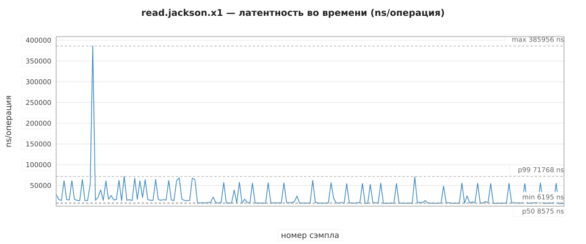
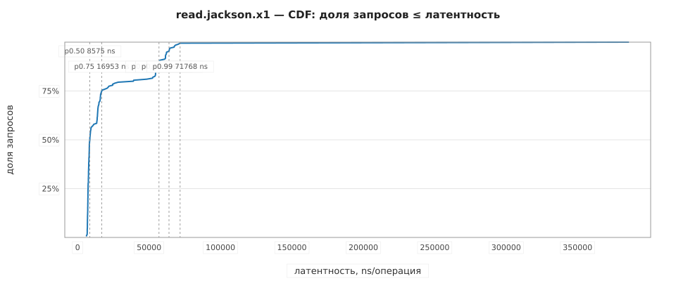
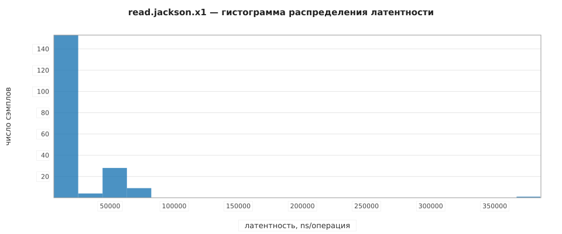

#### **kotlinx.serialization** — read.kotlinx.x1

**Фазы (8e, 8f):**

| Фаза | Сэмплов | Операций в сэмпле | Операций всего | Время, мс |
|---|---|---|---|---|
| warmup | 100 | 64 | 6400 | `322.4` |
| settle | 20 | 64 | 1280 | `17.7` |
| measure | 195 | 64 | 12480 | `156.6` |
| teardown | 20 | 64 | 1280 | `13.6` |
| **итого** | | | **21440** | |

**Статистика (8d), ns/операция; throughput ≈ `81,413` ops/s:**

| Метрика | Значение |
|---|---|
| сэмплов | 195 |
| mean | `12283.1` ns |
| stdev | `16607.3` ns |
| min | `4796.7` ns |
| max | `66174.8` ns |
| **p50 (медиана)** | **`6065.3` ns** (net: `6060.5` ns) |
| p75 | `6644.0` ns |
| p90 | `52418.5` ns |
| p95 | `53789.7` ns |
| p99 | `66071.0` ns |

**Перцентили (8b/8d):**

| Перцентиль | Латентность, ns |
|---|---|
| p0.100 | `4843.0` |
| p0.250 | `4925.9` |
| p0.500 | `6065.3` |
| p0.750 | `6644.0` |
| p0.900 | `52418.5` |
| p0.950 | `53789.7` |
| p0.990 | `66071.0` |
| p0.999 | `66174.8` |

**Графики:**

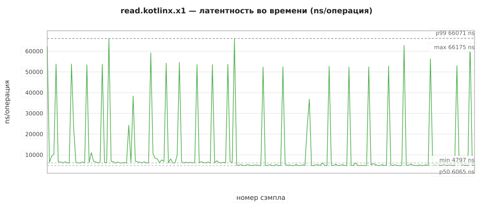
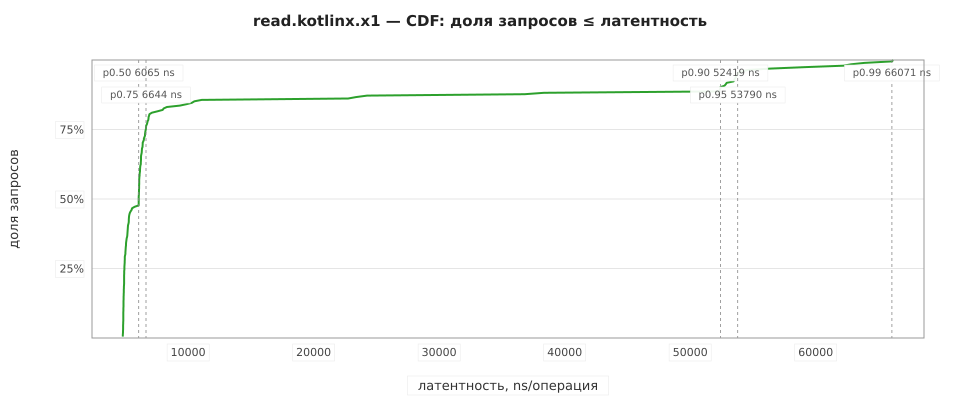
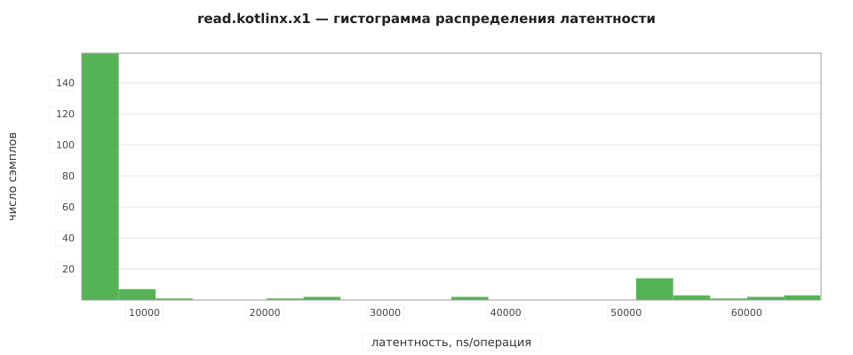

**Оба метода на одном графике (наложение):**

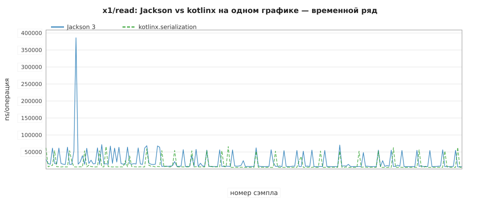
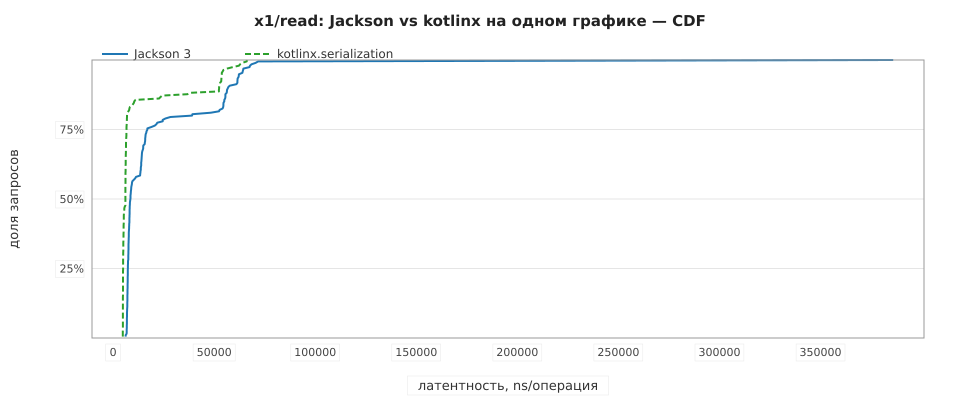
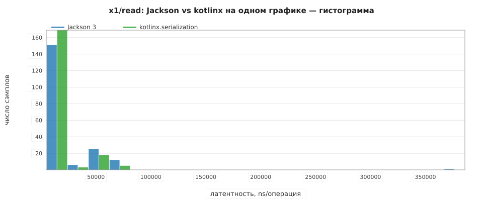

#### write — запись (serialize)

**Все метрики обоих методов (латентность, ns/операция):**

| Метрика | Jackson 3 | kotlinx.serialization | Δ, % |
|---|---|---|---|
| min | `4865.6` | `3123.9` | `-35.8%` |
| **p50 (медиана)** | **`5735.7`** | **`3937.9`** | `-31.3%` |
| p75 | `6648.8` | `5333.7` | `-19.8%` |
| p90 | `44749.2` | `19627.7` | `-56.1%` |
| p95 | `53873.1` | `51327.1` | `-4.7%` |
| p99 | `57654.8` | `57392.9` | `-0.5%` |
| max | `89622.2` | `57574.6` | `-35.8%` |
| mean | `12153.3` | `8753.5` | `-28.0%` |
| stdev | `15898.1` | `13963.2` | `-12.2%` |
| net median (минус overhead) | `5730.8` | `3933.0` | `-31.4%` |
| throughput, ops/s | `82,282` | `114,240` | |

#### **Jackson 3** — write.jackson.x1

**Фазы (8e, 8f):**

| Фаза | Сэмплов | Операций в сэмпле | Операций всего | Время, мс |
|---|---|---|---|---|
| warmup | 100 | 64 | 6400 | `414.7` |
| settle | 20 | 64 | 1280 | `14.8` |
| measure | 195 | 64 | 12480 | `163.2` |
| teardown | 20 | 64 | 1280 | `13.5` |
| **итого** | | | **21440** | |

**Статистика (8d), ns/операция; throughput ≈ `82,282` ops/s:**

| Метрика | Значение |
|---|---|
| сэмплов | 195 |
| mean | `12153.3` ns |
| stdev | `15898.1` ns |
| min | `4865.6` ns |
| max | `89622.2` ns |
| **p50 (медиана)** | **`5735.7` ns** (net: `5730.8` ns) |
| p75 | `6648.8` ns |
| p90 | `44749.2` ns |
| p95 | `53873.1` ns |
| p99 | `57654.8` ns |

**Перцентили (8b/8d):**

| Перцентиль | Латентность, ns |
|---|---|
| p0.100 | `5175.9` |
| p0.250 | `5347.9` |
| p0.500 | `5735.7` |
| p0.750 | `6648.8` |
| p0.900 | `44749.2` |
| p0.950 | `53873.1` |
| p0.990 | `57654.8` |
| p0.999 | `89622.2` |

**Графики:**

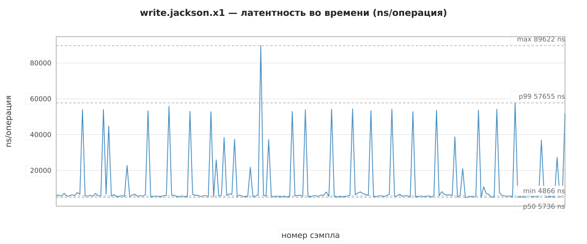
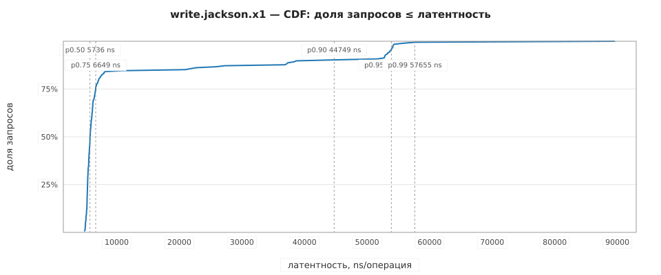
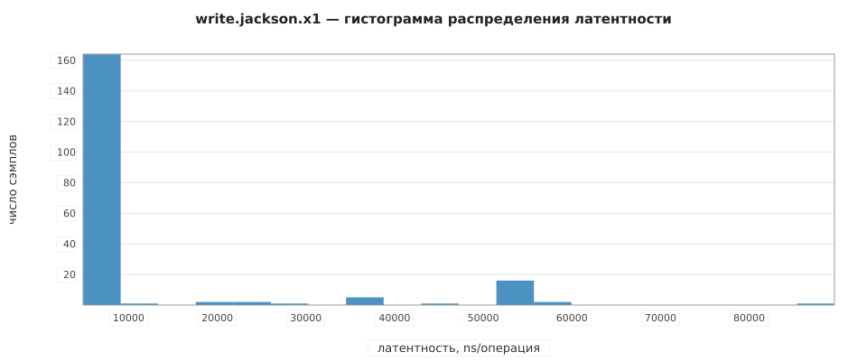

#### **kotlinx.serialization** — write.kotlinx.x1

**Фазы (8e, 8f):**

| Фаза | Сэмплов | Операций в сэмпле | Операций всего | Время, мс |
|---|---|---|---|---|
| warmup | 100 | 64 | 6400 | `199.0` |
| settle | 20 | 64 | 1280 | `14.6` |
| measure | 195 | 64 | 12480 | `120.0` |
| teardown | 20 | 64 | 1280 | `7.5` |
| **итого** | | | **21440** | |

**Статистика (8d), ns/операция; throughput ≈ `114,240` ops/s:**

| Метрика | Значение |
|---|---|
| сэмплов | 195 |
| mean | `8753.5` ns |
| stdev | `13963.2` ns |
| min | `3123.9` ns |
| max | `57574.6` ns |
| **p50 (медиана)** | **`3937.9` ns** (net: `3933.0` ns) |
| p75 | `5333.7` ns |
| p90 | `19627.7` ns |
| p95 | `51327.1` ns |
| p99 | `57392.9` ns |

**Перцентили (8b/8d):**

| Перцентиль | Латентность, ns |
|---|---|
| p0.100 | `3219.0` |
| p0.250 | `3606.5` |
| p0.500 | `3937.9` |
| p0.750 | `5333.7` |
| p0.900 | `19627.7` |
| p0.950 | `51327.1` |
| p0.990 | `57392.9` |
| p0.999 | `57574.6` |

**Графики:**

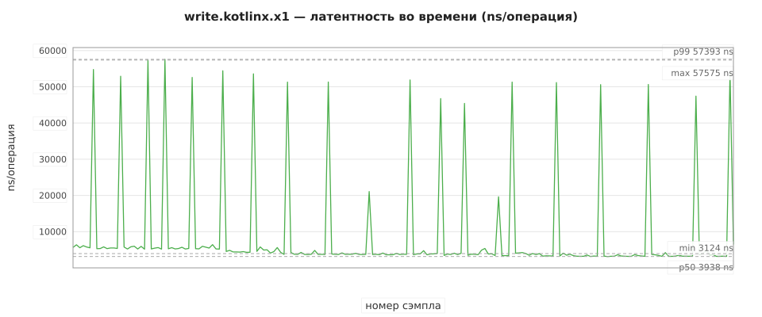
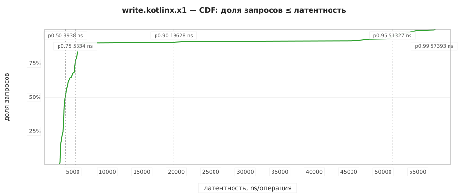
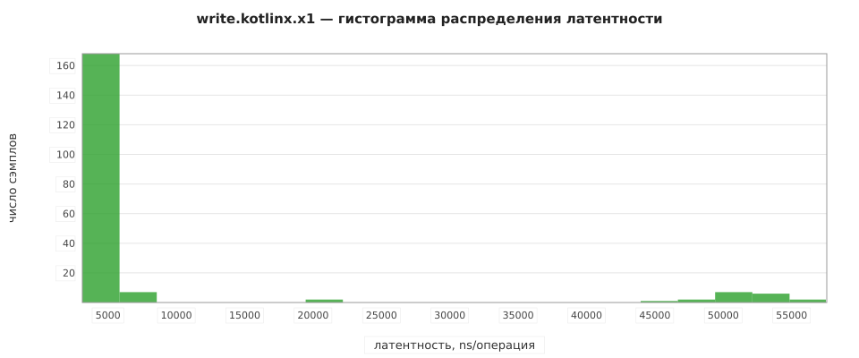

**Оба метода на одном графике (наложение):**

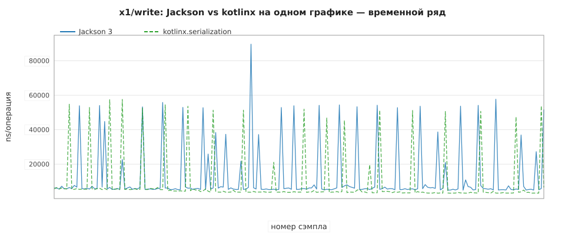
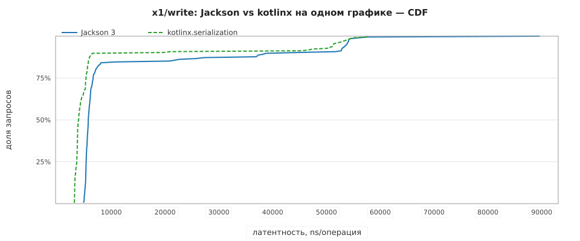
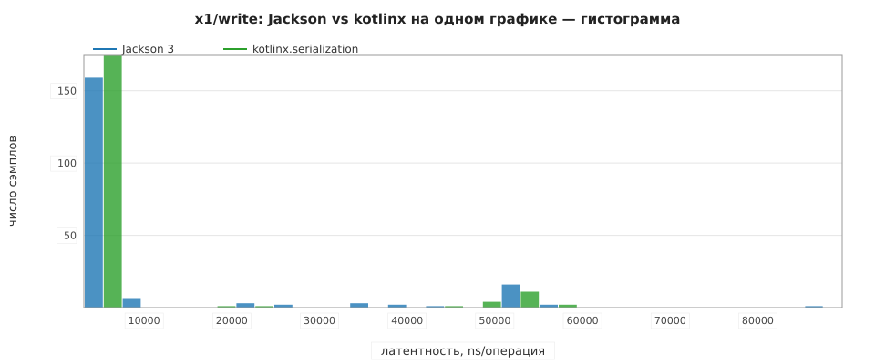

#### mixed — одновременные чтение + запись (2 потока)

**Все метрики обоих методов (латентность, ns/операция):**

| Метрика | Jackson 3 | kotlinx.serialization | Δ, % |
|---|---|---|---|
| min | `5691.5` | `2744.6` | `-51.8%` |
| **p50 (медиана)** | **`14795.6`** | **`3035.6`** | `-79.5%` |
| p75 | `30131.6` | `3352.3` | `-88.9%` |
| p90 | `41170.1` | `5044.5` | `-87.7%` |
| p95 | `45615.0` | `27037.4` | `-40.7%` |
| p99 | `52783.3` | `32358.8` | `-38.7%` |
| max | `53794.9` | `41881.3` | `-22.1%` |
| mean | `19867.9` | `5127.3` | `-74.2%` |
| stdev | `12927.0` | `6898.0` | `-46.6%` |
| net median (минус overhead) | `14586.0` | `2826.1` | `-80.6%` |
| throughput, ops/s | `50,332` | `195,035` | |

#### **Jackson 3** — mixed.jackson.x1

**Фазы (8e, 8f):**

| Фаза | Сэмплов | Операций в сэмпле | Операций всего | Время, мс |
|---|---|---|---|---|
| warmup | 100 | 128 | 12800 | `512.9` |
| settle | 20 | 128 | 2560 | `77.2` |
| measure | 195 | 128 | 24960 | `511.3` |
| teardown | 20 | 128 | 2560 | `23.2` |
| **итого** | | | **42880** | |

**Статистика (8d), ns/операция; throughput ≈ `50,332` ops/s:**

| Метрика | Значение |
|---|---|
| сэмплов | 195 |
| mean | `19867.9` ns |
| stdev | `12927.0` ns |
| min | `5691.5` ns |
| max | `53794.9` ns |
| **p50 (медиана)** | **`14795.6` ns** (net: `14586.0` ns) |
| p75 | `30131.6` ns |
| p90 | `41170.1` ns |
| p95 | `45615.0` ns |
| p99 | `52783.3` ns |

**Перцентили (8b/8d):**

| Перцентиль | Латентность, ns |
|---|---|
| p0.100 | `6970.7` |
| p0.250 | `10830.9` |
| p0.500 | `14795.6` |
| p0.750 | `30131.6` |
| p0.900 | `41170.1` |
| p0.950 | `45615.0` |
| p0.990 | `52783.3` |
| p0.999 | `53794.9` |

**Графики:**

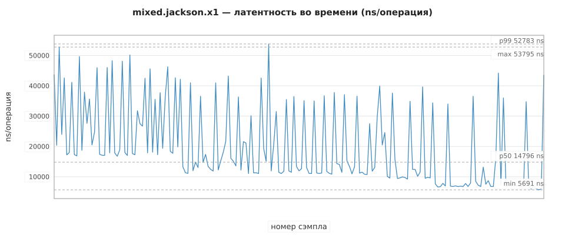
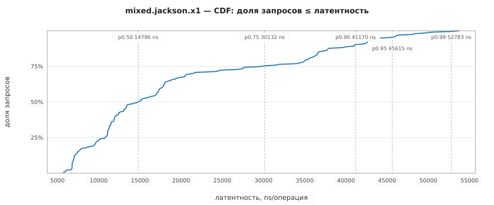
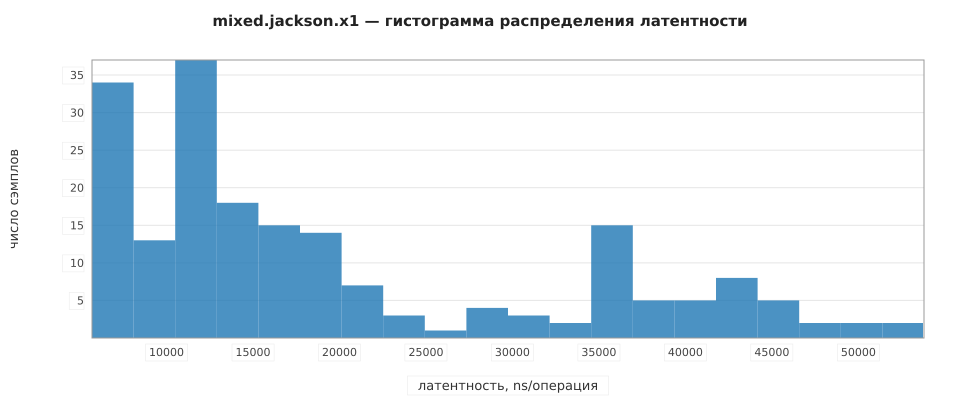

#### **kotlinx.serialization** — mixed.kotlinx.x1

**Фазы (8e, 8f):**

| Фаза | Сэмплов | Операций в сэмпле | Операций всего | Время, мс |
|---|---|---|---|---|
| warmup | 100 | 128 | 12800 | `82.9` |
| settle | 20 | 128 | 2560 | `12.1` |
| measure | 195 | 128 | 24960 | `133.7` |
| teardown | 20 | 128 | 2560 | `11.7` |
| **итого** | | | **42880** | |

**Статистика (8d), ns/операция; throughput ≈ `195,035` ops/s:**

| Метрика | Значение |
|---|---|
| сэмплов | 195 |
| mean | `5127.3` ns |
| stdev | `6898.0` ns |
| min | `2744.6` ns |
| max | `41881.3` ns |
| **p50 (медиана)** | **`3035.6` ns** (net: `2826.1` ns) |
| p75 | `3352.3` ns |
| p90 | `5044.5` ns |
| p95 | `27037.4` ns |
| p99 | `32358.8` ns |

**Перцентили (8b/8d):**

| Перцентиль | Латентность, ns |
|---|---|
| p0.100 | `2807.0` |
| p0.250 | `2891.9` |
| p0.500 | `3035.6` |
| p0.750 | `3352.3` |
| p0.900 | `5044.5` |
| p0.950 | `27037.4` |
| p0.990 | `32358.8` |
| p0.999 | `41881.3` |

**Графики:**

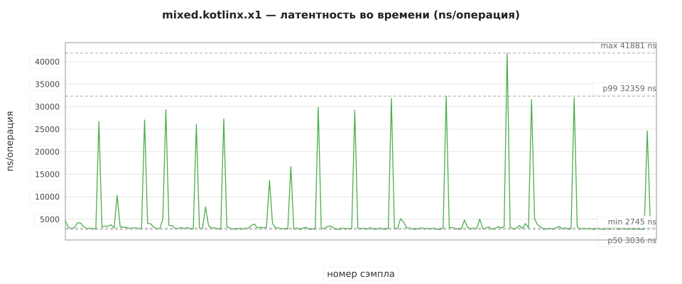
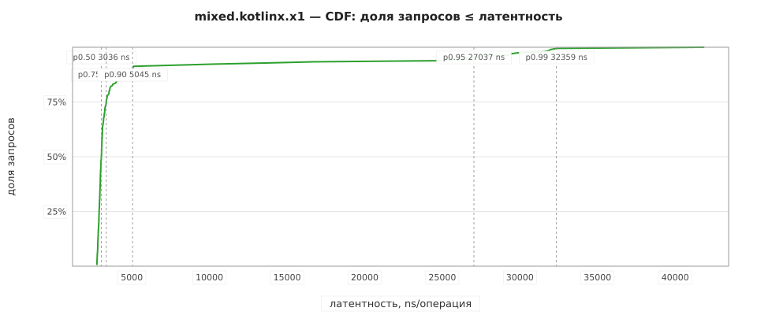
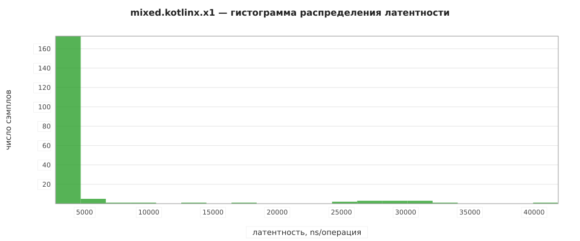

**Оба метода на одном графике (наложение):**

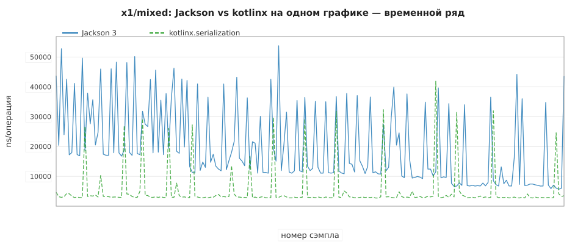
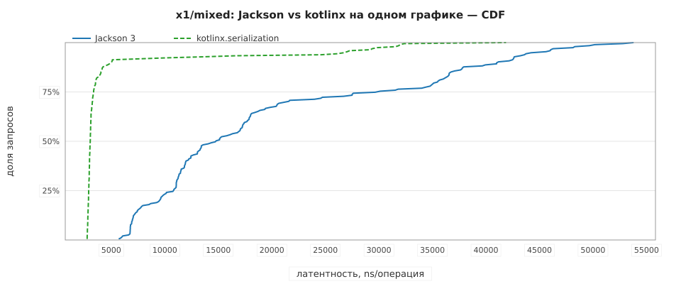
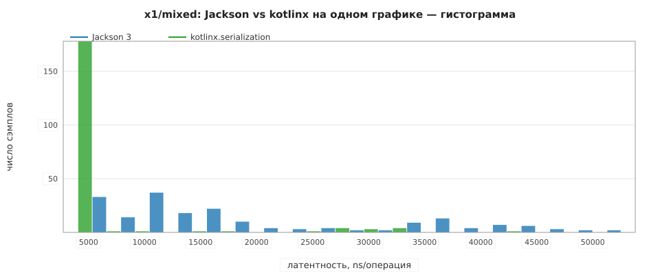

### Модель x4 (40 полей)

#### read — чтение (deserialize)

**Все метрики обоих методов (латентность, ns/операция):**

| Метрика | Jackson 3 | kotlinx.serialization | Δ, % |
|---|---|---|---|
| min | `18616.7` | `34923.1` | `87.6%` |
| **p50 (медиана)** | **`24856.2`** | **`83666.1`** | `236.6%` |
| p75 | `69696.6` | `84446.8` | `21.2%` |
| p90 | `74435.2` | `89415.2` | `20.1%` |
| p95 | `93406.5` | `99622.8` | `6.7%` |
| p99 | `163871.1` | `139920.3` | `-14.6%` |
| max | `167967.9` | `162517.0` | `-3.2%` |
| mean | `47669.4` | `75670.6` | `58.7%` |
| stdev | `32068.8` | `21969.9` | `-31.5%` |
| net median (минус overhead) | `24851.3` | `83661.2` | `236.6%` |
| throughput, ops/s | `20,978` | `13,215` | |

#### **Jackson 3** — read.jackson.x4

**Фазы (8e, 8f):**

| Фаза | Сэмплов | Операций в сэмпле | Операций всего | Время, мс |
|---|---|---|---|---|
| warmup | 100 | 64 | 6400 | `1116.0` |
| settle | 20 | 64 | 1280 | `74.7` |
| measure | 195 | 64 | 12480 | `609.3` |
| teardown | 20 | 64 | 1280 | `48.7` |
| **итого** | | | **21440** | |

**Статистика (8d), ns/операция; throughput ≈ `20,978` ops/s:**

| Метрика | Значение |
|---|---|
| сэмплов | 195 |
| mean | `47669.4` ns |
| stdev | `32068.8` ns |
| min | `18616.7` ns |
| max | `167967.9` ns |
| **p50 (медиана)** | **`24856.2` ns** (net: `24851.3` ns) |
| p75 | `69696.6` ns |
| p90 | `74435.2` ns |
| p95 | `93406.5` ns |
| p99 | `163871.1` ns |

**Перцентили (8b/8d):**

| Перцентиль | Латентность, ns |
|---|---|
| p0.100 | `19710.0` |
| p0.250 | `20636.0` |
| p0.500 | `24856.2` |
| p0.750 | `69696.6` |
| p0.900 | `74435.2` |
| p0.950 | `93406.5` |
| p0.990 | `163871.1` |
| p0.999 | `167967.9` |

**Графики:**

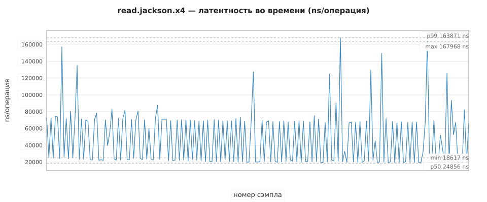
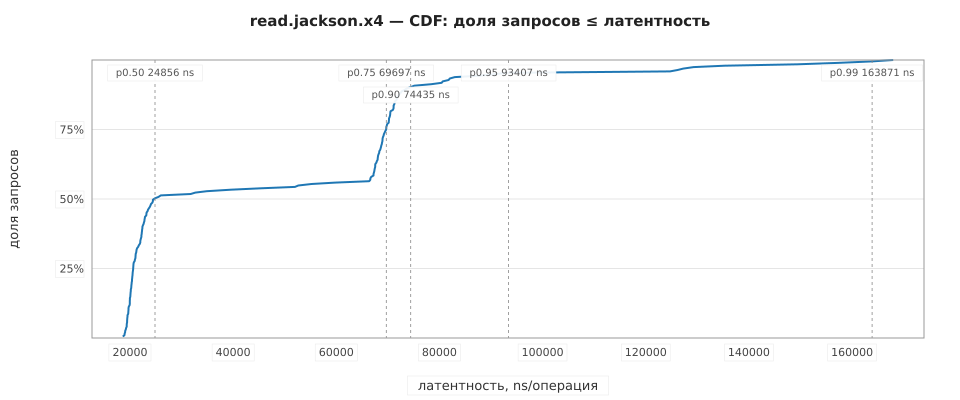
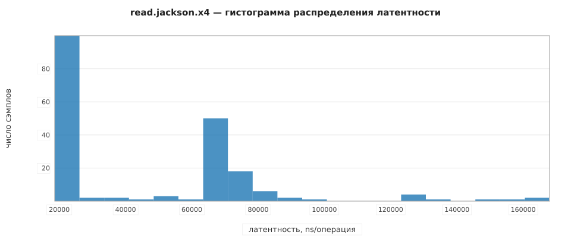

#### **kotlinx.serialization** — read.kotlinx.x4

**Фазы (8e, 8f):**

| Фаза | Сэмплов | Операций в сэмпле | Операций всего | Время, мс |
|---|---|---|---|---|
| warmup | 100 | 64 | 6400 | `809.0` |
| settle | 20 | 64 | 1280 | `100.2` |
| measure | 195 | 64 | 12480 | `965.3` |
| teardown | 20 | 64 | 1280 | `99.7` |
| **итого** | | | **21440** | |

**Статистика (8d), ns/операция; throughput ≈ `13,215` ops/s:**

| Метрика | Значение |
|---|---|
| сэмплов | 195 |
| mean | `75670.6` ns |
| stdev | `21969.9` ns |
| min | `34923.1` ns |
| max | `162517.0` ns |
| **p50 (медиана)** | **`83666.1` ns** (net: `83661.2` ns) |
| p75 | `84446.8` ns |
| p90 | `89415.2` ns |
| p95 | `99622.8` ns |
| p99 | `139920.3` ns |

**Перцентили (8b/8d):**

| Перцентиль | Латентность, ns |
|---|---|
| p0.100 | `36263.8` |
| p0.250 | `69162.9` |
| p0.500 | `83666.1` |
| p0.750 | `84446.8` |
| p0.900 | `89415.2` |
| p0.950 | `99622.8` |
| p0.990 | `139920.3` |
| p0.999 | `162517.0` |

**Графики:**

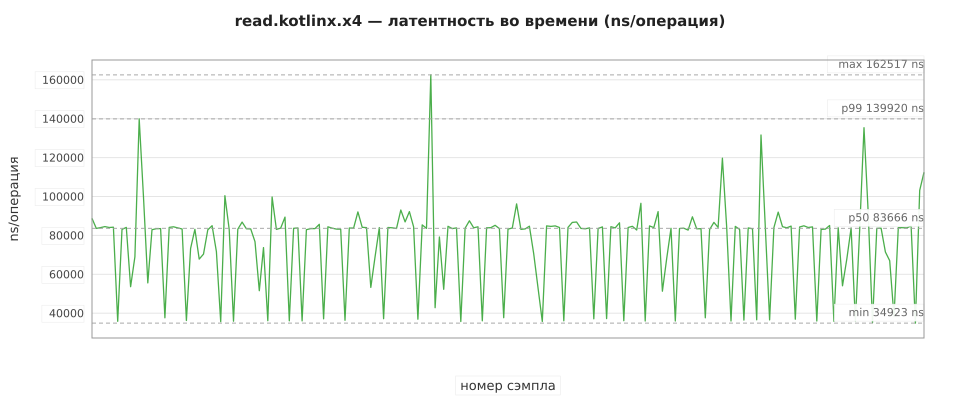
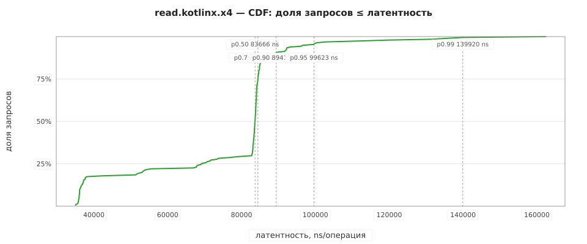
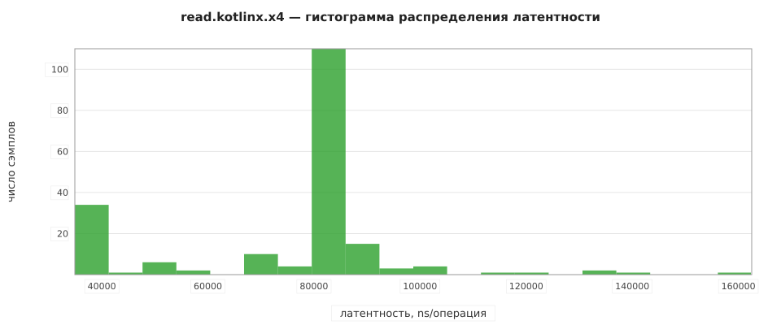

**Оба метода на одном графике (наложение):**

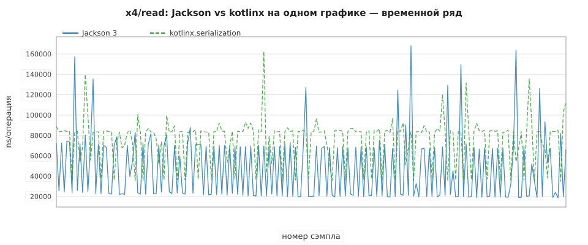
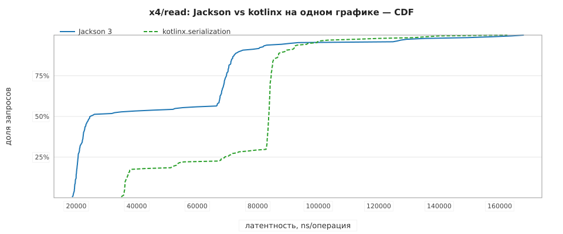
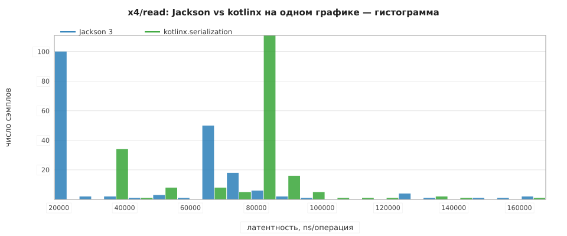

#### write — запись (serialize)

**Все метрики обоих методов (латентность, ns/операция):**

| Метрика | Jackson 3 | kotlinx.serialization | Δ, % |
|---|---|---|---|
| min | `16272.4` | `11207.6` | `-31.1%` |
| **p50 (медиана)** | **`19193.0`** | **`12996.9`** | `-32.3%` |
| p75 | `65839.3` | `44359.4` | `-32.6%` |
| p90 | `66755.6` | `60198.7` | `-9.8%` |
| p95 | `68711.9` | `61124.8` | `-11.0%` |
| p99 | `75111.5` | `130853.9` | `74.2%` |
| max | `286095.9` | `216589.9` | `-24.3%` |
| mean | `39129.0` | `27040.7` | `-30.9%` |
| stdev | `29167.9` | `26467.8` | `-9.3%` |
| net median (минус overhead) | `19188.1` | `12992.0` | `-32.3%` |
| throughput, ops/s | `25,557` | `36,981` | |

#### **Jackson 3** — write.jackson.x4

**Фазы (8e, 8f):**

| Фаза | Сэмплов | Операций в сэмпле | Операций всего | Время, мс |
|---|---|---|---|---|
| warmup | 100 | 64 | 6400 | `1112.0` |
| settle | 20 | 64 | 1280 | `75.0` |
| measure | 195 | 64 | 12480 | `502.6` |
| teardown | 20 | 64 | 1280 | `43.1` |
| **итого** | | | **21440** | |

**Статистика (8d), ns/операция; throughput ≈ `25,557` ops/s:**

| Метрика | Значение |
|---|---|
| сэмплов | 195 |
| mean | `39129.0` ns |
| stdev | `29167.9` ns |
| min | `16272.4` ns |
| max | `286095.9` ns |
| **p50 (медиана)** | **`19193.0` ns** (net: `19188.1` ns) |
| p75 | `65839.3` ns |
| p90 | `66755.6` ns |
| p95 | `68711.9` ns |
| p99 | `75111.5` ns |

**Перцентили (8b/8d):**

| Перцентиль | Латентность, ns |
|---|---|
| p0.100 | `17978.2` |
| p0.250 | `18349.0` |
| p0.500 | `19193.0` |
| p0.750 | `65839.3` |
| p0.900 | `66755.6` |
| p0.950 | `68711.9` |
| p0.990 | `75111.5` |
| p0.999 | `286095.9` |

**Графики:**

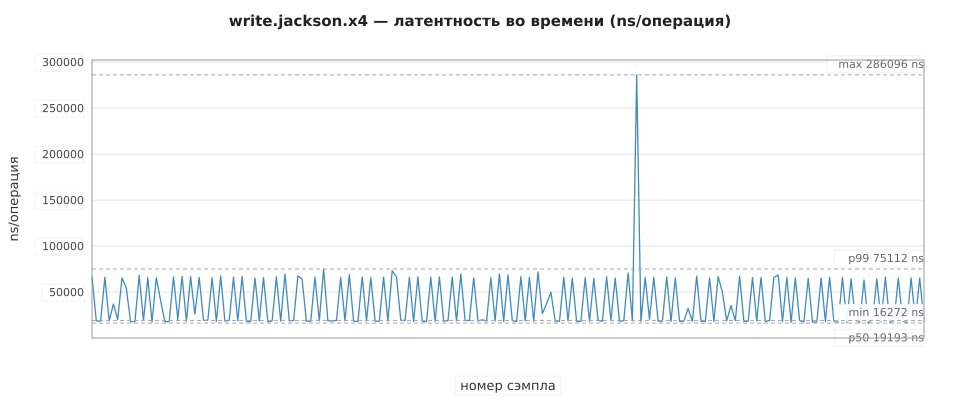
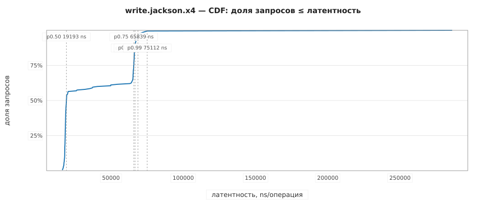
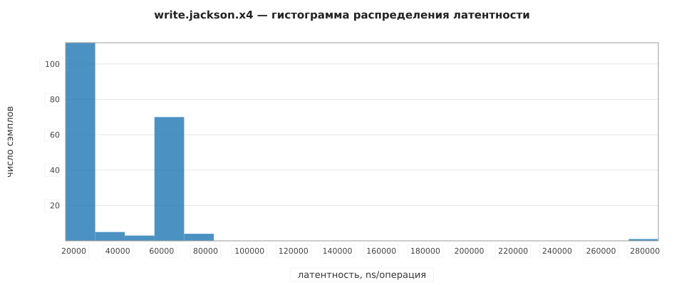

#### **kotlinx.serialization** — write.kotlinx.x4

**Фазы (8e, 8f):**

| Фаза | Сэмплов | Операций в сэмпле | Операций всего | Время, мс |
|---|---|---|---|---|
| warmup | 100 | 64 | 6400 | `360.1` |
| settle | 20 | 64 | 1280 | `35.2` |
| measure | 195 | 64 | 12480 | `344.8` |
| teardown | 20 | 64 | 1280 | `38.5` |
| **итого** | | | **21440** | |

**Статистика (8d), ns/операция; throughput ≈ `36,981` ops/s:**

| Метрика | Значение |
|---|---|
| сэмплов | 195 |
| mean | `27040.7` ns |
| stdev | `26467.8` ns |
| min | `11207.6` ns |
| max | `216589.9` ns |
| **p50 (медиана)** | **`12996.9` ns** (net: `12992.0` ns) |
| p75 | `44359.4` ns |
| p90 | `60198.7` ns |
| p95 | `61124.8` ns |
| p99 | `130853.9` ns |

**Перцентили (8b/8d):**

| Перцентиль | Латентность, ns |
|---|---|
| p0.100 | `11809.0` |
| p0.250 | `12260.2` |
| p0.500 | `12996.9` |
| p0.750 | `44359.4` |
| p0.900 | `60198.7` |
| p0.950 | `61124.8` |
| p0.990 | `130853.9` |
| p0.999 | `216589.9` |

**Графики:**

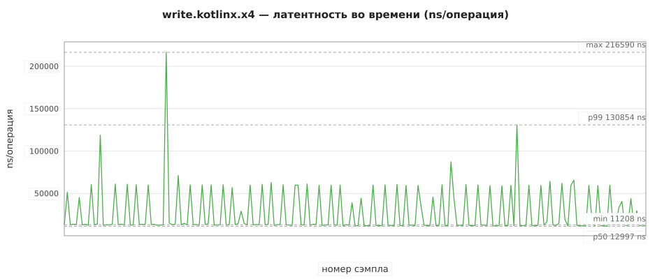
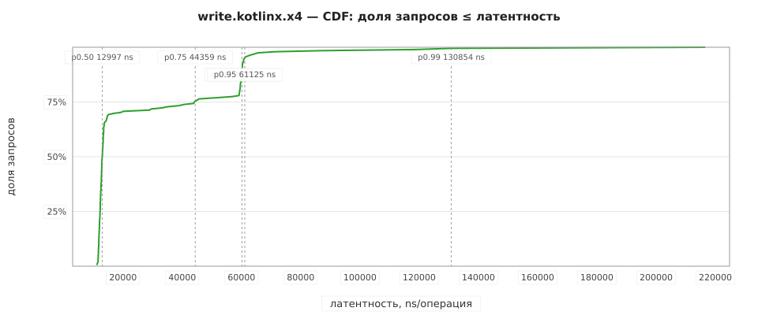
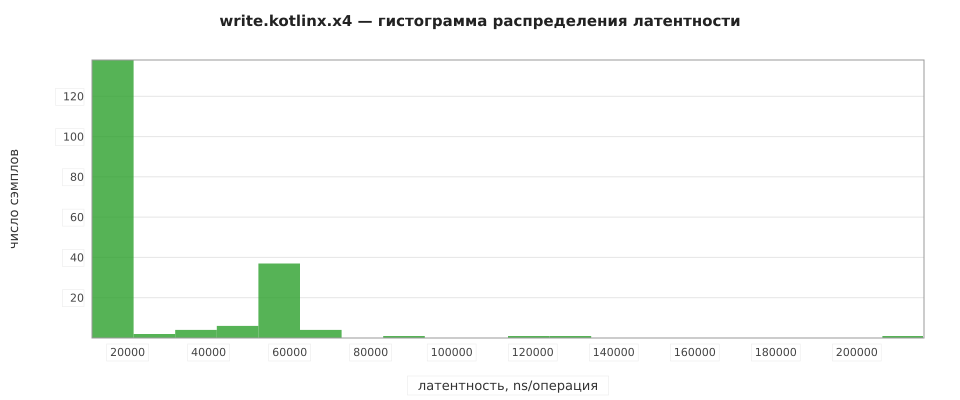

**Оба метода на одном графике (наложение):**

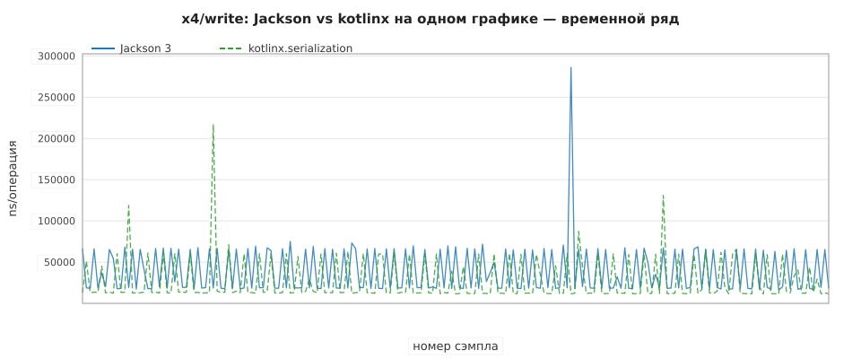
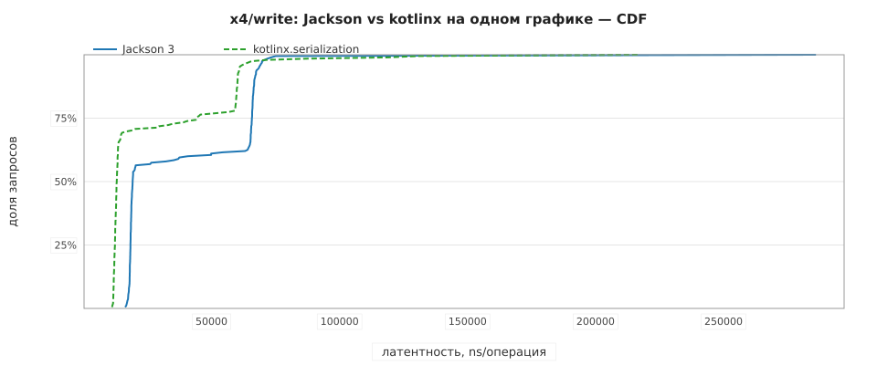
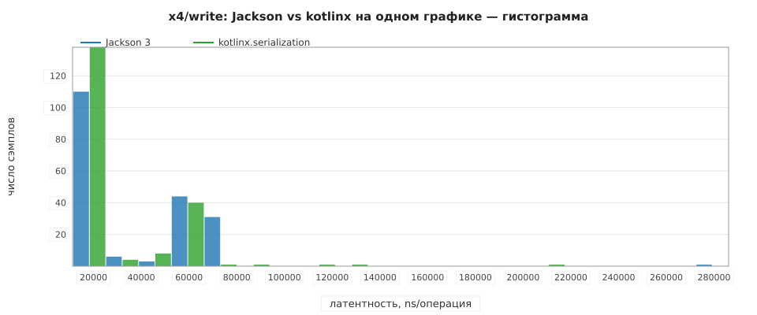

#### mixed — одновременные чтение + запись (2 потока)

**Все метрики обоих методов (латентность, ns/операция):**

| Метрика | Jackson 3 | kotlinx.serialization | Δ, % |
|---|---|---|---|
| min | `14451.1` | `11963.7` | `-17.2%` |
| **p50 (медиана)** | **`18794.4`** | **`13809.7`** | `-26.5%` |
| p75 | `41695.6` | `35306.6` | `-15.3%` |
| p90 | `45673.9` | `39917.5` | `-12.6%` |
| p95 | `49100.9` | `43204.4` | `-12.0%` |
| p99 | `74041.8` | `50464.4` | `-31.8%` |
| max | `88580.0` | `70338.7` | `-20.6%` |
| mean | `27341.9` | `21107.5` | `-22.8%` |
| stdev | `13974.4` | `12035.5` | `-13.9%` |
| net median (минус overhead) | `18584.9` | `13600.2` | `-26.8%` |
| throughput, ops/s | `36,574` | `47,377` | |

#### **Jackson 3** — mixed.jackson.x4

**Фазы (8e, 8f):**

| Фаза | Сэмплов | Операций в сэмпле | Операций всего | Время, мс |
|---|---|---|---|---|
| warmup | 100 | 128 | 12800 | `564.5` |
| settle | 20 | 128 | 2560 | `79.5` |
| measure | 195 | 128 | 24960 | `701.3` |
| teardown | 20 | 128 | 2560 | `64.3` |
| **итого** | | | **42880** | |

**Статистика (8d), ns/операция; throughput ≈ `36,574` ops/s:**

| Метрика | Значение |
|---|---|
| сэмплов | 195 |
| mean | `27341.9` ns |
| stdev | `13974.4` ns |
| min | `14451.1` ns |
| max | `88580.0` ns |
| **p50 (медиана)** | **`18794.4` ns** (net: `18584.9` ns) |
| p75 | `41695.6` ns |
| p90 | `45673.9` ns |
| p95 | `49100.9` ns |
| p99 | `74041.8` ns |

**Перцентили (8b/8d):**

| Перцентиль | Латентность, ns |
|---|---|
| p0.100 | `15401.5` |
| p0.250 | `16589.7` |
| p0.500 | `18794.4` |
| p0.750 | `41695.6` |
| p0.900 | `45673.9` |
| p0.950 | `49100.9` |
| p0.990 | `74041.8` |
| p0.999 | `88580.0` |

**Графики:**

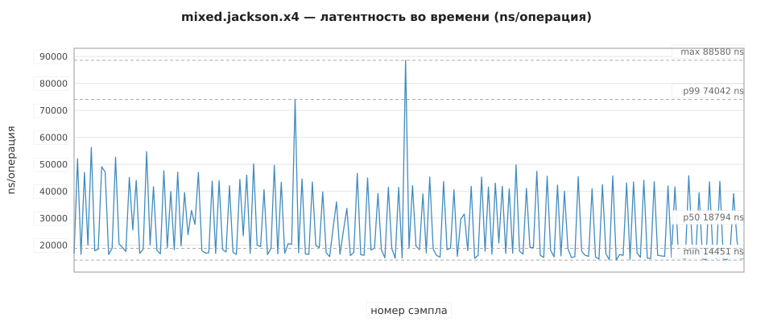
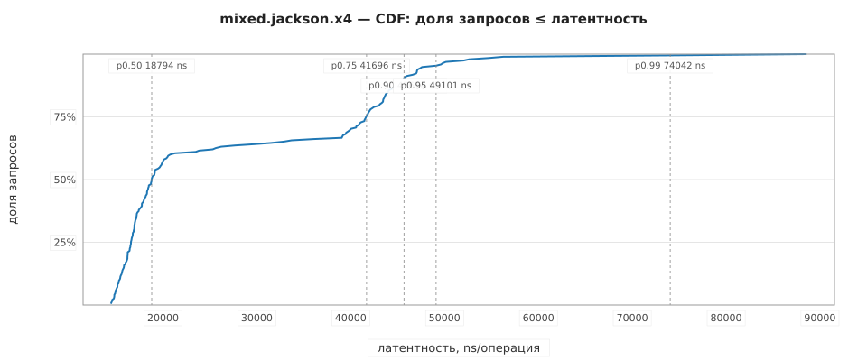
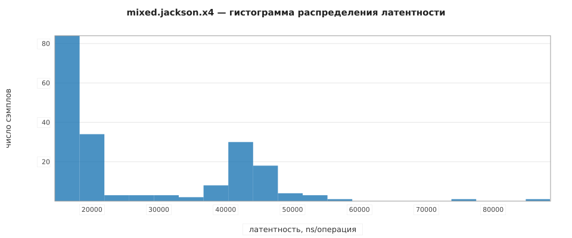

#### **kotlinx.serialization** — mixed.kotlinx.x4

**Фазы (8e, 8f):**

| Фаза | Сэмплов | Операций в сэмпле | Операций всего | Время, мс |
|---|---|---|---|---|
| warmup | 100 | 128 | 12800 | `294.4` |
| settle | 20 | 128 | 2560 | `54.1` |
| measure | 195 | 128 | 24960 | `538.8` |
| teardown | 20 | 128 | 2560 | `60.9` |
| **итого** | | | **42880** | |

**Статистика (8d), ns/операция; throughput ≈ `47,377` ops/s:**

| Метрика | Значение |
|---|---|
| сэмплов | 195 |
| mean | `21107.5` ns |
| stdev | `12035.5` ns |
| min | `11963.7` ns |
| max | `70338.7` ns |
| **p50 (медиана)** | **`13809.7` ns** (net: `13600.2` ns) |
| p75 | `35306.6` ns |
| p90 | `39917.5` ns |
| p95 | `43204.4` ns |
| p99 | `50464.4` ns |

**Перцентили (8b/8d):**

| Перцентиль | Латентность, ns |
|---|---|
| p0.100 | `12628.5` |
| p0.250 | `13108.4` |
| p0.500 | `13809.7` |
| p0.750 | `35306.6` |
| p0.900 | `39917.5` |
| p0.950 | `43204.4` |
| p0.990 | `50464.4` |
| p0.999 | `70338.7` |

**Графики:**

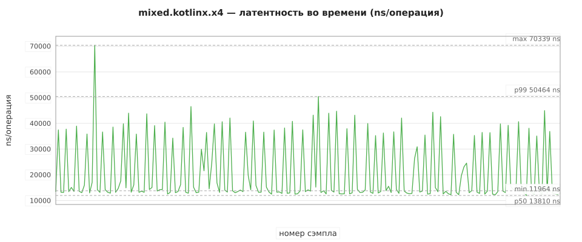
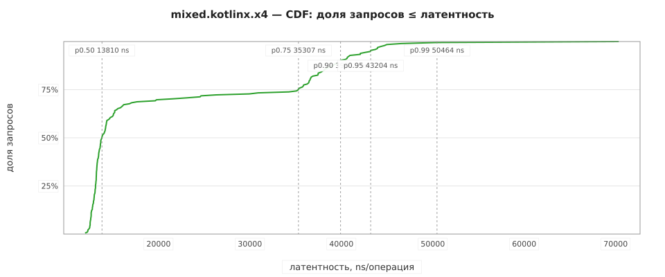

**Оба метода на одном графике (наложение):**

### Модель x8 (80 полей)

#### read — чтение (deserialize)

**Все метрики обоих методов (латентность, ns/операция):**

| Метрика | Jackson 3 | kotlinx.serialization | Δ, % |
|---|---|---|---|
| min | `44334.5` | `50706.2` | `14.4%` |
| **p50 (медиана)** | **`46923.9`** | **`53515.0`** | `14.0%` |
| p75 | `48551.2` | `54758.1` | `12.8%` |
| p90 | `55525.6` | `58050.1` | `4.5%` |
| p95 | `96859.8` | `62848.0` | `-35.1%` |
| p99 | `212565.7` | `65129.7` | `-69.4%` |
| max | `316404.7` | `65828.7` | `-79.2%` |
| mean | `53427.6` | `54301.5` | `1.6%` |
| stdev | `26592.9` | `2990.8` | `-88.8%` |
| net median (минус overhead) | `46919.0` | `53510.1` | `14.0%` |
| throughput, ops/s | `18,717` | `18,416` | |

#### **Jackson 3** — read.jackson.x8

**Фазы (8e, 8f):**

| Фаза | Сэмплов | Операций в сэмпле | Операций всего | Время, мс |
|---|---|---|---|---|
| warmup | 100 | 64 | 6400 | `1211.8` |
| settle | 20 | 64 | 1280 | `98.8` |
| measure | 195 | 64 | 12480 | `685.4` |
| teardown | 20 | 64 | 1280 | `60.7` |
| **итого** | | | **21440** | |

**Статистика (8d), ns/операция; throughput ≈ `18,717` ops/s:**

| Метрика | Значение |
|---|---|
| сэмплов | 195 |
| mean | `53427.6` ns |
| stdev | `26592.9` ns |
| min | `44334.5` ns |
| max | `316404.7` ns |
| **p50 (медиана)** | **`46923.9` ns** (net: `46919.0` ns) |
| p75 | `48551.2` ns |
| p90 | `55525.6` ns |
| p95 | `96859.8` ns |
| p99 | `212565.7` ns |

**Перцентили (8b/8d):**

| Перцентиль | Латентность, ns |
|---|---|
| p0.100 | `44998.1` |
| p0.250 | `45888.7` |
| p0.500 | `46923.9` |
| p0.750 | `48551.2` |
| p0.900 | `55525.6` |
| p0.950 | `96859.8` |
| p0.990 | `212565.7` |
| p0.999 | `316404.7` |

**Графики:**

#### **kotlinx.serialization** — read.kotlinx.x8

**Фазы (8e, 8f):**

| Фаза | Сэмплов | Операций в сэмпле | Операций всего | Время, мс |
|---|---|---|---|---|
| warmup | 100 | 64 | 6400 | `721.2` |
| settle | 20 | 64 | 1280 | `75.5` |
| measure | 195 | 64 | 12480 | `694.9` |
| teardown | 20 | 64 | 1280 | `69.1` |
| **итого** | | | **21440** | |

**Статистика (8d), ns/операция; throughput ≈ `18,416` ops/s:**

| Метрика | Значение |
|---|---|
| сэмплов | 195 |
| mean | `54301.5` ns |
| stdev | `2990.8` ns |
| min | `50706.2` ns |
| max | `65828.7` ns |
| **p50 (медиана)** | **`53515.0` ns** (net: `53510.1` ns) |
| p75 | `54758.1` ns |
| p90 | `58050.1` ns |
| p95 | `62848.0` ns |
| p99 | `65129.7` ns |

**Перцентили (8b/8d):**

| Перцентиль | Латентность, ns |
|---|---|
| p0.100 | `51951.8` |
| p0.250 | `52432.4` |
| p0.500 | `53515.0` |
| p0.750 | `54758.1` |
| p0.900 | `58050.1` |
| p0.950 | `62848.0` |
| p0.990 | `65129.7` |
| p0.999 | `65828.7` |

**Графики:**

**Оба метода на одном графике (наложение):**

#### write — запись (serialize)

**Все метрики обоих методов (латентность, ns/операция):**

| Метрика | Jackson 3 | kotlinx.serialization | Δ, % |
|---|---|---|---|
| min | `21296.8` | `16236.3` | `-23.8%` |
| **p50 (медиана)** | **`64499.0`** | **`20040.8`** | `-68.9%` |
| p75 | `91290.5` | `66716.7` | `-26.9%` |
| p90 | `121648.1` | `68251.7` | `-43.9%` |
| p95 | `145281.8` | `71399.2` | `-50.9%` |
| p99 | `178322.0` | `105252.2` | `-41.0%` |
| max | `185040.1` | `109809.4` | `-40.7%` |
| mean | `64327.3` | `37968.1` | `-41.0%` |
| stdev | `40651.6` | `24425.5` | `-39.9%` |
| net median (минус overhead) | `64494.1` | `20036.0` | `-68.9%` |
| throughput, ops/s | `15,546` | `26,338` | |

#### **Jackson 3** — write.jackson.x8

**Фазы (8e, 8f):**

| Фаза | Сэмплов | Операций в сэмпле | Операций всего | Время, мс |
|---|---|---|---|---|
| warmup | 100 | 64 | 6400 | `1279.8` |
| settle | 20 | 64 | 1280 | `126.5` |
| measure | 195 | 64 | 12480 | `836.8` |
| teardown | 20 | 64 | 1280 | `32.0` |
| **итого** | | | **21440** | |

**Статистика (8d), ns/операция; throughput ≈ `15,546` ops/s:**

| Метрика | Значение |
|---|---|
| сэмплов | 195 |
| mean | `64327.3` ns |
| stdev | `40651.6` ns |
| min | `21296.8` ns |
| max | `185040.1` ns |
| **p50 (медиана)** | **`64499.0` ns** (net: `64494.1` ns) |
| p75 | `91290.5` ns |
| p90 | `121648.1` ns |
| p95 | `145281.8` ns |
| p99 | `178322.0` ns |

**Перцентили (8b/8d):**

| Перцентиль | Латентность, ns |
|---|---|
| p0.100 | `22617.7` |
| p0.250 | `24205.8` |
| p0.500 | `64499.0` |
| p0.750 | `91290.5` |
| p0.900 | `121648.1` |
| p0.950 | `145281.8` |
| p0.990 | `178322.0` |
| p0.999 | `185040.1` |

**Графики:**

#### **kotlinx.serialization** — write.kotlinx.x8

**Фазы (8e, 8f):**

| Фаза | Сэмплов | Операций в сэмпле | Операций всего | Время, мс |
|---|---|---|---|---|
| warmup | 100 | 64 | 6400 | `651.2` |
| settle | 20 | 64 | 1280 | `58.4` |
| measure | 195 | 64 | 12480 | `486.5` |
| teardown | 20 | 64 | 1280 | `22.7` |
| **итого** | | | **21440** | |

**Статистика (8d), ns/операция; throughput ≈ `26,338` ops/s:**

| Метрика | Значение |
|---|---|
| сэмплов | 195 |
| mean | `37968.1` ns |
| stdev | `24425.5` ns |
| min | `16236.3` ns |
| max | `109809.4` ns |
| **p50 (медиана)** | **`20040.8` ns** (net: `20036.0` ns) |
| p75 | `66716.7` ns |
| p90 | `68251.7` ns |
| p95 | `71399.2` ns |
| p99 | `105252.2` ns |

**Перцентили (8b/8d):**

| Перцентиль | Латентность, ns |
|---|---|
| p0.100 | `17658.2` |
| p0.250 | `18611.4` |
| p0.500 | `20040.8` |
| p0.750 | `66716.7` |
| p0.900 | `68251.7` |
| p0.950 | `71399.2` |
| p0.990 | `105252.2` |
| p0.999 | `109809.4` |

**Графики:**

**Оба метода на одном графике (наложение):**

#### mixed — одновременные чтение + запись (2 потока)

**Все метрики обоих методов (латентность, ns/операция):**

| Метрика | Jackson 3 | kotlinx.serialization | Δ, % |
|---|---|---|---|
| min | `24868.7` | `27551.4` | `10.8%` |
| **p50 (медиана)** | **`28334.4`** | **`29695.8`** | `4.8%` |
| p75 | `31939.8` | `39309.7` | `23.1%` |
| p90 | `45288.6` | `40863.4` | `-9.8%` |
| p95 | `61862.3` | `41570.1` | `-32.8%` |
| p99 | `92258.5` | `47202.2` | `-48.8%` |
| max | `101059.0` | `48013.5` | `-52.5%` |
| mean | `32597.9` | `33114.4` | `1.6%` |
| stdev | `12166.9` | `5559.7` | `-54.3%` |
| net median (минус overhead) | `28124.8` | `29486.2` | `4.8%` |
| throughput, ops/s | `30,677` | `30,198` | |

#### **Jackson 3** — mixed.jackson.x8

**Фазы (8e, 8f):**

| Фаза | Сэмплов | Операций в сэмпле | Операций всего | Время, мс |
|---|---|---|---|---|
| warmup | 100 | 128 | 12800 | `920.7` |
| settle | 20 | 128 | 2560 | `152.5` |
| measure | 195 | 128 | 24960 | `849.9` |
| teardown | 20 | 128 | 2560 | `71.2` |
| **итого** | | | **42880** | |

**Статистика (8d), ns/операция; throughput ≈ `30,677` ops/s:**

| Метрика | Значение |
|---|---|
| сэмплов | 195 |
| mean | `32597.9` ns |
| stdev | `12166.9` ns |
| min | `24868.7` ns |
| max | `101059.0` ns |
| **p50 (медиана)** | **`28334.4` ns** (net: `28124.8` ns) |
| p75 | `31939.8` ns |
| p90 | `45288.6` ns |
| p95 | `61862.3` ns |
| p99 | `92258.5` ns |

**Перцентили (8b/8d):**

| Перцентиль | Латентность, ns |
|---|---|
| p0.100 | `25681.0` |
| p0.250 | `26661.4` |
| p0.500 | `28334.4` |
| p0.750 | `31939.8` |
| p0.900 | `45288.6` |
| p0.950 | `61862.3` |
| p0.990 | `92258.5` |
| p0.999 | `101059.0` |

**Графики:**

#### **kotlinx.serialization** — mixed.kotlinx.x8

**Фазы (8e, 8f):**

| Фаза | Сэмплов | Операций в сэмпле | Операций всего | Время, мс |
|---|---|---|---|---|
| warmup | 100 | 128 | 12800 | `379.5` |
| settle | 20 | 128 | 2560 | `75.8` |
| measure | 195 | 128 | 24960 | `845.7` |
| teardown | 20 | 128 | 2560 | `103.6` |
| **итого** | | | **42880** | |

**Статистика (8d), ns/операция; throughput ≈ `30,198` ops/s:**

| Метрика | Значение |
|---|---|
| сэмплов | 195 |
| mean | `33114.4` ns |
| stdev | `5559.7` ns |
| min | `27551.4` ns |
| max | `48013.5` ns |
| **p50 (медиана)** | **`29695.8` ns** (net: `29486.2` ns) |
| p75 | `39309.7` ns |
| p90 | `40863.4` ns |
| p95 | `41570.1` ns |
| p99 | `47202.2` ns |

**Перцентили (8b/8d):**

| Перцентиль | Латентность, ns |
|---|---|
| p0.100 | `28188.0` |
| p0.250 | `28699.0` |
| p0.500 | `29695.8` |
| p0.750 | `39309.7` |
| p0.900 | `40863.4` |
| p0.950 | `41570.1` |
| p0.990 | `47202.2` |
| p0.999 | `48013.5` |

**Графики:**

**Оба метода на одном графике (наложение):**

## 5. Сводная таблица сравнения (Jackson 3 vs kotlinx.serialization)

| Модель | Сценарий | Медиана Jackson, ns | Медиана kotlinx, ns | Δ median | Δ mean | Δ p99 | Быстрее |
|---|---|---|---|---|---|---|---|
| x1 | mixed | `14795.6` | `3035.6` | `-79.5%` | `-74.2%` | `-38.7%` | **kotlinx.serialization** |
| x1 | read | `8575.3` | `6065.3` | `-29.3%` | `-43.2%` | `-7.9%` | **kotlinx.serialization** |
| x1 | write | `5735.7` | `3937.9` | `-31.3%` | `-28.0%` | `-0.5%` | **kotlinx.serialization** |
| x4 | mixed | `18794.4` | `13809.7` | `-26.5%` | `-22.8%` | `-31.8%` | **kotlinx.serialization** |
| x4 | read | `24856.2` | `83666.1` | `236.6%` | `58.7%` | `-14.6%` | **Jackson 3** |
| x4 | write | `19193.0` | `12996.9` | `-32.3%` | `-30.9%` | `74.2%` | **kotlinx.serialization** |
| x8 | mixed | `28334.4` | `29695.8` | `4.8%` | `1.6%` | `-48.8%` | **Jackson 3** |
| x8 | read | `46923.9` | `53515.0` | `14.0%` | `1.6%` | `-69.4%` | **Jackson 3** |
| x8 | write | `64499.0` | `20040.8` | `-68.9%` | `-41.0%` | `-41.0%` | **kotlinx.serialization** |

> Δ = (kotlinx − Jackson) / Jackson × 100%. Отрицательное значение — kotlinx быстрее.

## 5.1 Перцентили p50 и p99: столбчатое сравнение библиотек

> Девять групп столбцов — 3 модели (x1/x4/x8) × 3 сценария (read/write/mixed); в каждой два столбца: Jackson (синий) и kotlinx (зелёный).

## 6. «Сырые» сэмплы

Каждый кейс: `raw/<case>.csv` (колонки `sample,ns_per_op`). Полные данные — `report.json`.

